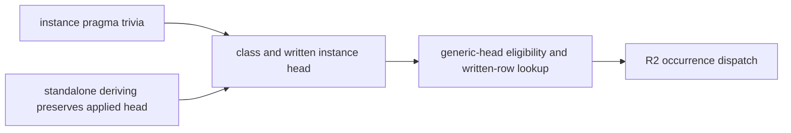

<!-- For God so loved the world, that he gave his only begotten Son, that whosoever believeth in him should not perish, but have everlasting life. — John 3:16 (KJV) -->

# R2 instance-head integration Chirho

Owner: HASKELUJAH/gpt_chirho. The builder stays serialized here until the current-main integration gate returns it by name. This unit repairs only the two declaration producers that the exact 54067f26 R2 gate inherited from held source but canonical main 2df9ac63 did not.

## Placement

- [x] Preserve the RED integration receipt from 5bcb2fc9: every focused suite except `dictionary_evidence_chirho` passed; the two failures were `BinderHeaderChirho.hs` and `EqSpecializedAtItsTypeChirho.hs`.
- [x] Trace all three frozen binaries. Exact 54067f26 generates `$fEq(SBoolChirho t0)` and keeps both `BoxChirho Int` and `BoxChirho t0`; current main loses the applied standalone head and the overlap pragma; R2 then makes the surviving generic `BoxChirho` alias reachable.
- [x] Preserve the first repair checkpoint `cfd829e3` and its RED focused receipt. The exact be4b6ce7 declaration-head module fixed the specialized `BoxChirho Int` route, but its synthetic kind-header binders regressed current main's already-correct inline and zero-binder deriving routes.
- [x] Keep the structural `deriving_chirho/` split, restore current main's `TyVarChirho::visible_binders_chirho` route byte-for-byte for inline data/newtype deriving, and retain only standalone deriving's recursive target lookup plus the user's written context and applied instance head.
- [x] Restore c32f071a's pragma-as-trivia lowering rule and its parser controls. The overlap pragma remains metadata-free; only the declaration's class and head survive lowering.
- [x] Apply ca4976dc's test-only raw-reader calibration. The standalone-deriving pragma parser control belongs to the wider declaration-head parser stack and stays outside this bounded integration slice; the end-to-end `BoxChirho Int` control remains decisive for the overlap fix.
- [x] Preserve the second RED focused receipt from `b0317963`. Its Core proves the remaining mismatch: standalone lowering split `(SBoolChirho b)` into separate entries, naming the body row `SBoolChirho_b`, while exact 54067f26 keeps the written application `SBoolChirho b` that generic-head dispatch recognizes.
- [x] Reuse ordinary instance lowering's existing `lower_instance_head_types_chirho` for standalone deriving. A context test now pins the applied head as one AST type; no wider known-type pattern or inference change is absorbed.
- [x] Run rustfmt and review the additive parser revision against current main, `c32f071a`, exact 54067f26, and both preserved RED checkpoints.
- [x] Preserve the first full `70d907ac` integration receipt as RED at changed-line Clippy after every build, focused suite and named control passed. Remove the two needless `&class_text_chirho` borrows in the owned standalone-deriving helper without changing behavior.
- [x] Rebuild under the held builder and rerun parser, typing, `dictionary_evidence_chirho`, and the focused integration union.
- [x] Require `BinderHeaderChirho.hs` to print `True`; require `EqSpecializedAtItsTypeChirho.hs` to print GHC's `False` or fail loudly, never print the generic `True`.
- [x] Re-run changed-line Clippy, gitleaks, oracles, matrix, O1 rows, all mutation sets, corrected two-worker corpus pair, replay, execution, and postflight.
- [x] Land only after the complete current-main integration gate is GREEN. Do not absorb known-type pattern inference, record ownership, NonEmpty, Char, case, Ord, or unit 524.

## Current-main integration gate

Exact compiler source `22e94efd043ea201287e882a202c517dd9b68c5e` is GREEN in `r2-main-integration-22e94efd-gate2-chirho`.

- Warning-free current-main and candidate builds; core 141/141, typing 354/354, dictionary evidence 44/44, instance obligations 28/28, rigid type variables 14/14, IO actions 9/9, filtered driver 474/474 and the integral computed-error control passed.
- All 11 named R1, R2b, A4 and O1 controls ran and passed. The five standalone-deriving probes printed GHC's outputs, and their Core keeps the written applied dictionary and row keys.
- Changed-line Clippy found zero warnings; gitleaks scanned 30 commits with no leaks.
- The four source oracles rebuilt 55 programs, all GHC-exact. The matrix measured `EXACT=34`, `LOUD=56`, `REJECTED=4`, `WRONG=3`; the three wrong rows are the retained `/=` and ordering boundaries. O1 met 4/4 rows.
- Mutation baselines were valid and byte-restored: typed entries 3/3 caught, String lists 1/1, proven occurrences 5/6 with declared `p3`, ground keys 9/10 with declared `g4`, identity 7/7, sections 1/2 with declared `q2`.
- Both two-worker corpus passes were deterministic and byte-identical between current main and the candidate: should-compile 885 accepted and 53 rejected; should-fail 240 rejected and 527 accepted. All 293 rejections replayed identically, no current-main execution PASS became FAIL, and postflight preserved both heads, tracked trees and frozen binaries.
- The full parser binary's nested-parentheses property still aborts with a stack overflow on both current main and the candidate. That run is INVALID/ABNORMAL and not a gate pass; the 366 deterministic parser tests, including the applied-head control, pass. The inherited parser-depth defect remains a separate repair.

The first `22e94efd` receipt is preserved as a gate-tooling failure: the fresh oracle source directories were absent, so extraction raised `FileNotFoundError` before any oracle program ran. The corrected gate creates each directory and the complete fresh rerun above is GREEN.

## Dependency direction

The parser and deriving producers feed the existing class environment. Neither depends on the dictionary pass. The dictionary pass keeps its private-alias rule: one generic head may serve a constructor only when the complete class environment contains no competing specialized or variable head.
