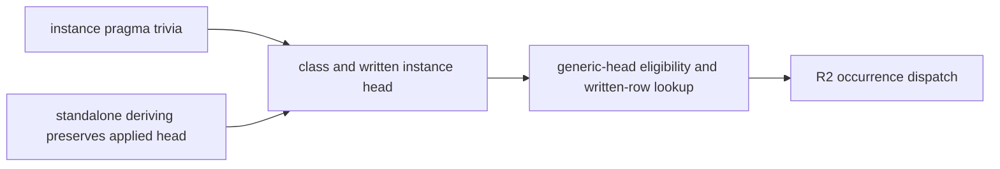

<!-- For God so loved the world, that he gave his only begotten Son, that whosoever believeth in him should not perish, but have everlasting life. — John 3:16 (KJV) -->

# R2 instance-head integration Chirho

Owner: HASKELUJAH/gpt_chirho. The builder stays serialized here until the current-main integration gate returns it by name. This unit repairs only the two declaration producers that the exact 54067f26 R2 gate inherited from held source but canonical main 2df9ac63 did not.

## Placement

- [x] Preserve the RED integration receipt from 5bcb2fc9: every focused suite except `dictionary_evidence_chirho` passed; the two failures were `BinderHeaderChirho.hs` and `EqSpecializedAtItsTypeChirho.hs`.
- [x] Trace all three frozen binaries. Exact 54067f26 generates `$fEq(SBoolChirho t0)` and keeps both `BoxChirho Int` and `BoxChirho t0`; current main loses the applied standalone head and the overlap pragma; R2 then makes the surviving generic `BoxChirho` alias reachable.
- [x] Move `deriving_chirho.rs` to `deriving_chirho/mod.rs` and restore the exact be4b6ce7 declaration-head module. This preserves standalone context and applied heads plus visible binders without importing the known-type pattern inference changes.
- [x] Restore c32f071a's pragma-as-trivia lowering rule and its parser controls. The overlap pragma remains metadata-free; only the declaration's class and head survive lowering.
- [x] Run rustfmt and source identity/diff checks. Both deriving files equal the be4b6ce7 blobs byte for byte; the parser patch applies from c32f071a without adaptation.
- [ ] Rebuild under the held builder and rerun parser, typing, `dictionary_evidence_chirho`, and the focused integration union.
- [ ] Require `BinderHeaderChirho.hs` to print `True`; require `EqSpecializedAtItsTypeChirho.hs` to print GHC's `False` or fail loudly, never print the generic `True`.
- [ ] Re-run changed-line Clippy, gitleaks, oracles, matrix, O1 rows, all mutation sets, corrected two-worker corpus pair, replay, execution, and postflight.
- [ ] Land only after the complete current-main integration gate is GREEN. Do not absorb known-type pattern inference, record ownership, NonEmpty, Char, case, Ord, or unit 524.

## Dependency direction

The parser and deriving producers feed the existing class environment. Neither depends on the dictionary pass. The dictionary pass keeps its private-alias rule: one generic head may serve a constructor only when the complete class environment contains no competing specialized or variable head.
