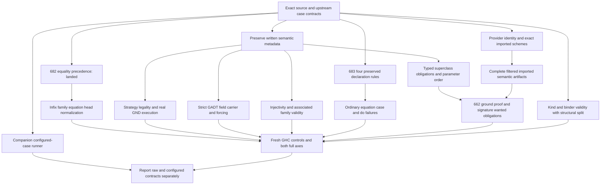

<!-- For God so loved the world, that he gave his only begotten Son, that whosoever believeth in him should not perish, but have everlasting life. — John 3:16 (KJV) -->

# Corpus frontier closure Chirho

Direct L.J. instruction: figure out how to get the remaining 54 should_compile files passing and fix the shouldn't-compile tests. Starting source: 75b4e3a9, exact crate tree 2d144db46f2e8477d7fbe4cf6bece3dd5ce1522d. Row 681 owns this accounting and execution plan. The frozen final CLI and complete raw receipts from the previous unit match that starting source. They are baseline evidence after row 682 changes the crate tree.

This is a local compiler project with reversible source changes and no push/release authority. GPT owns main, the ledger and the consolidated report. Internal read-only reviewers own the accept/reject accounting. The one builder lease is explicit: GPT executed row 682, then granted it to Claude2 in #30829 for row 683. GPT performs only read-only/source planning and documentation during that lease.

## Placement and evidence

The existing committed paired artifacts remain the published directory-label measurements. Do not change source fixtures, loosen invalid-program checking, or silently relabel their denominators. A companion upstream-aware manifest will identify exact all.T expectation, options and module setup separately. Each case must be accounted for, including helpers and actual upstream expected rejections. No estimated family size is a measured gain.

Audit receipts and machine-readable manifests live in ignored `tmp-chirho/frontier-closure-chirho/`. The durable outcome will be a concise tracked closure plan under this day directory, linked to existing row owners rather than creating another task queue. Compiler fixes use logical category homes under the completed inference decomposition, with positive and negative behavioral controls for the shared root. Source placement is reviewed before a new implementation module.

- [x] Refresh direct request, instructions, Git, both committed measurements and machine/resource rules.
- [x] Assign exhaustive read-only accept/reject audits and a focused declaration-validity review to Claude2.
- [x] Account for all 54 directory-label rejections using raw diagnostics, actual compiler paths and upstream all.T expectations.
- [x] Account for all 514 directory-label accepts in should_fail, distinguishing real invalid-program acceptance from auxiliary files, flags and driver context. Per-member causal proof remains incomplete and is labelled accordingly.
- [x] Run fresh GHC 9.14.1 oracles over all 54: 46 plain accepts, three intended rejects, one obsolete reject, and four deliberate-error examples accepted with their literal upstream defer options. No abnormal result occurred.
- [x] Build the shared-root dependency graph below, with complete member ledgers, control obligations, source homes and uncertainty labels in the companion audits.
- [x] Implement and locally land row 682's shared equality-fixity correction, without changing equality solving.
- [ ] Verify each source unit at its actual scope, preserve RED/abnormal evidence, and update paired results only after the tested candidate has completed both axes.
- [ ] Publish the actionable closure map and actual improvements, update the existing ledger rows, and report unclosed work honestly.

## Initial protocol finding

The accept reviewer found explicit upstream `compile_fail` entries for PolytypeDecomp, T12427a and tc231; tc134 is disabled upstream; T12104, T14590, T15370 and T25180 require deferred type errors. Those findings must be checked against fresh GHC and retained alongside real semantic failures. They are not permission to make the raw directory score green by accepting invalid code.

## Prototype decisions and first source placement

The deriving-keyword prototype repairs two whole-file check verdicts, but newly makes an explicitly newtype-derived Show print stock output (`AgeChirho 7` rather than GHC's `7`). It is HELD, saved as a patch and frozen CLI in the corpus-parser worktree; the worktree source was restored before the next prototype. A full repair needs strategy metadata, legality checks and the correct deriving route. The strict-GADT signature seam similarly requires an AST-to-Core strictness carrier and forcing proof.

The first narrow implementation candidate is equality fixity: GHC's own `:info (~)` gives non-associative precedence 4, while the common type-operator lowerer defaults it to precedence 9. The isolated prototype accepts T18252 and keeps T18252a rejected. Production placement is the existing `lower_chirho/expr_syntax_chirho/fixity_chirho.rs`; syntax controls extend the existing type-operator test file. End-to-end positive/negative controls use a new `typing_integration_chirho/type_equality_fixity_chirho.rs` submodule, taking that directory from 13 to 14 entries with no new root target. Gate both axes before claiming a corpus gain.

## Closure map and execution order

The companion [accept-frontier audit](accept-frontier-baseline-chirho.md) accounts for every one of the starting 54 files exactly once and gives its first blocker, source home and semantic counterexample. The [reject-frontier audit](reject-frontier-baseline-chirho.md) accounts for all 514 starting directory-label accepts, with a disjoint topic index. Its topic labels are not a causal proof for each file and never a predicted flip count. Both documents pin the starting source, including mechanisms corrected after reading current code. `upstream-case-contracts-chirho.jsonl` preserves the 568 exact source hashes and literal all.T action/options/arguments. `accept-oracle-contracts-chirho.jsonl` preserves the fresh 54-file GHC 9.14.1 commands and verdicts. These are generated evidence records, not source configuration or a second task queue.

The directory-label measurements remain fixed-contract historical comparisons. A separate configured-case runner must honor per-case flags, dependencies, boot/signature files and upstream version expectations. It must not execute all.T as arbitrary code or change the published raw denominator. Among the starting reject-axis accepts, 447 have upstream negative actions, 30 have positive actions, and 37 are helpers/unlisted; the retained identical-source standalone GHC run accepts 50 of the 514. Some negative actions are warning-policy/version cases. Rejecting all 514 would therefore reject valid Haskell.

Order is driven by actual shared roots, not easiest counts:

1. **682 is landed as fbef8a56 + 6ffe8072.** A complete candidate pass gains exactly T18252 and T24845a, with no loss or changed reject-axis verdict. Parser 401/401, three all-engine integration groups, warning-free workspace check and zero changed-line Clippy pass. True unrelated-addition and zero-product negatives remain rejected. The existing addition cancellation rule already works; no solver relaxation was added. This one-pass result is not yet a refreshed published paired measurement.
2. **683 is the active three-rule candidate.** Claude2 initially prepared four rules. Fresh GHC and baseline accept FixityBetween, but the fourth rule falsely rejected it because lowering dropped its actual default body after a legal class fixity declaration. Rule 4 is HELD; its green focused tests did not establish validity. The final 683 candidate checks newtype field count, GADT-newtype constructor context and duplicate written instance bindings before generated deriving declarations. Four right-reason file gains remain hypotheses until the full pass; T17955, if rejected by a malformed lowered constructor, is a wrong-reason change separately. The rebuilt gate passes validity 29, integration 112 (2 ignored), instance obligations 28, warning-free check and zero changed-line Clippy. Row 685 will repair the exact member-walk truncation and then enable the held rule, with the valid source and execution controls. Forbidden magic-class instances and deriving Enum eligibility remain excluded until provenance, strategy and Cabal default-extension carriers are sound.
3. **Next accept root: SplitWD's closed family equations (C03).** The source trace now identifies two producers: the CST retains raw LHS tokens, so lowering loses infix heads and constructor-application grouping; closed registration then uses declaration parameters instead of each equation's free LHS variables. Reuse structured type parsing/lowering, retain the written family head for validation, and quantify equation-local variables as open instances do. Merely skipping the named operator is insufficient. Prove prefix/infix equivalence and invalid-family/arity/ordered-overlap neighbors. Whole-file closure is unmeasured. Parsec.try and Set.insert (B02/B03) follow through provider-aware imported schemes, with qualified competing APIs and wrong-operand controls. Do not add permissive global bare-name schemes.
4. **Next reject roots:** GADT constructor return-parent validity (four direct wrong-parent witnesses in the reject audit; T18357 and T18357b remain separate alias/kind-dependent neighbors), then ordinary incompatible equation/case/do failures. Establish the alias boundary with fresh GHC before choosing normalization order. Row 684 isolates the discarded inferred-equation errors, with an unsigned GADT-index-diversity counterexample required before any landing: unseeded does not mean non-GADT, and some expected-type paths fall back to unseeded inference. Keep branch-local GADT refinement and the selected RebindableSyntax operation; observational evidence-capture errors must not become false source errors. Each proposed rule needs fresh valid neighbors and full-axis comparison before its exact reach is claimed.
5. **Semantic carriers precede solver changes.** Deriving strategy, strict GADT fields, constructor quantified binders/contexts, typed superclass arguments, associated-family categories/kinds, and injectivity declarations are presently erased at identified producers. Carry each fact through AST/interfaces/Core to its consumer before adding a rejection or proof rule. A names-only superclass check cannot handle Collects' second parameter; a self-dictionary is not a proof. A token-only deriving fix is RED even when two files check.
6. **Proof/typing families remain open.** Row 662 owns ground-goal proof and placement; preserve proven/refuted/unknown outcomes and every MPTC argument variable. Higher-rank annotated parameters, pattern-binding SCC order, GADT branch givens, visible/invisible binder order and type-family improvement each have exact members in the accept audit. `RuleEqs` and `T21558` still require a live producer trace; their precise root is not asserted. Kind checking requires a mechanical split before broad additions to its oversized root. Primitive Int# literals, GHC2024 expansion, implicit parameters and Arrows have their own contracts, not placeholder builtins.

Acceptance for each unit: unchanged fixtures; fresh GHC oracle at the actual case setup; normal positive/negative tests; runtime proof whenever newly admitted code can execute differently; complete both-axis verdict comparison with no unexplained loss or abnormal result; warning-free build and no new changed-line lint; exact source and executable hashes. Retain a RED intermediate and count the final tested tip only. The final paired artifact refresh runs twice on the combined source. Full compatibility stays open until these roots and the configured-case contract pass.
