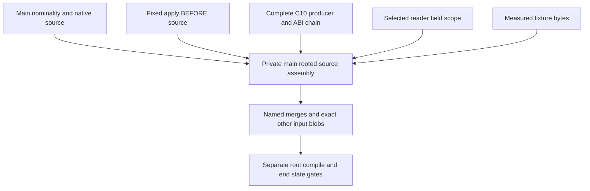

<!-- For God so loved the world, that he gave his only begotten Son, that whosoever believeth in him should not perish, but have everlasting life. — John 3:16 (KJV) -->

# Dependable source union Chirho

Current resume: unit719's exact shared opaque-constructor correction is measured at f6b97149988cc411e248f019c6e2131a4515cd74. Its fresh AFTER carriers pass U7 plus whole typing848 (no double count), source compile-only2, Core238 and scoped changed-span Clippy versus exact c104 with0 hits/247 OUTSIDE. BEFORE U6/1 and S1/1 remain raw REDs. This NEW owned worktree begins from f6 and carries the separately leased selected-application, GND producer, complete family-header, Q and measured row710 patches. The resulting composition is UNCOMPILED and UNRUN; main, SQLite, old c104 and unit719 worktrees/targets/evidence remain untouched.

This isolated branch starts at exact main acd8baaab60fe2005429cbae72a31ccfd2fd3d06 (compiler04116a69). Root delegated source-only assembly to /root/integration_frontier_chirho. No compiler execution or acceptance is authorized by this plan. Canonical main, its dirty work, SQLite and reporting remain root-owned and untouched.

- [x] Verify the new worktree/branch are unused, inspect registrations and preserve canonical dirty state.
- [x] Pin all source inputs below; freeze the selected-apply BEFORE checkpoint, excluding its future certificate implementation.
- [x] Merge the explicit foundation/package/checked-inference input, preserve main nominality/native behavior and record every source adaptation.
- [x] Merge the complete C10 producer/ABI chain through the mechanical P2 leaf, preserving supplier proofs/input-ID reservation.
- [x] Merge the reader interface/physical-field/context-entry chain with C10 entry purpose and the existing selected import payload intact.
- [x] Carry the exact fixture-literal leaf, retaining every original assertion.
- [x] Verify all final compiler blobs equal a declared input outside named semantic merges; retain main non-compiler metadata and add only this plan/manifest/workflow records.
- [x] Run source-only formatting and diff checks, scan the outgoing Git range and commit/push the frozen source assembly. First-compile readiness is prepared separately from the final clean source HEAD.
- [x] Root's separately named c104 workspace check and frozen Rust preservation set, with exact raw reconciliation and closed groups.
- [ ] Remaining main-parent quality/behavior/corpus/end-state gates at the final source. Earlier scoped measurements are not whole-union acceptance.

| Source role | Exact input |
| --- | --- |
| Main | acd8baaab60fe2005429cbae72a31ccfd2fd3d06 |
| Apply BEFORE, including foundation/package/expected substitution/options/common controls | d275f76c96d24a2f8a826c9d613943b10d4908d9 |
| C10 complete producer/ABI chain and P1/P2 | 81df0c74a4620f986380e8c710c03b0768b896ae |
| Reader selected interfaces/physical field order/context entry | a352b2cc9a65a6c96520f0506ed6326cf415083a |
| Exact407-byte source fixture correction | 2d46429aaa7dd967ba34bc00c8e9e3d4f3297466 |

Source ancestry is retained in explicit merge commits. Each merge takes compiler paths (crates and the package-ladder compiler fixtures); other incoming metadata is restored from the assembly's preceding main-rooted state. No historical private SQLite/tasklist/report is imported. Relevant workflow changes, if needed, are separately named rather than taking a private spec tree wholesale.

The private foundation has874 changed crate paths from the old common ancestor; it is an explicit large input, not a narrow accepted repair. Main's nominality and native runtime source must remain present. In particular, the private ordinary Int/Double widening arm is removed while its checked kind machinery is retained. The import context must carry reader ConstructorFieldScope, C10 entry obligation and the existing selected imported value scheme payload together. Core keeps both actual-input ID reservation and proof-directed namespaces. Source options affect the checked root, with providers retaining their own existing header/default route.

Merge adaptations are recorded as each source parent is assembled. The final source manifest will name all differences from the frozen input blobs. Old isolated passes stay attached to their original commits; none becomes an execution of this branch.

Foundation merge adaptations: restore28 incoming non-compiler metadata paths from the preceding main-rooted state; retain the new package-ladder compiler fixtures. The native harness conflict is the equivalent jobs option spelling, and main's `-j2` is kept with both branches' surrounding functionality. In the unifier, retain main's ordinary nominal constructor rule while keeping the incoming checked-kind engine. The private branch extracted unifier tests into an existing module; move main's three nominality tests there byte-for-byte except indentation, retaining all existing private tests. The driver integration root merges both registrations without a conflict. No compiler is run.

C10 merge adaptations: restore the two incoming workflow files rather than importing private metadata. Union the integration root's MR/namesake registrations with main's nominality registration. Resolve the search-context purpose/options conflict with the existing single FrontendOptions carrier: the default file path supplies default options; the program-file wrapper supplies for_program(entry); actual caller options reach both discovery and frontend. The same fresh unseeded imported class environment and actual suppliers remain. The redundant private program_entry field on SourceSearchContext is not introduced because purpose is already carried by FrontendOptions. Package input-ID reservation and C10 proof/layout additions merge in their separate Core regions; these remain unmeasured.

Source-only whitespace finding retained: the imported exact T18005.hs syntax fixture has a pre-existing extra blank line at EOF. The first merge's diff check reported it; the source bytes are kept as the declared input, with no claim that the whole union diff check is clean.

Reader merge adaptations: keep both the MR restriction imports and LocalConstructorFieldContext import in declaration-module inference. The two reader-migrated test callers explicitly pass entry_obligation None, preserving their prior non-program purpose while borrowing the actual seeded or sticky-failed class environment unchanged. The existing production convenience caller already retains its C10 None field, and the actual frontend root retains policy.program_entry. Reader ConstructorFieldScope replaces the old field Vec in the common context without removing C10 entry purpose; selected imported value schemes remain the current pre-certificate payload. Four incoming metadata paths are restored; no private ledger/tasklist/workflow is imported.

The fixture parent merges as exactly one source line in project_chirho.rs: preserve the two spaces before the Rust line continuation, producing the committed407-byte EqOrdUtil positive. All assertions and the StrictPair provider remain unchanged. There are no fixture-merge conflicts and no incoming metadata changes.

Source identity:1489 compiler/fixture paths are recorded in three bounded generated JSONL shards;1468 equal at least one frozen input blob and21 are named source merges. Of main's31 changed compiler paths,28 remain exact main blobs; the unifier, integration root and native harness are the explicitly documented unions. All21 mixed Rust files are rustfmt1.93/edition2024 clean on stdin without rewriting children. The outgoing source ancestry scan covered201 commits/6.81MB and found no leaks. The final manifest-only commit is scanned again before push. No compiler has run; the own target is absent.

The frozen compiler source and manifest were pushed at2380269dfc27c36706ce91d955e754238fbde960; remote readback matched. The full outgoing scan covered202 commits/7.30MB with no leaks. This closure changes only the owned task record, preserving the source tree. No runtime, compiler, test or Clippy process has been launched; first compile is still a separate root GO.

The first actual compile at acea7dec ran40.488 seconds, Cargo101/runner98: one E0308 plus its failure-note,325 artifacts/36 scripts/build-finished false, no JSON warnings. Pins and original40368 group closed before the fold; after-facts carries only the actual nonzero build finding. Old packet and raw evidence remain untouched. Root then leased only the native_identity synthetic input-ID caller: import the existing occurrence-evidence record and retain Eq/Int through legacy_chirho, which explicitly has Unknown(Legacy). All15 cases, keys, assertions, fixtures and production code are unchanged. The source manifest now names22 adaptations and1467 exact frozen-input blobs.

## Unit719 source constructor key checkpoints Chirho

Root's canonical unit719 owns this regression/repair; the private BEFORE and AFTER scopes below are now measured. This private tasklist records source and actual-gate progress only; root remains the sole SQLite writer.

- [x] Create the new owned gpt-source-key-nominality-before-chirho worktree from frozen c1042478 under haskelujah-workspaces-chirho; preserve the union worktree, target, contracts and raw evidence at their original paths. The new own target is absent, with no cloning or sharing.
- [x] Add the actual AST source-declaration factory controls to existing unify_chirho/tests_chirho.rs: AlphaChirho.SharedChirho and OtherChirho.SharedChirho TokenChirho must remain distinct in both orders and nested positions; the same producer and metavariable substitution stay valid. Preserve all existing numeric, promoted and legacy qualified-alias controls.
- [x] Add compile-only controls to existing native_symbol_identity_chirho/import_identity_chirho.rs: a signed wrong-definer identity must name both source types in its refusal, and direct/forwarded aliases of one defining module must compile. The new controls never call interpreter or native helpers.
- [x] Format only the two owned Rust test files at the BEFORE checkpoint; its production remained byte-equal to c104.
- [x] Execute the fresh list/exact-control BEFORE packets under root GO33176 and GO33178. U lists848 and executes the7 selected names once (6ok/1FAILED); S lists77 and executes the2 new compile-only names once (1ok/1FAILED). No ignored, missing, extra or duplicate outcome; both REDs stay raw.
- [x] Before editing production, retain bounded verified COPY backups of both BEFORE executables, not hardlinks, with original/copy paths and SHA,size,mtime,mode plus observational inode facts. The manifest is tmp-chirho/source-key-nominality-chirho/retained-before-chirho/binary-copies-chirho.json (914f5088); copies are not fresh executions. Keep the1bdf BEFORE branch, contracts/raw records and old c104 worktree/binaries intact.
- [x] Under the separate source lease, use the existing warmed worktree on gpt-source-key-nominality-after-chirho and extend only same_tycon_name_chirho's opaque guard to the reserved constructor-key namespace. No fixture, assertion, oracle, legacy alias or numeric-rule change.
- [x] Execute separately granted AFTER U7/S2, whole typing/Core and scoped changed-span Clippy against exact c104. Every reverse/nested negative arm must actually complete in a passing AFTER test; BEFORE never measured those unreached arms.

The c104 workspace check has378 compiler artifacts,36 scripts,one true build-finished and zero compiler messages. Its preservation run proves ID1/1, nominality3/3 and source2/2, whole typing846/846, Core238/238 and naming220/220; the focused three are included in whole typing. It is not an execution of this test-only descendant. Its immutable inventory and run summaries are a7b87d6d and a7a254c5 respectively. All native/CLI/corpus/Clippy acceptance and the dotted-definer BEFORE results remain separate.

The measured BEFORE finds the shared helper's raw qualifier suffix route: the first plain pair of distinct actual constructor keys fails its required Mismatch expectation. Reverse/nested arms are unreached after that panic. The source negative takes its Ok-only panic, confirming that compile_modules actually served the signed wrong-definer identity; the same-definer direct/forwarded alias positive passes. U's same-producer/meta, legacy qualified/bare and main numeric controls pass. This AFTER changes the single shared comparison boundary, with no per-file guard, new registry/parser or manufactured identity authority. At the f6 source checkpoint no AFTER result was claimed. Subsequently root GO33195 measured U7 plus whole848, source2 and Core238 all green, with0 scoped Clippy hits/247 OUTSIDE. The copied BEFORE executables, raw REDs and old c104 evidence remain immutable. No canonical main or SQLite changes follow from these private measurements.

## Selected application and GND composition Chirho

Placement: this new private gpt-dependable-union-selected-gnd-26-11-08-chirho worktree is rooted at f6b97149988cc411e248f019c6e2131a4515cd74, which already includes c104 and unit719. Its own target starts absent and is not cloned or shared. Preserve all old worktree, executable-copy and evidence paths. Root remains the sole canonical source/SQLite writer.

- [x] Inspect registrations, current clean branches and exact input DAGs; create an unused owned worktree under haskelujah-workspaces-chirho.
- [x] Compose selected-application semantic/test commits in order: c89e6532a291c5305f7110a4cda2aacd737d36a4,40d8cdaf820c4191bb4a5df6fb517d9592de2198,cdc63b014c011795401d600f6bcc5c8fd4429887,02d45d087ac7cf670a4548244a3c0a34822f7ce8. Do not replay d275/830/options or resurrect the private selected-application tasklist.
- [x] Compose exact9957bec9c122f4bd55d100d32dfe89ad158c05b3 as its three-path GND canonical-newtype producer patch; do not import its b91 test parent.
- [x] Reconcile the named inference import context, two extra caller-field renames and actual builtin workflow DAG while keeping reader field scopes, C10 entry/literal evidence, selected triples and main nominality/native source. No whole-file source replacement.
- [x] Record exact source parents, path identity and every conflict adaptation; format/diff-check owned changes, scan the outgoing range and commit/push coherent source.
- [ ] Prepare a fresh all-target workspace check at the frozen composed source; execute only after a separate actual root GO. No private intermediate compiler gate or inherited-pass claim.
- [ ] Final main-parent quality/behavior/corpus/end-state gates remain required at the assembled source.

The future certificate/selected-value changes preserve actual supplier reference evidence, fresh module-owned Core IDs and input-ID reservation. The selected import entry carries its scheme and optional compiler-value certificate together; unavailable_values still includes field-label and import-scope absences. The reader's ConstructorFieldScope and entry_obligation are retained. C10 literal substitution and superclass proofs/layouts stay intact. Q16b/0ce and family973 are separately cleared and carried in the checkpoints below; row710 is now separately cleared and composed at the checkpoint below.

Composition checkpoint: selected commits map to5f66f55f,bec5b9ee,87469d3e,4e3ff374 and the exact GND patch to0a8a21ef. Source changes cover20 compiler paths;11 are exact selected/GND blobs and9 are the named union/caller adaptations. Every other compiler/fixture path is exact f6, and all31 protected main-source paths remain byte-identical to f6. All20 changed Rust files are rustfmt-clean on stdin. The two documentation conflicts retain the current workflow DAG and row714 while omitting private row688 history; the private selected tasklist stays deleted. The old source manifest/shards remain historical c104 records; selected-gnd-composition-manifest-chirho.json and its20-row blob shard record this layer. No compiler has run.

The coherent composition was pushed at7e30564b; the outgoing seven-commit range from f6 scanned64.97KB with no leaks. The final task-only closure preserves that compiler tree. Its new all-target check packet is prepared against the final clean HEAD outside the tracked source; it authorizes no execution.

## Cleared family-header extension Chirho

- [x] Inspect exact973bcc3f796526358da32e8d9be7fb20ac500645 on9957; port its existing two-path patch only. Production is byte-identical to the frozen input and rustfmt-clean.
- [x] Reconcile only its declaration-kinds workflow conflict: retain the main-rooted head-binder prose and add complete standalone family-header publication before equation checking, including the workflow DAG. No expanded source authority.
- [x] Preserve the a04426cf check packet unchanged as SUPERSEDED/UNRUN, with manifest1a62b485 and an empty stages child; no contract or actual GO is materialized.
- [x] Compose Q after root clears its exact source. The seven named source/test commits are ported below; ae0c46ce is skipped because exact9957 is already carried.
- [ ] After all cleared inputs are assembled, prepare one fresh final-source check packet; no duplicate intermediate compiler check.

Root's33211/33212 family receipts are scoped to973: zero-message check,whole typing827,c18b/e01/C15b/E03 output on all three engines,both safety negatives and0 scoped Clippy hits/249 OUTSIDE. Those isolated passes do not become executions of this composition. Family port2051e478 retains the exact production blob; its only source-merge adaptation is the existing workflow document. Old c104 and unit719 source/targets/evidence remain frozen, and canonical main/SQLite are untouched.

## Cleared Q composition Chirho

- [x] Port f62965fb,7d31f182,ad11c778,16b42722,f26dbfcb,0ce3bd73,02453b5d in order onto9b49, skipping the exact9957 duplicate ae0c46ce and retaining P281df already carried by c104.
- [x] Production merges cleanly. Preserve selected/reader/entry/literal/nominal/native seams, actual input-ID reservation and certified-body generation; add only the Q test registration to the protected integration root.
- [x] Reconcile only the existing dictionary-evidence workflow conflicts, adding current proof-layout/list/superclass/Double conversion/demand-owner descriptions and DAG edges without resurrecting private historical C10 prose.
- [x] Format-check all17 Q Rust files on stdin and record exact-source identity. No compiler, test, runtime/native, GHC or Clippy execution belongs to this composition.
- [x] Resolve the bounded missing row710 dependency under the separate root source lease; carry only the measured source chain, with no invented do implementation. Its c06 evidence control still requires a fresh combined-source result.
- [ ] Prepare one combined workspace check at the final cleared assembled source; preserve a044's packet superseded/unrun.

Q ports are85415cc0,8af02dbe,e3181e88,128c2da2,caa0590c,9f3558b6,18ed8f68. Root's actual33215/33216 scopes at024 include zero-message compilation, whole typing845/Core231 and29 exact controls. Private MR/evidence/ground/mutation/lint and all final union/main gates remain required. The current main-rooted composition has no such fresh execution.

Dependency source reading: row710 is not an ancestor and its translation is missing by blob, not just history. The unchanged b35 do_operations module still exists; do_blocks does not. Its already measured chain is8e9b2a6e,01ce5d58,9ea8a41f,14691144,dc879e94 after the docs-onlydf96 checkpoint. The infer registration and expressions do arm/full-name diagnostic share files with selected/reader work but distinct hunks. P1's literal-capture substitution and Q proof-aware entailment must remain when that dependency is separately cleared. No row710 edit has been made here.

Root subsequently cleared the exact measured row710 dependency chain8e9b2a6e throughdc879e94 on this Q checkpoint. That separate source-only port is next; no new do semantics or compiler execution is authorized.

## Cleared measured row710 dependency Chirho

- [x] Port8e9b2a6e,01ce5d58,9ea8a41f,14691144,dc879e94 in order; skip the docs-onlydf96 design checkpoint. Production has no textual conflict.
- [x] Preserve the selected generic section/application paths, unavailable-values scope mask, reader constructor scopes, entry purpose, P1 literal substitution, Q proof entailment and all protected main native/nominal behavior. do_blocks/dependency/both driver controls are exactdc879 blobs; do_operations is the exact selected deletion. Only infer registration and expressions are shared-file unions.
- [x] Reconcile the actual qualified-do workflow narrowly, retaining the translation DAG and naming its historical four REDs as original-pair results only. No private tasklist or transient source ownership reservation is imported.
- [ ] Freeze final source/provenance, scan/push and prepare the single combined all-target check packet. No compiler execution until root's actual GO.

Row710 ports are207a002d,751cc59b,6dac6ac6,2c183f44,d13f40fe. The original dc879 set47/4 and the test-only b35 BEFORE pair remain immutable; their four failures are not waived or current-candidate findings. All final gates must measure the composed source freshly. The new source contains the existing measured c06 dependency rather than claiming evidence-all-green without it.
