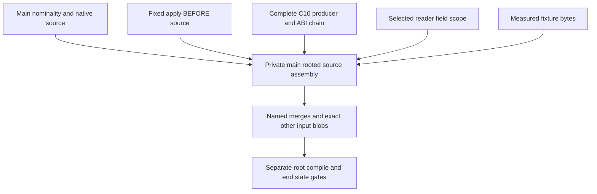

<!-- For God so loved the world, that he gave his only begotten Son, that whosoever believeth in him should not perish, but have everlasting life. — John 3:16 (KJV) -->

# Dependable source union Chirho

This isolated branch starts at exact main acd8baaab60fe2005429cbae72a31ccfd2fd3d06 (compiler04116a69). Root delegated source-only assembly to /root/integration_frontier_chirho. No compiler execution or acceptance is authorized by this plan. Canonical main, its dirty work, SQLite and reporting remain root-owned and untouched.

- [x] Verify the new worktree/branch are unused, inspect registrations and preserve canonical dirty state.
- [x] Pin all source inputs below; freeze the selected-apply BEFORE checkpoint, excluding its future certificate implementation.
- [ ] Merge the explicit foundation/package/checked-inference input, preserve main nominality/native behavior and record every source adaptation.
- [ ] Merge the complete C10 producer/ABI chain through the mechanical P2 leaf, preserving supplier proofs/input-ID reservation.
- [ ] Merge the reader interface/physical-field/context-entry chain with C10 entry purpose and the existing selected import payload intact.
- [ ] Carry the exact fixture-literal leaf, retaining every original assertion.
- [ ] Verify all final compiler blobs equal a declared input outside named semantic merges; retain main non-compiler metadata and add only this plan/manifest/workflow records.
- [ ] Run source-only formatting and diff checks, scan the outgoing Git range, commit/push the frozen assembly and report its own-target compile readiness.
- [ ] Root's separately named first compile and subsequent main-parent quality/behavior/corpus/end-state gates. UNSTARTED.

| Source role | Exact input |
| --- | --- |
| Main | acd8baaab60fe2005429cbae72a31ccfd2fd3d06 |
| Apply BEFORE, including foundation/package/expected substitution/options/common controls | d275f76c96d24a2f8a826c9d613943b10d4908d9 |
| C10 complete producer/ABI chain and P1/P2 | 81df0c74a4620f986380e8c710c03b0768b896ae |
| Reader selected interfaces/physical field order/context entry | a352b2cc9a65a6c96520f0506ed6326cf415083a |
| Exact407-byte source fixture correction | 2d46429aaa7dd967ba34bc00c8e9e3d4f3297466 |

Source ancestry is retained in explicit merge commits. Each merge takes compiler paths (crates and the package-ladder compiler fixtures); other incoming metadata is restored from the assembly's preceding main-rooted state. No historical private SQLite/tasklist/report is imported. Relevant workflow changes, if needed, are separately named rather than taking a private spec tree wholesale.

The private foundation has874 changed crate paths from the old common ancestor; it is an explicit large input, not a narrow accepted repair. Main's nominality and native runtime source must remain present. In particular, the private ordinary Int/Double widening arm is removed while its checked kind machinery is retained. The import context must carry reader ConstructorFieldScope, C10 entry obligation and the existing selected imported value scheme payload together. Core keeps both actual-input ID reservation and proof-directed namespaces. Source options affect the checked root, with providers retaining their own existing header/default route.

Merge adaptations are recorded as each source parent is assembled. The final source manifest will name all differences from the frozen input blobs. Old isolated passes stay attached to their original commits; none becomes an execution of this branch.
