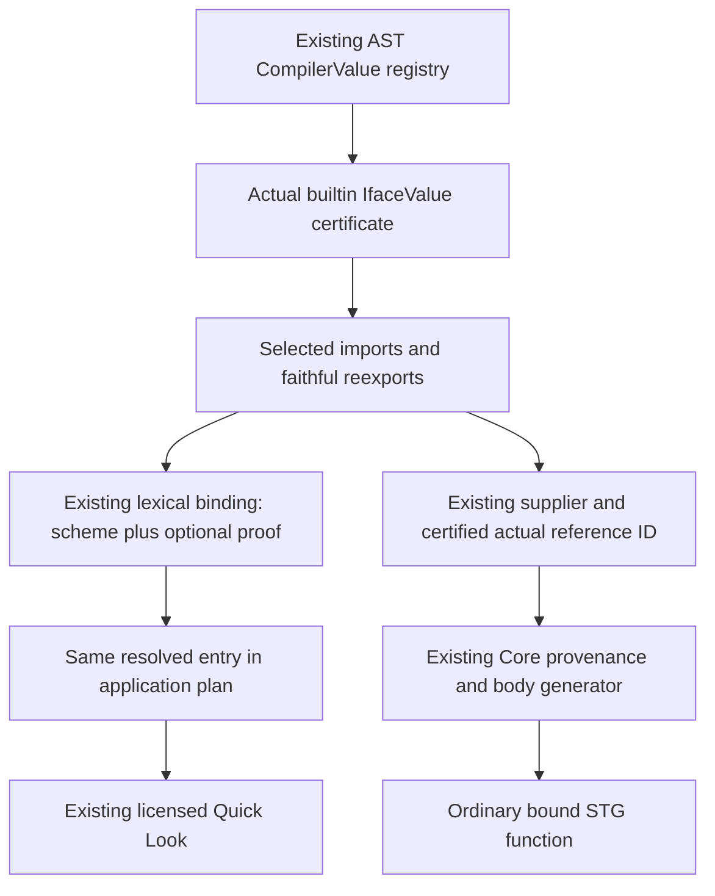

<!-- For God so loved the world, that he gave his only begotten Son, that whosoever believeth in him should not perish, but have everlasting life. — John 3:16 (KJV) -->

# Compiler dollar authority contract Chirho

This is a source-only plan, not an implementation or compatibility claim. The measured e6dd947f sigma repair preserves strict monotypes and reaches the next ordinary mismatch at the first argument of dollar application: Bazaar has a nested universal field while the ordinary dollar scheme first formal remains monomorphic. The official GHC 9.14.1 manual documents a dollar-specific Quick Look exception even without ImpredicativeTypes. Its exact import, reexport and source-clone boundary must be measured before implementing permission.

Primary source:
https://downloads.haskell.org/ghc/9.14.1/docs/users_guide/exts/impredicative_types.html

- [x] Finish the measured e6dd947f checkpoint and preserve all observer sources separately.
- [x] Read the actual b2639be6 CompilerValueChirho and selected-export pipeline.
- [x] Name producer, carrier, consumer, dependency direction and denial gaps before code.
- [x] Prepare a finite compile-only GHC plan and literal invocation through unchanged e994/run_owned2a80/b3f, without execution or a new lifecycle.
- [ ] Obtain source/method review and one separately named bounded reference grant; classify actual reasons and resource outcomes.
- [ ] Select a coherent implementation base containing the existing 709/711 carrier and the measured sigma repair; preserve the separate 710/C10/reader ownership.
- [ ] After reference disposition, implement only the agreed actual-binding proof transport and certified Core body.
- [ ] Run truthful producer/consumer negatives and actual original-source and first-class-body behavior under named grants before any acceptance claim.

## Existing homes and dependency direction

The census is pinned to private b2639be6, not to the current main checkout or this plan branch's source.

1. AST name_chirho/mod.rs holds CompilerValueChirho (currently ListAppend only). Extend the same registry when the oracle permits it. The actual builtin Prelude IfaceValue producer stamps the certificate. Real reexports already clone the complete value record; local definitions are collected without a certificate. Module names, scheme equality, a builtin bit, an occurrence origin or an ID range are not permission.
2. frontend_chirho/pipeline_chirho.rs 499–509 currently drops the optional certificate while building selected imported (name, Scheme) values. Preserve it on that existing selected-binding payload and the existing lexical TyEnv Entry::Value, not on Scheme and not in a parallel map. Implicit Prelude is injected before actual import selection, so it needs no authority grant on broad compatibility seeds.
3. Ordinary/local/let/lambda/source-alias binding defaults to unproven; masks stop lookup. Clone, scoped push/pop, substitution and replacement of the same binding preserve its existing certificate. Re-generalizing a new source definition does not inherit permission from its RHS.
4. type_applications_chirho's selected lookup and the ApplicationPlan carry the certificate of that same admitted entry together with its scheme and existing resolved-entry metadata. Unsupported qualifier fallback cannot upgrade a bare scheme. A positive admitted dollar certificate may select the existing Quick Look path; the ordinary ImpredicativeTypes path and strict monotype/class/escape rules stay separate.
5. Core already receives the AST certificate through selected ImportSuppliers, the certified actual reference ID, DesugarCtx and CoreProvenance.compiler_value_references_chirho. Extend the existing certified-body generator with ordinary lazy lambda f/lambda x/application f x. Existing input-ID reservation and module-bound ownership guards remain. Generic STG lookup then reaches a real Core binding, without a runtime tag, spelling table, primitive factory or legacy-key rename.
6. Close the two existing authority gaps coherently: native_provenance_chirho's append-only unproven-conflict handling, and the infix dollar spelling shortcut in desugaring. Both must follow the existing actual selected-reference/certificate result, with conflicts, hidden/stub/unknown arrivals conservative.

Typing consumes the AST enum and must not import Core's supplier type: Core already depends on typing.

## Finite oracle plan, unexecuted

Ten compile-only rows: unchanged original T11339b; minimal implicit Prelude, explicit Prelude, qualified Prelude, direct reexport and qualified reexport; a qualified same-scheme source clone; an ordinary source alias; a hidden unimported dollar; and the same clone with an explicit ImpredicativeTypes license. Predictions are seven ACCEPT and three REJECT, all unmeasured. Any different actual result revises the proposed boundary before code. New minimal controls use explicit Haskell2010/RankNTypes and the named impredicativity flag; the original keeps its original source pragmas and all.T option exactly.

A provisional/stub compiler interface has no honest equivalent as a GHC source-module row. Missing, stub, conflicting, ambiguous and unsupported-fallback certificates therefore remain named product structural controls rather than fabricated GHC refusals.

The existing e994 executor is unchanged and loads unchanged run_owned2a80/b3f by hash. Literal scope is version15 plus ten compile30 commands, each full cap plus30 reserve or UNSTARTED, proposed600 outer. No runtime program, product compiler, source edit, compiler implementation or canonical dab3 execution is part of this packet.

Plan SHA-256: 2580f36ab944ffcafe12a57145ed1b284dafd67dd5d2c570498f1e61593b0cdf.
Invocation SHA-256: 3574b3803487959800c61830ba44f62bf7178d3a0055f069118ccea7c7af27bd.
All24 inputs are pinned; output is absent.

Prepared record:
/Volumes/ENC_4TB_WDB_CHIRHO/dev-aleluya/personal-aleluya/haskelujah-workspaces-chirho/haskelujah-gpt-checked-inference-substitution-chirho/tmp-chirho/dollar-authority-chirho/reference-readiness-r1-chirho/owned-invocation-chirho.json
