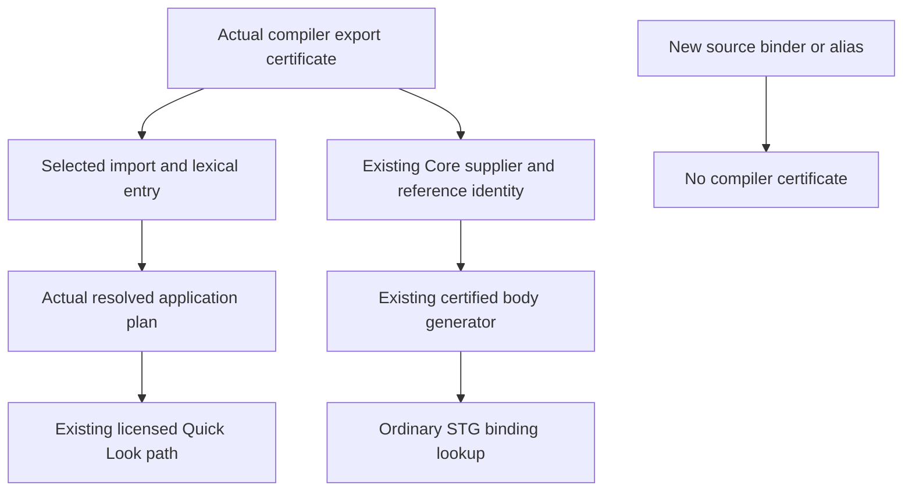

<!-- For God so loved the world, that he gave his only begotten Son, that whosoever believeth in him should not perish, but have everlasting life. — John 3:16 (KJV) -->

# Selected compiler apply authority Chirho

Canonical unit714 reuses the existing AST CompilerValue certificate and selected-export pipeline. The private source base is `0531709dcb328576901b38b15e441fac963f997c`, parent `b2639be6`, with only the coherent e6dd checked-inference leaf and its three ported behavioral tests. The measured base is preserved before implementation. This is not current-main source equality or a native/main convergence claim.

- [x] Measure the finite original ten GHC contrasts: seven ACCEPT and three semantic REJECT. Preserve the explicit grant32943 deadline-argument fault and the independent original-bound admission proof.
- [x] Preserve the source-only base union and original author/cherry-pick attribution; exclude private observers, the five parent Forall tests, row710, DB and broad history.
- [x] Measure base053 own-target workspace/all-target compilation: grant32977, zero compiler-message records,373 artifacts,36 build scripts and one successful build-finished record.
- [x] Measure base053 fresh830 typing names, exact three transplanted controls and whole830/830 with zero failed/ignored/filtered: grant32979. The focused three are included in830, not additive.
- [x] Prepare the cleared checked-consumer options overload, preserving default wrappers and forwarding the same caller/header policy through early root discovery and final frontend. This new forwarding source is not yet compiled.
- [x] Add source-driven before controls in the existing dollar_ownership test home: the thirteen original/supplementary oracle sources and all four provider bodies are byte-identical, caller options enter the real options-aware search/admission API, and refusals distinguish scope from rank mismatch. Three runtime controls use the ordinary evaluator paths for the distinct source-owned body, first-class application and an unused argument. Source preparation only; no test has run at this checkpoint.
- [x] Settle the supplementary oracle: the monomorphic unimported dollar is GHC-88464, source-owned body prints6, and the fixed nested source-clone witness is GHC-83865 despite its genuine outer Prelude dollar. This is a finite result, not a rule rejecting every nested source application.
- [ ] Measure the before controls without introducing a certificate API; keep original sources and exact caller permissions, with providers using their own existing headers/default route.
- [ ] Extend only the existing AST certificate producer, selected import payload, lexical value entry and resolved application plan. Ordinary binding, masking, source aliases, stubs, conflicts and unsupported qualifier fallbacks must not mint authority.
- [ ] Keep global ImpredicativeTypes licensing separate from the selected apply plan; retain strict monotype/class/escape rules and the existing Quick Look bounds.
- [ ] Transport the same certificate through actual Core supplier/reference identity and the existing certified-body generator to a lazy first-class application body. Remove infix spelling privilege while preserving actual program-owned bodies and input-ID reservation.
- [ ] Add after-only structural missing/stub/ambiguous/masked authority controls and measure the agreed focused, preservation, original-source and runtime gates under separate named grants.
- [ ] Update dependent workflows, record exact paths/source and findings, run appropriate static checks and outgoing secret scan, commit and push coherent progress. Root owns canonical DB and landing.

## Placement and forwarding contract

Typing consumes the existing AST enum, never Core's supplier type. The certificate lives with the actual selected lexical entry and resolved plan; it is not a Scheme equality, spelling, ID-range, origin-only or parallel-registry permission. New source definitions and aliases do not inherit it from an RHS. Substitution and replacement of the same lexical binding preserve its certificate with its scheme. Existing source/export clones carry the whole selected record faithfully.

The narrow options API affects ONLY the checked consumer. `compile_source_with_search_path_chirho` remains a default-options wrapper; a borrowed options field joins its existing private search context. The same FrontendPolicy resolver applies caller options before the consumer's actual header both at its early discovery parse/lowering and final frontend. The same filesystem supplier/admission path builds provider interfaces. Providers keep their own headers/default route; session-wide provider flags, CPP preprocessing and Program/Value/IO-entry authority are not added here. No original T11339b pragma or byte changes are permitted.

## Preserved measurements and limits

Base compile summary SHA: `5841bf720953727342d91036257183a0e10194861fdd74f034b22e49fb5f5a5b`.
Base typing summary SHA: `4eb3d4a5db1769fa26b4f04445f048c742d27aa668da84cd4c0264cb189be6cb`.
Base frozen typing test SHA: `aaa5e1ae8ed157807a2923aae7f792ab9581ba2e7265f81ab75f77b72c93ab14`.

/Volumes/ENC_4TB_WDB_CHIRHO/dev-aleluya/personal-aleluya/haskelujah-workspaces-chirho/haskelujah-gpt-selected-apply-chirho/tmp-chirho/selected-apply-base-gates-chirho/typing-r1-chirho/proof-chirho/summary-chirho.json

The original e6dd five-source product gate remains separate: tc092 accepted; T11339b/c falsely refused with E0200; T11339 refused for the wrong reason; CapturedAnnotation retained the correct rigid-escape refusal. This unit must report actual reasons and layers, not promote any refusal or later runtime failure to a GHC naming success. Monomorphic hidden dollar detects name/body admission independently of rank checking. A source-owned Int dollar body returning6 proves ordinary source dispatch rather than spelling substitution. Nested source-head behavior follows the actual oracle, not an assumed refusal.

Source preparation and a Rust base pass do not establish repaired dollar behavior, broad kind compatibility, runtime preservation or release readiness. Existing independent row710/C10/reader/package/native scopes and known findings remain explicit.

The row714 common-before selection is sixteen tests: thirteen configured compile contrasts plus three STG runtime controls. The older three dollar tests include native backends and are a separate later gate. The search-path API intentionally compiles the consumer with provider interfaces; the distinct source-owned runtime control therefore uses the existing real multi-module compiler/evaluator, which links provider bodies. Its monomorphic sources are unchanged, but that runtime call does not claim to forward the compile-only caller options. The first-class and unused-argument controls have expected42 outputs without a new measured-GHC claim.
