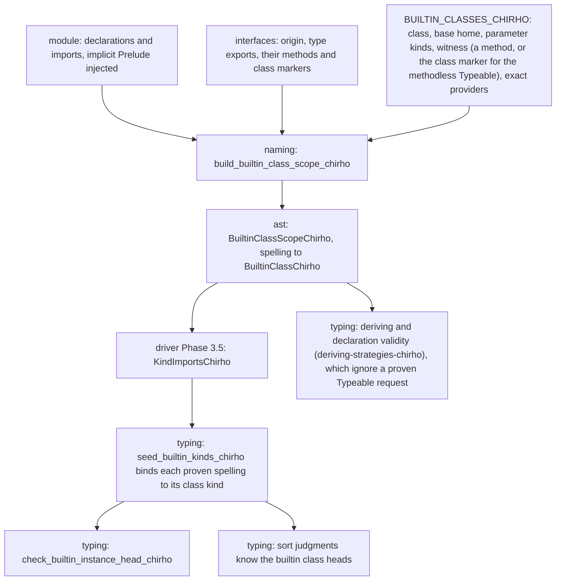

<!-- For God so loved the world, that he gave his only begotten Son, that whosoever believeth in him should not perish, but have everlasting life. — John 3:16 (KJV) -->

# Builtin class identity Chirho

K01 (#31175, #31176, #31203). A class spelling names one of the compiler's own classes only when naming proves it from a trusted builtin interface, never by its spelling. The kind pass reads that scope for builtin class kinds, such as `Functor :: (Type -> Type) -> Constraint`. GHC 9.14.1 measured every supplier, the kinds and the instance-head controls (#31202) before the consumer was wired. The methodless, poly-kinded `Typeable` joined the table later (#32090): a class marker on the provider's export is its witness, and deriving ignores a request for it (#32106).

## Trust

A spelling is bound to a builtin class only when all of these hold:

- The providing interface's origin is `IfaceOriginChirho::BuiltinChirho`.
- The class is in the table, and the interface is one of that entry's exact providers.
- The interface's type export of that name shows the entry's witness: it lists the witness method or, for the methodless `Typeable`, its producer marked it a class (`IfaceTypeChirho::is_class_chirho`) and it lists no method.

Builtin interfaces receive class methods by class name (`builtin_class_methods_chirho`), so the witness proves a type-namespace class entry in the interface. The same table pass sets the class marker, as do a source class declaration and the explicit builtin class entries. `false` claims nothing, and the two export merges keep a marker either side set. The GHC supplier oracles prove that the real module exports the class with that method.

## Exclusion

A spelling is excluded when anything else binds it:

- a declaration of this module, under both its bare and its module-qualified spelling;
- a source interface;
- an untrusted builtin homonym;
- a different class.

Exclusion is monotonic: no later import restores an excluded spelling. Spellings follow imports exactly, including aliases, `qualified`, import lists and `hiding`.

## Table

The table holds twenty-five classes. Twenty-four are monomorphic in GHC 9.14.1, each with a witness method:

- **`Type -> Constraint`:** Eq, Ord, Show, Enum, Bounded, Num, Integral, Fractional, Floating, Real, RealFrac, RealFloat, Semigroup, Monoid.
- **`(Type -> Type) -> Constraint`:** Functor, Applicative, Monad, MonadFail, Foldable, Traversable, Alternative, MonadFix, MonadIO.
- **`((Type -> Type) -> Type -> Type) -> Constraint`:** MonadTrans.

The twenty-second is `Typeable` (`forall k. k -> Constraint`), with no method to list. Its providers are Data.Typeable, Type.Reflection and Data.Data, the three builtin interfaces that export it, and each one's `import M (Typeable)` was measured under GHC 9.14.1 (typeable-route r2).

Read is left out, because its builtin entry lists `read`, not a method. Real, RealFrac and RealFloat take their witnesses (`toRational`, `properFraction`, `floatRadix`) from the class table's GHC 9.14.1 member sets (#32156): Prelude and GHC.Real provide Real and RealFrac, Prelude and GHC.Float provide RealFloat, each measured (t12760-route r2 and r3). Their typing seed (`class_chirho.rs`) lists no method, so the witness proves which class a spelling names, not that the class environment implements their methods: the builtin functions of those names still serve them, a named gap. The kind environment's spelling-based `Typeable` and `Generic` kinds remain: K01's `Typeable` has a hidden kind binder, so it seeds no kind.

## Consumer

The driver builds the scope from the interfaces resolution read and passes it to `infer_module_kinds_with_imports_chirho` in a `KindImportsChirho`. `infer_module_kinds_chirho` stays the direct path with an empty scope, so no spelling names a builtin class there.

**Seeding.** `seed_builtin_kinds_chirho` does two things:
- It records the builtin environment's names, before anything is learned from a use.
- It binds each proven spelling to its class kind. A local declaration is skipped, even if a scope were to list it.

**Instance heads.** A builtin class's instance head is judged whatever the representability switch says, but only under all of these conditions:
- the class has a single parameter, and the head has exactly one written argument, which cannot be misaligned;
- the argument's kind is read without inference, from a constructor declared in this module or a builtin type, after its written arguments (list, tuple and function types are `*`);
- that kind is variable-free.

A variable head, an imported constructor (its kind is learned from a use) and any malformed shape stay unjudged. Only instance heads written in source are judged: the driver passes the count of declarations after splices (`written_decl_count_chirho`), and deriving appends its instances after them. A derived head applies every type parameter (`Monad (T a x)` for generalized newtype deriving), which is the deriver's own boundary, so derived heads stay unjudged (T3955, T12734). A spelling that names a builtin class never falls through to the local-class check.

**Sort judgments.** The proven spellings join the known heads, so `newtype B = B (Show Int)` reports a constraint written where a type is required. A proven `Typeable` joins them too. Contexts are not unified with class kinds, and the spelling-based `Typeable` and `Generic` kinds are unchanged.

## Controls

- **Naming:** `iface_chirho/class_identity_tests_chirho.rs`.
  - The trust and exclusion rules, on hand-built interfaces.
  - The supplier guard over the real builtin interfaces: every listed provider exports the class entry with its witness, and every builtin class export is either a listed provider or a named untrusted one.
  - The methodless witness: a marked export proves `Typeable`, while an unmarked one, an unlisted builtin interface's and one beside a local class do not; each measured provider's import list proves it.
- **Typing:** `kind_chirho/class_imports_tests_chirho.rs`, covering:
  - the movers' and holds' shapes under their extensions;
  - qualified spellings;
  - a local homonym;
  - the direct path;
  - the proven `Typeable`, which seeds no kind.
- **Driver:** `declarations_chirho/builtin_class_kinds_chirho.rs`, with the GHC-measured holds and negatives and T5120 embedded byte for byte. The Typeable provider programs are in `declarations_chirho/typeable_route_chirho/`. The Real, RealFrac and RealFloat provider programs and their GND Double-newtype superclass-chain program are in `declarations_chirho/real_classes_chirho/`, beside T12760 checked from the corpus.
- **GHC:** the `oracle-classes-chirho` set.
  - One supplier program per class and provider.
  - A `:kind` probe.
  - Instance-head holds and negatives, including a local homonym, a source-module homonym and a variable-headed instance.
