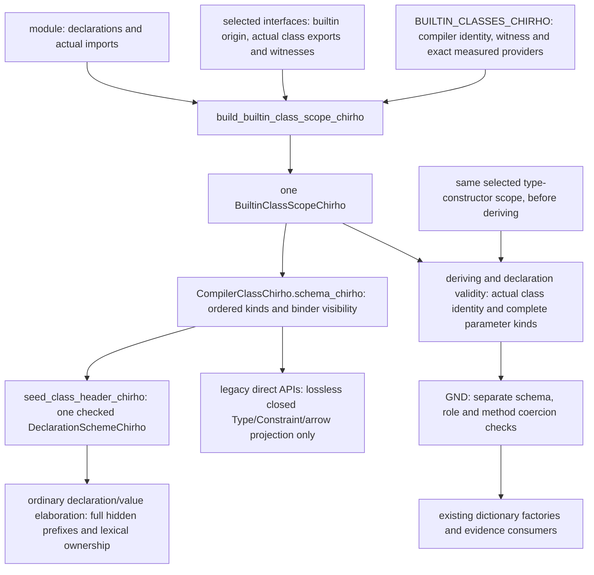

<!-- For God so loved the world, that he gave his only begotten Son, that whosoever believeth in him should not perish, but have everlasting life. — John 3:16 (KJV) -->

# Builtin class identity Chirho

K01 (#31175, #31176, #31203). A class spelling names one of the compiler's own classes only when naming proves it from a selected builtin interface. The existing compiler identity owns one ordered class-kind schema. A spelling, interface label or eta arity does not manufacture that identity or reconstruct its telescope. The methodless Typeable entry uses the provider's truthful class marker (#32090).

## Trust

A spelling is bound to a compiler class only when all of these hold:

- The providing interface has builtin origin and is selected by the real import route.
- The class is in the existing table and that interface is one of its exact providers.
- Its class export carries the entry's witness method, or, for methodless Typeable, the producer's `IfaceTypeChirho::is_class_chirho` marker with no listed method.

The builtin supplier produces the actual method membership and class marker. A source class declaration also sets its truthful marker, but source origin cannot prove a compiler class. A false marker, missing declaration or unknown/stub export supplies no positive proof. Export merges retain the marker while preserving the conservative declaration-identity meet. The public module label is not source-unit proof and does not authorize runtime instance selection.

## Exclusion

A local declaration, source interface, untrusted builtin homonym or different class excludes the spelling. Exclusion is monotonic; a later import cannot restore it. Bare and module-qualified local names are excluded, and aliases, qualification, import lists and hiding use the actual import visibility. A proof is not recovered from a caller's spelling.

## Shared schema and providers

The table holds twenty-five classes. Twenty-four have a method witness:

- `Type -> Constraint`: Eq, Ord, Show, Enum, Bounded, Num, Integral, Fractional, Floating, Real, RealFrac, RealFloat, Semigroup and Monoid.
- `(Type -> Type) -> Constraint`: Functor, Applicative, Monad, MonadFail, Foldable, Traversable, Alternative, MonadFix and MonadIO.
- `((Type -> Type) -> Type -> Type) -> Constraint`: MonadTrans.

Typeable has `forall {k}. k -> Constraint` and a methodless witness. Its measured providers are Data.Typeable, Type.Reflection and Data.Data. Alternative is provided by Control.Applicative, not Prelude; the erroneous Prelude type export was removed at its producer. MonadFix uses Control.Monad.Fix; MonadIO uses Control.Monad.IO.Class and Control.Monad.Trans; MonadTrans uses Control.Monad.Trans.Class and Control.Monad.Trans. Their real export membership, hidden/local/ambiguous controls and qualified imports are retained in the supplier evidence.

Real and RealFrac use Prelude and GHC.Real, while RealFloat uses Prelude and GHC.Float. The existing method table retains their measured member sets and witnesses toRational, properFraction and floatRadix (#32156). Their typing seeds still have empty own-method maps: this identity proof does not claim those methods have dictionary implementations. The retained superclass-chain controls exercise Num/Ord through Real, Fractional through RealFrac and Floating through RealFloat. Read stays outside this naming table because its builtin entry lists read rather than a class method.

The compiler schema also describes other positive class producers. Typeable and Coercible keep their inferred shared kind binder; KnownNat, KnownSymbol and KnownChar keep their literal kinds. HasField is explicitly the existing restricted Symbol-label/lifted-field producer; general label kinds and representation-polymorphic fields remain unsupported. No restricted schema is presented as GHC's complete HasField telescope.

## Consumers

The frontend builds the class and type-constructor scopes before deriving and reuses them afterward: deriving appends instances and introduces no class or type header. The ordinary engine selects the common schema through the positive compiler identity, materializes it into the existing declaration arena and transports the complete hidden prefix. The adapter uses the original elaboration allowance and latches resource exhaustion there. The live frontend does not run the old spelling-based kind pass as another authority.

The reusable AST schema is independent of the ordinary engine. Declaration binder visibility/specificity are the same shared types. `closed_parameter_kind_chirho` returns a complete closed Type/arrow tree; `single_parameter_eta_arity_chirho` counts outer result arrows for one required parameter. Hidden, dependent, literal-kind and partial schemas refuse a lossy legacy hint. An eta count never reconstructs a kind, and MonadTrans's first domain stays `(Type -> Type)`.

A local methodless class with written deriving arguments may prove its last parameter's Type arity from the full AST annotation. That borrowed view accepts only arrows between actual compiler-owned universe atoms. It reads the same selected type-constructor scope, preserves an attached declaration first, refuses opaque/source homonyms and shares one shrinking projection-depth allowance. Fresh grammar star syntax is governed by the module's shared StarIsType policy. Proofless flat projections remain Unknown. Other full kind forms conservatively refuse this GND hint rather than being approximated.

A derived Typeable request is truly ignored: it mints no instance, no GND request and no representation erasure. Source homonyms retain their own route. GND's instance/class schema, role and coercion checks remain separate. A full constructor prefix retains typed binders and context; an unread prefix or any kind-annotated existential remains conservative Unknown in role inference. This producer upgrade does not license new coercions or constructor packing.

## Controls

- Naming's class-identity tests cover exact selected suppliers, methodless markers, hidden/local/ambiguous imports, source homonyms and missing witnesses.
- AST compiler-class-kind tests retain nested MonadTrans domains, invisible ownership and literal kinds.
- The ordinary engine's compiler-scheme tests cover complete telescopes, unbound-slot refusal and terminal resource failure across a later tiny argument.
- Existing driver class-kind, Typeable and Real-class fixtures retain their measured supplier bytes and original T12760 control; class identity does not itself prove all own methods implemented.
- Full-kind-arity driver controls exercise the real parsed qualified universe beside a local Type, shared star overrides and a selected-scope proof erased before derivation. The private annotation control retains opacity and the existing depth limit.
- Existing GND and evidence controls retain constructor-prefix Unknown behavior, complete class heads, applied types, qualified resolved entries and the runtime route's separate proof obligations.
