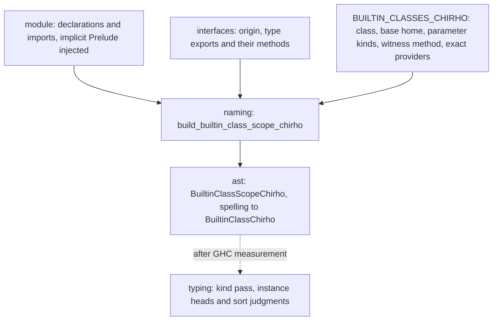

<!-- For God so loved the world, that he gave his only begotten Son, that whosoever believeth in him should not perish, but have everlasting life. — John 3:16 (KJV) -->

# Builtin class identity Chirho

K01 (#31175, #31176). A class spelling names one of the compiler's own classes only when naming proves it from a trusted builtin interface, never by its spelling. The kind pass reads the scope for builtin class kinds, such as `Functor :: (Type -> Type) -> Constraint`. That consumer is activated only after GHC has measured the supplier, kind and instance-head oracles.

## Trust

A spelling is bound to a builtin class only when all of these hold:

- The providing interface's origin is `IfaceOriginChirho::BuiltinChirho`.
- The class is in the table, and the interface is one of that entry's exact providers.
- The interface's type export of that name lists the entry's witness method.

Builtin interfaces receive class methods by class name (`builtin_class_methods_chirho`), so the witness proves a type-namespace class entry in the interface. The GHC supplier oracles prove that the real module exports the class with that method.

## Exclusion

A spelling is excluded when anything else binds it:

- a declaration of this module, under both its bare and its module-qualified spelling;
- a source interface;
- an untrusted builtin homonym;
- a different class.

Exclusion is monotonic: no later import restores an excluded spelling. Spellings follow imports exactly, including aliases, `qualified`, import lists and `hiding`.

## Table

The table holds seventeen classes, all monomorphic in GHC 9.14.1:

- **`Type -> Constraint`:** Eq, Ord, Show, Enum, Bounded, Num, Integral, Fractional, Floating, Semigroup, Monoid.
- **`(Type -> Type) -> Constraint`:** Functor, Applicative, Monad, MonadFail, Foldable, Traversable.

Read, Real, RealFrac and RealFloat are left out, because their builtin entries list no real method. The kind environment's existing spelling-based `Typeable` and `Generic` kinds remain a named residual.

## Controls

- **Naming:** `iface_chirho/class_identity_tests_chirho.rs`.
  - The trust and exclusion rules, on hand-built interfaces.
  - The supplier guard over the real builtin interfaces: every listed provider exports the class entry with its witness, and every builtin class export is either a listed provider or a named untrusted one.
- **GHC:** the `oracle-classes-chirho` set.
  - One supplier program per class and provider.
  - A `:kind` probe.
  - Instance-head holds and negatives, including a local homonym, a source-module homonym and a variable-headed instance.
