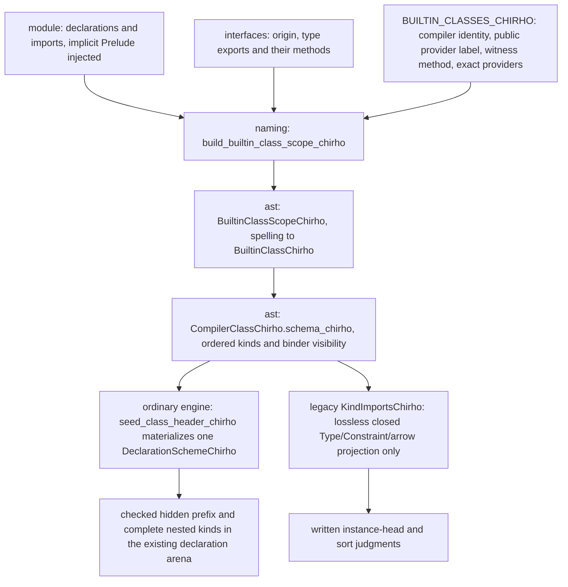

<!-- For God so loved the world, that he gave his only begotten Son, that whosoever believeth in him should not perish, but have everlasting life. — John 3:16 (KJV) -->

# Builtin class identity Chirho

K01 (#31175, #31176, #31203). A class spelling names one of the compiler's own classes only when naming proves it from a selected builtin interface. The existing compiler identity owns one ordered class-kind schema. A public class spelling, an interface label and an eta arity do not manufacture that identity or reconstruct its telescope.

## Trust

A spelling is bound to a builtin class only when all of these hold:

- The providing interface's origin is `IfaceOriginChirho::BuiltinChirho`.
- The class is in the table, and the interface is one of that entry's exact providers.
- The interface's type export of that name lists the entry's witness method.

Builtin interfaces receive class methods by class name (`builtin_class_methods_chirho`), so the witness proves a type-namespace class entry in the interface. The GHC supplier oracles check the real module's corresponding export. The record's public module label is not a source-unit proof and does not authorize runtime instance selection.

## Exclusion

A spelling is excluded when anything else binds it:

- a declaration of this module, under both its bare and its module-qualified spelling;
- a source interface;
- an untrusted builtin homonym;
- a different class.

Exclusion is monotonic: no later import restores an excluded spelling. Spellings follow imports exactly, including aliases, `qualified`, import lists and `hiding`.

## Table

The naming table holds twenty-one classes:

- **`Type -> Constraint`:** Eq, Ord, Show, Enum, Bounded, Num, Integral, Fractional, Floating, Semigroup, Monoid.
- **`(Type -> Type) -> Constraint`:** Functor, Applicative, Monad, MonadFail, Foldable, Traversable, Alternative, MonadFix, MonadIO.
- **`((Type -> Type) -> Type -> Type) -> Constraint`:** MonadTrans. Its parameter has two outer result arrows, and its first domain is itself `Type -> Type`.

The added providers are `Control.Applicative` (`empty`), `Control.Monad.Fix` (`mfix`), `Control.Monad.IO.Class` and `Control.Monad.Trans` (`liftIO`), and `Control.Monad.Trans.Class` and `Control.Monad.Trans` (`lift`). Prelude does not export the Alternative class; its former incorrect type export was removed at the supplier so an actual Control.Applicative import is not poisoned as ambiguous. Existing legacy value helpers are unchanged.

Read, Real, RealFrac and RealFloat remain outside this naming proof table because their builtin entries list no real method. The compiler's schema also describes its other existing positive class identities. Typeable and Coercible retain their inferred shared kind slot; KnownNat, KnownSymbol and KnownChar retain their respective literal kinds. HasField is explicitly marked as the existing restricted Symbol-label/lifted-field producer; general label kinds and representation-polymorphic fields remain unsupported.

## Consumer

The driver builds the scope from the interfaces resolution read. The ordinary engine selects the shared schema through the positive compiler identity and materializes it into the existing declaration arena, preserving the hidden prefix and preceding-slot ownership. The adapter charges the original elaboration allowance and latches depth exhaustion in that same state.

The reusable AST schema is independent of the ordinary engine and runtime evidence carriers. Declaration binder visibility/specificity are re-exports of the same shared types. `closed_parameter_kind_chirho` returns a complete closed Type/arrow tree; `single_parameter_eta_arity_chirho` counts outer result arrows for a single required parameter. An eta count must never reconstruct the parameter kind. Hidden, dependent, literal-kind and partial schemas refuse that closed legacy hint rather than becoming Type-only approximations.

The legacy path still receives `KindImportsChirho`. Its projection binds only schemas it can represent without loss, and its direct empty-scope API mints no spelling-based class proof.

**Seeding.** `seed_builtin_kinds_chirho` does two things:
- It records the builtin environment's names, before anything is learned from a use.
- It binds each proven spelling to its class kind. A local declaration is skipped, even if a scope were to list it.

**Instance heads.** A builtin class's instance head is judged whatever the representability switch says, but only under all of these conditions:
- the class has a single parameter, and the head has exactly one written argument, which cannot be misaligned;
- the argument's kind is read without inference, from a constructor declared in this module or a builtin type, after its written arguments (list, tuple and function types are `*`);
- that kind is variable-free.

A variable head, an imported constructor (its kind is learned from a use) and any malformed shape stay unjudged. Only instance heads written in source are judged: the driver passes the count of declarations after splices (`written_decl_count_chirho`), and deriving appends its instances after them. A derived head applies every type parameter (`Monad (T a x)` for generalized newtype deriving), which is the deriver's own boundary, so derived heads stay unjudged (T3955, T12734). A spelling that names a builtin class never falls through to the local-class check.

**Sort judgments.** The proven spellings join the known heads, so `newtype B = B (Show Int)` reports a constraint written where a type is required. This legacy projection does not replace the ordinary engine's checked declaration catalogue or grant authority to unresolved metadata.

## Controls

- **Naming:** `iface_chirho/class_identity_tests_chirho.rs`.
  - The trust and exclusion rules, on hand-built interfaces.
  - The supplier guard over the real builtin interfaces: every listed provider exports the class entry with its witness, and every builtin class export is either a listed provider or a named untrusted one.
  - All four added classes beside real Prelude: explicit class-only imports, qualified aliases, hidden/local bindings and missing witness methods.
- **AST:** `name_chirho/compiler_class_kind_chirho/tests_chirho.rs`, including the nested MonadTrans domain, shared invisible kind ownership and non-Type literal kinds.
- **Typing:** `kind_chirho/class_imports_tests_chirho.rs`, covering:
  - the movers' and holds' shapes under their extensions;
  - qualified spellings;
  - a local homonym;
  - the direct path.
- **Driver:** `declarations_chirho/builtin_class_kinds_chirho.rs`, with the GHC-measured holds and negatives and T5120 embedded byte for byte.
  - `source_chirho/class_kind_tests_chirho.rs` exercises the actual added provider imports, wrong-kind heads and Prelude-qualified Alternative refusal.
- **Ordinary engine:** `elaboration_chirho/compiler_schemes_chirho/tests_chirho.rs`, including complete class telescopes, unbound-slot refusal and terminal resource failure across a later tiny argument.
- **GHC:** the `oracle-classes-chirho` set.
  - One supplier program per class and provider.
  - A `:kind` probe.
  - Instance-head holds and negatives, including a local homonym, a source-module homonym and a variable-headed instance.
