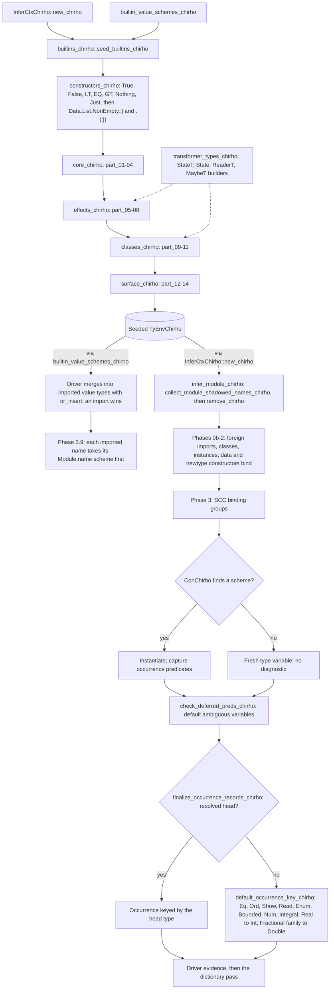
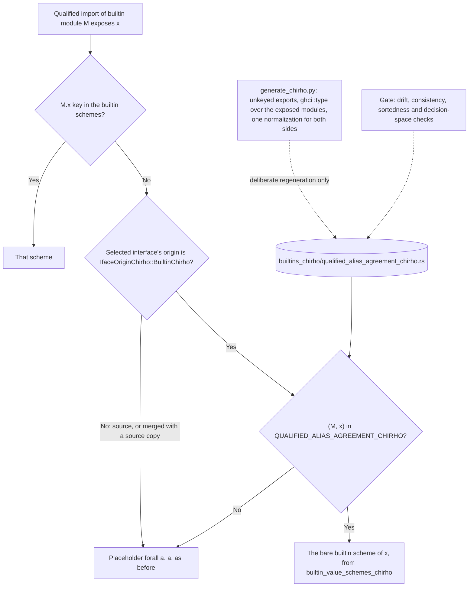

<!-- For God so loved the world, that he gave his only begotten Son, that whosoever believeth in him should not perish, but have everlasting life. — John 3:16 (KJV) -->
# Builtin type environment workflow

Type inference for every module starts from a seeded builtin environment. The module's own declarations then remove and rebind any seeded name, and occurrence typing reads whatever is left. An unbound variable is reported. A constructor expression (`ExprChirho::ConChirho`) that the environment never binds is not: it silently becomes a fresh type variable.

## Seed order

- The hub calls `constructors_chirho`, then the core, effects, classes and surface groups, and each group calls its parts in ascending order. Every part is a contiguous slice of the former single `seed_builtins_chirho`, so the bind sequence is that function's, plus `LT`, `EQ` and `GT` right after `True` and `False` (RC5).
- Order matters. `TyEnvChirho::bind_chirho` inserts into the innermost scope, so a later bind of the same name replaces an earlier one. Moving binds between parts, or reordering parts, can change a builtin's scheme.
- The builders in `transformer_types_chirho.rs` are pure type constructors. They bind nothing.
- Add a builtin to the part whose topic fits it, and a data constructor to `constructors_chirho.rs`. Keep every file under 1000 lines.

## Module names win

- `collect_module_shadowed_names_chirho` gathers the module's top-level function, signature and pattern-bound names, its data and newtype constructors, and its record field names. `infer_module_chirho` removes all of them from the seeded environment before Phase 0, then the module's own declarations bind them.
- Class methods are not removed. Phase 1a binds them over the seed.
- The driver's copy goes the other way. It merges `builtin_value_schemes_chirho()` into the module's imported value types with `or_insert`, so an imported scheme wins over a builtin of the same name.

## Module-scoped builtins

- `join` and `&` are bound under `<Module>.<name>`, never under their bare names (unit 532). Together these keys cover every builtin interface that exports the names, and a control reads that set from the interfaces.
  - `join` carries its own scheme under `Control.Monad` and `GHC.Base`.
  - The five semigroupoids modules keep the scheme their imports reached before.
  - `&` carries its own scheme under `Data.Function` and `Control.Lens`.
  - The builtin lens interface pushes one export set under 16 more `Control.Lens.*` names. Their `&` keys keep the scheme those imports reached before, which preserves an interface approximation and is not a per-module GHC claim. The keys numbered 18 for `&` at unit 532, but the control derives the set from the interfaces rather than counting it.
- For each value an import exposes, driver Phase 3.9 looks up `<Module>.<name>` first:
  - an open or selective import binds the bare name to that scheme;
  - a qualified import binds `<qualifier>.<name>`;
  - hiding the name, or leaving it out of an import list, binds nothing.
- A module that imports none of them reports the name unbound, as GHC does (GHC-88464).
- Boundaries:
  - `InferCtxChirho::new_chirho` still seeds every canonical key. An unimported fully qualified `Control.Monad.join` no longer reaches it: naming reports GHC-76037's class first (row 598).
  - A qualified import of a builtin module with no `Module.x` key takes the bare builtin scheme only where GHC 9.14.1 agrees; see "Qualified builtin aliases (row 608)" below.
  - The semigroupoids modules' preserved scheme is Monad's `join`, not their `Bind` method's own. That approximation predates this unit.
  - Which `Control.Lens.*` modules really export `(&)` was not measured. Their preserved keys carry no GHC-exact claim, and no oracle row covers them.
  - `guard` and the other non-Prelude bare seeds keep the old route.
  - Neither `join` nor `&` has a runtime implementation yet.

## Qualified builtin aliases (row 608)

- **The defect.** Phase 3.9 gave a qualified import's `Q.x` the placeholder `forall a. a` whenever no `Module.x` key existed. An unqualified import fell back to the bare scheme instead.
  - So every Prelude, Data.List and Data.Char alias was untyped, and `print (L.reverse xs)` defaulted Show to Int.
  - Natively it failed "no native Show instance for a boxed value".
  - Beside a local binder, every engine failed "no matching alternative".
- **The rule.** Phase 3.9 passes the interface it actually selected to the driver's `qualified_import_alias_scheme_chirho`.
  - That interface must be proven builtin. Only then does `qualified_builtin_alias_scheme_chirho` give the alias the bare builtin scheme of its name, and only when the generated table lists `(module, name)`.
  - Otherwise the alias keeps the placeholder.
  - Row 598 already links the alias to the bare name at runtime, so the type now describes what runs.
- **Interface origin.** `IfaceExportsChirho::origin_chirho` is an `IfaceOriginChirho`, and its default `SourceChirho` fails closed.
  - Only `builtin_module_ifaces_chirho` marks `BuiltinChirho`, in one loop over its finished vector.
  - `merge_module_ifaces_chirho` keeps `BuiltinChirho` only when every merged copy carries it, in either order.
  - So a source module named like a builtin module, or a source re-export of builtin names, never reads the table, whatever its spelling.
- **The data.** GHC 9.14.1 measured 12,721 unkeyed builtin exports: 726 agree; 679 disagree; 2,870 have no bare scheme; and 8,446 GHC does not type. Row 608 measured 721 and 684; row 611's Data.Maybe repair moved five pairs.
  - Container modules have no entries, by the data rather than a list.
  - The generator, the normalization contract and the evidence are in `test-data-chirho/qualified-alias-agreement-chirho/`.
  - Regeneration is deterministic: two bases gave byte-identical outputs.
- **Disagreements kept the placeholder.** Each is a named residual for a row of its own:
  - GHC's Foldable-generic functions against list-only bare schemes;
  - a String-only `intercalate`;
  - missing constraints on `forever`, `mapM` and `sequence`.
- **Named-to-named transitions.**
  - A Data.List program now prints its agreeing lines natively, then still fails at `L.intercalate` with the named Show failure.
  - `O.comparing` now reaches the missing runtime body, failing exactly as a plain `import Data.Ord (comparing)` does.
- **Boundaries.**
  - A sibling user module's types do not reach the checker at all today: `twiceChirho 'x'` checks whether it is imported plainly or qualified.
  - The loader does not load a project-local `Data/List.hs` in place of the builtin `Data.List`, in `check` or `compile`. Its own names are unbound, so the interface selected is the builtin one, and the table applies to it consistently with what links.
    - Base compiled such a program, then crashed: native exit 139, and "no matching alternative" in the interpreter.
    - The candidate rejects it at compile time with the builtin `lookup`'s type.
    - The loader's behavior is its own residual.
- **Controls.**
  - In `tests/typing_integration_chirho/qualified_alias_agreement_chirho.rs`:
    - the contract, sortedness, every entry against today's bare scheme, and the whole decision space over the builtin interfaces;
    - the origin seam: every builtin interface is builtin, and the default is source; merges stay builtin only when every copy is, in either order;
    - a source `Data.List`, merged with the seed either way, and a source re-export of builtin names, miss `reverse` and `lookup`.
  - In `qualified_builtin_aliases_chirho.rs`, on all three engines:
    - agreeing aliases, the Row 597/598 namesake seam and Row 607's local Enum cell;
    - the routes the table leaves alone;
    - the two named-to-named transitions;
    - a user module's alias.

## Data.Maybe helpers at GHC's types (row 611)

- `fromMaybe`, `isJust`, `isNothing` and `maybe` are seeded in `core_chirho/part_03_chirho.rs` with `Maybe` itself, as GHC types them. Their neighbors `maybeToList`, `listToMaybe`, `catMaybes`, `mapMaybe` and `fromJust` already were.
- **The shortcut it removes.** bea5612c (row 429, 2026-07-05) typed the four over any constructor `f a`. It existed for five driver tests that declared their own `data Maybe` and applied the builtin helpers to it, programs GHC 9.14.1 rejects (GHC-87543).
  - So a list, an `Either`, a user `Box` or a rigid `g` checked.
  - Then the interpreter failed "no matching alternative", and the natives printed wrong values.
  - Those five tests now use the standard `Maybe` and import the helpers, with the same expected values.
- **Now.** Each misuse is a frontend rejection on every engine. The valid uses keep GHC's answers, and the regenerated row 608 table types the qualified Data.Maybe aliases.
- **Controls.**
  - In `tests/typing_integration_chirho/maybe_helper_schemes_chirho.rs`: the valid and shadowing uses and the qualified aliases on all three engines; seven misuses; and the old local-`Maybe` shape as a rejection.
  - In `eval_basic_chirho.rs`: the five rewritten value tests.

## Prelude numeric functions with generated bodies

- `gcd` and `lcm` have generated Core bodies and the public type `Integral a => a -> a -> a`.
  Their builtin schemes must name that same type. A placeholder scheme allowed each argument and
  the result to float independently, so `print (gcd 12 (18 :: Int), lcm 4 (6 :: Int))` recorded
  only `Show (,)`; all engines then reached the canonical print route instead of `Show (Int,Int)`.
- The schemes make the typed operand resolve the result before occurrence evidence is finalized.
  The dictionary pass therefore receives the concrete tuple key without a print-specific fallback.
- Controls cover each exact scheme, positive/negative/zero/coprime/first-class results in the
  interpreter, and the former R5 pair on the interpreter, LLVM and Cranelift (row 564).

## Report folds with generated bodies (row 558)

- `foldl1`, `foldr1` and `until` have generated Core bodies (`report_chirho/report_folds_chirho.rs`; row 548 for
  `foldl1` and `until`, row 558 for `foldr1`). Their builtin schemes name the report's types:
  `(a -> a -> a) -> [a] -> a` for both folds, as `foldl1'` already had, and
  `(a -> Bool) -> (a -> a) -> a -> a` for `until`.
- With no scheme, the step function and the result were unconstrained:
  - over Double, the occurrence evidence defaulted to Int;
  - `foldl1 (-) [10, 3, 2 :: Double]` printed a Double's bits as an integer natively, and the
    interpreter failed on `SubIntChirho`;
  - `until (> 100) (* 2) (1.5 :: Double)` printed `192` in the interpreter and raw bits natively.
- `scanl1`, which had its scheme, was exact everywhere and served as the contrast.
- The control is `report_folds_answer_as_ghc_at_every_type_everywhere_chirho`. Only 3 corpus
  files name these functions, and none of them moves.

## Unbound constructors

- When an `ExprChirho::ConChirho` finds no scheme, it gets a fresh type variable and no diagnostic. Class predicates on that variable stay unresolved through `check_deferred_preds_chirho`.
- `finalize_occurrence_records_chirho` then keys the occurrence through `default_occurrence_key_chirho`. For Eq and Ord that is `Int` even with no Num constraint.
- So a constructor missing from the seed dispatches at `Int`. Bare `LT`, `EQ` and `GT` did, until `constructors_chirho.rs` seeded them as `Ordering` (RC5; see Builtin constructor seeds in language-features-chirho/dictionary-evidence-chirho.md).
- Rejecting unbound constructors, and Eq/Ord defaulting without Num, are separate debts.

## NonEmpty's constructor (unit 517)

- `constructors_chirho.rs` seeds `(:|) :: forall a. a -> [a] -> NonEmpty a` under the module-qualified keys `Data.List.NonEmpty.:|` and `Data.List.NonEmpty.(:|)`, the two spellings the interface exports. No bare key is seeded.
- Phase 3.9 looks the `Module.name` key up first, so every import of Data.List.NonEmpty that exposes the constructor gives it this scheme under its own spelling (`:|`, `NE.:|`, `Data.List.NonEmpty.:|`). A value built with `:|` then has a concrete Show key (`NonEmpty Int` where the type is imported unqualified), and the derived NonEmpty metadata renders it (print-show-evidence-chirho).
- Boundary: like `Data.List.NonEmpty.reverse`, the module-qualified keys are seeded for every module, but naming rejects a full-qualifier `Data.List.NonEmpty.:|` that no import binds before inference reads one (row 598).
