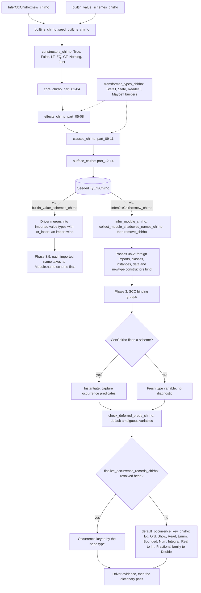

<!-- For God so loved the world, that he gave his only begotten Son, that whosoever believeth in him should not perish, but have everlasting life. — John 3:16 (KJV) -->
# Builtin type environment workflow

Type inference for every module starts from a seeded builtin environment. The module's own declarations then remove and rebind any seeded name, and occurrence typing reads whatever is left. An unbound variable is reported. A constructor expression (`ExprChirho::ConChirho`) that the environment never binds is not: it silently becomes a fresh type variable.

## Seed order

- The hub calls `constructors_chirho`, then the core, effects, classes and surface groups, and each group calls its parts in ascending order. Every part is a contiguous slice of the former single `seed_builtins_chirho`, so the bind sequence is that function's, plus `LT`, `EQ` and `GT` right after `True` and `False` (RC5).
- Order matters. `TyEnvChirho::bind_chirho` inserts into the innermost scope, so a later bind of the same name replaces an earlier one. Moving binds between parts, or reordering parts, can change a builtin's scheme.
- The builders in `transformer_types_chirho.rs` are pure type constructors. They bind nothing.
- Add a builtin to the part whose topic fits it, and a data constructor to `constructors_chirho.rs`. Keep every file under 1000 lines.

## Module names win

- `collect_module_shadowed_names_chirho` gathers the module's top-level function, signature and pattern-bound names, its data and newtype constructors, and its record field names. `infer_module_chirho` removes all of them from the seeded environment before Phase 0, then the module's own declarations bind them.
- Class methods are not removed. Phase 1a binds them over the seed.
- The driver's copy goes the other way. It merges `builtin_value_schemes_chirho()` into the module's imported value types with `or_insert`, so an imported scheme wins over a builtin of the same name.

## Module-scoped builtins

- `join` and `&` are bound under `<Module>.<name>`, never under their bare names (unit 532). Together these keys cover every builtin interface that exports the names, and a control reads that set from the interfaces.
  - `join` carries its own scheme under `Control.Monad` and `GHC.Base`.
  - The five semigroupoids modules keep the scheme their imports reached before.
  - `&` carries its own scheme under `Data.Function` and `Control.Lens`.
  - The builtin lens interface pushes one export set under 16 more `Control.Lens.*` names. Their `&` keys keep the scheme those imports reached before, which preserves an interface approximation and is not a per-module GHC claim. The keys numbered 18 for `&` at unit 532, but the control derives the set from the interfaces rather than counting it.
- For each value an import exposes, driver Phase 3.9 looks up `<Module>.<name>` first:
  - an open or selective import binds the bare name to that scheme;
  - a qualified import binds `<qualifier>.<name>`;
  - hiding the name, or leaving it out of an import list, binds nothing.
- A module that imports none of them reports the name unbound, as GHC does (GHC-88464).
- Boundaries:
  - `InferCtxChirho::new_chirho` still seeds every canonical key, so an unimported fully qualified `Control.Monad.join` still checks where GHC reports GHC-76037.
  - The semigroupoids modules' preserved scheme is Monad's `join`, not their `Bind` method's own. That approximation predates this unit.
  - Which `Control.Lens.*` modules really export `(&)` was not measured. Their preserved keys carry no GHC-exact claim, and no oracle row covers them.
  - `guard` and the other non-Prelude bare seeds keep the old route.
  - Neither `join` nor `&` has a runtime implementation yet.

## Unbound constructors

- When an `ExprChirho::ConChirho` finds no scheme, it gets a fresh type variable and no diagnostic. Class predicates on that variable stay unresolved through `check_deferred_preds_chirho`.
- `finalize_occurrence_records_chirho` then keys the occurrence through `default_occurrence_key_chirho`. For Eq and Ord that is `Int` even with no Num constraint.
- So a constructor missing from the seed dispatches at `Int`. Bare `LT`, `EQ` and `GT` did, until `constructors_chirho.rs` seeded them as `Ordering` (RC5; see Builtin constructor seeds in language-features-chirho/dictionary-evidence-chirho.md).
- Rejecting unbound constructors, and Eq/Ord defaulting without Num, are separate debts.
