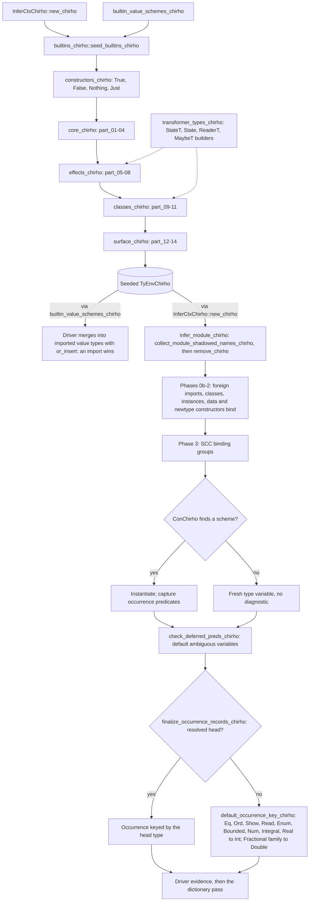

<!-- For God so loved the world, that he gave his only begotten Son, that whosoever believeth in him should not perish, but have everlasting life. — John 3:16 (KJV) -->
# Builtin type environment workflow

Type inference for every module starts from a seeded builtin environment. The module's own declarations then remove and rebind any seeded name, and occurrence typing reads whatever is left. An unbound variable is reported. A constructor expression (`ExprChirho::ConChirho`) that the environment never binds is not: it silently becomes a fresh type variable.

## Seed order

- The hub calls `constructors_chirho`, then the core, effects, classes and surface groups, and each group calls its parts in ascending order. Every part is a contiguous slice of the former single `seed_builtins_chirho`, so the bind sequence is that function's.
- Order matters. `TyEnvChirho::bind_chirho` inserts into the innermost scope, so a later bind of the same name replaces an earlier one. Moving binds between parts, or reordering parts, can change a builtin's scheme.
- The builders in `transformer_types_chirho.rs` are pure type constructors. They bind nothing.
- Add a builtin to the part whose topic fits it, and a data constructor to `constructors_chirho.rs`. Keep every file under 1000 lines.

## Module names win

- `collect_module_shadowed_names_chirho` gathers the module's top-level function, signature and pattern-bound names, its data and newtype constructors, and its record field names. `infer_module_chirho` removes all of them from the seeded environment before Phase 0, then the module's own declarations bind them.
- Class methods are not removed. Phase 1a binds them over the seed.
- The driver's copy goes the other way. It merges `builtin_value_schemes_chirho()` into the module's imported value types with `or_insert`, so an imported scheme wins over a builtin of the same name.

## Unbound constructors

- When an `ExprChirho::ConChirho` finds no scheme, it gets a fresh type variable and no diagnostic. Class predicates on that variable stay unresolved through `check_deferred_preds_chirho`.
- `finalize_occurrence_records_chirho` then keys the occurrence through `default_occurrence_key_chirho`. For Eq and Ord that is `Int` even with no Num constraint.
- So a constructor missing from the seed dispatches at `Int`. Today the seed does not bind `LT`, `EQ` or `GT`, so bare Ordering literals dispatch at `Int` (RC5). RC5 will seed them as `Ordering` in `constructors_chirho.rs`.
- Rejecting unbound constructors, and Eq/Ord defaulting without Num, are separate debts.
