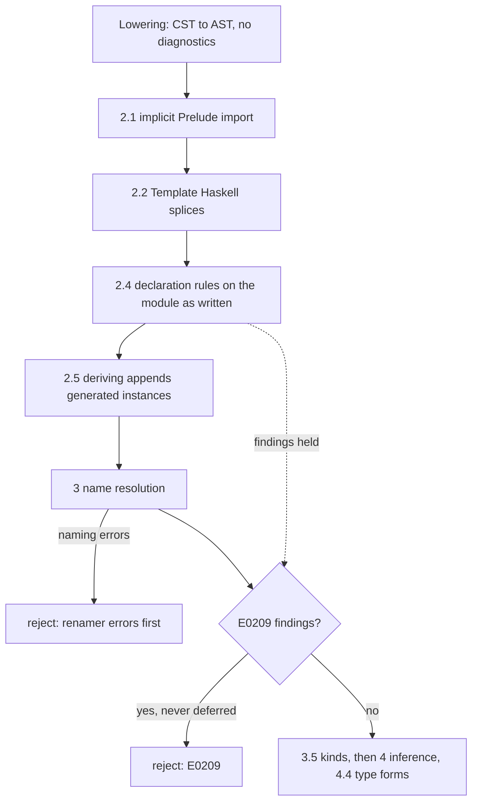

<!-- For God so loved the world, that he gave his only begotten Son, that whosoever believeth in him should not perish, but have everlasting life. — John 3:16 (KJV) -->

# Declaration validity Chirho

GHC judges each declaration's written shape before using it. Haskelujah's type-form checks
(`GHC-91510`, Phase 4.4) are one family of those rules; this phase holds the
declaration-shape family (row 683). The code is
`crates/haskelujah-typing-chirho/src/validity_chirho/declarations_chirho.rs`, and every
finding is reported as `E0209`.

## Rules

1. A named Haskell 98 newtype constructor has exactly one field (`GHC-23517`). A record
   counts field names. Lowering's empty-name placeholder is never judged: it stands for a
   constructor lowering could not read (`newtype N = (:|) Int`, which GHC accepts).
2. A GADT-syntax newtype constructor has no context in its own signature (`GHC-17440`).
   A context inside an argument is a rank-N field, which GHC allows.
3. One written instance body binds each name once (`GHC-10498`). Lowering already merges
   adjacent equations, so a repeat was written apart. Signatures are not bindings.
4. A default signature has a default binding (`GHC-59794`). Lowering extracts only
   `default name ::` signatures, so an operator's default signature is not judged.
5. A named Haskell 98 newtype constructor's field has no strictness annotation
   (`GHC-04049`): `!`, UNPACK and `~` alike, at any `StrictData` setting. As in GHC, it is
   judged only once rule 1 holds.
6. A data constructor field's lazy annotation (`~T`) needs `StrictData`, or `Strict`, which
   implies it (`GHC-81601`). The flags are read in GHC's order: the last mention wins, and
   `NoStrict` leaves `StrictData` as it was.
7. to 16. Deriving strategies, the extensions they need and the classes they derive
   (`deriving_strategy_chirho.rs`, row 694; see `deriving-strategies-chirho.md`).
17. A role annotation writes only `nominal`, `representational`, `phantom` or `_`
    (`GHC-09009`, a parse error in GHC). One unknown word anywhere stops every later rule.
18. A role annotation lists one role per visible parameter of its data type, newtype or class
    (`GHC-54298`). One that does not is judged no further, and role inference ignores it, as
    GHC's does.
19. Each written role is at least the role inference proves for its parameter
    (`GHC-29178`). Inference starts from the written role and only raises it, so a written
    role below the final one is contradicted by the declarations. Against a role the module
    cannot prove (Unknown: an imported or qualified constructor, a synonym, a GADT) the
    annotation is a named Unsupported gap, never GHC's mismatch. A class's parameters start
    nominal unless written otherwise, and then its superclasses, methods and associated
    families raise them (`local_class_roles_chirho`, GHC's `irClass`).
20. A type takes one role annotation (`GHC-97170`, reported at the repeat).
21. The target is a type or class this module declares: a data type, newtype, class,
    synonym or family (`GHC-44432` for an undeclared or an imported one). A qualified
    target is a named Unsupported gap. Rules 20 and 21 are GHC's renamer: an error in
    either stops rules 18, 19 and 22 to 24.
22. The module has RoleAnnotations (`GHC-17779`), and the other rules still run. GHC2024
    implies it, GHC2021 does not, and only the last edition counts (`GHC2024` then
    `GHC2021` is GHC2021).
23. A synonym or a type family takes no roles (`GHC-77192`). An associated family's
    annotation is a named Unsupported gap: no measurement covers it.
24. A class parameter's final role is nominal unless IncoherentInstances is on
    (`GHC-18273`). Against an Unknown final role it is a named Unsupported gap.

Rules 17 to 24 judge every annotation, whether or not a GND request reads its roles, on the
`DeclChirho::RoleAnnotationDeclChirho` lowering keeps with every word as written, an
operator target in parentheses (`(:-)`) and a qualified one included. Lowering never
rewrites an annotation. root measured RA1 to RA4 with GHC 9.14.1
(`role-annotation-r1-chirho`, #31844) and RX1 to RX9, Claude's role surfaces
(`role-surfaces-and-direct-gnd-r1-chirho`, #31865): every refusal above and the GHC2024 and
nominal-class twins, which print 8.

Rule 4 depends on lowering reading the whole class body. `collect_instance_methods_chirho`
ends its walk at the first non-method member after a method, a defence against sibling
declarations leaked by layout. Row 683 held the rule because a legal fixity declaration
ended the walk and lost a default binding written after it (#30830). Row 685 admits a
fixity declaration whose operators are all names the class body declares (its method
signatures and associated families, read from every member first, so the fixity may precede
them, as in T10816). Every other non-method member still ends the walk. An instance body
admits no fixity: GHC 9.14.1 rejects one there ("misplaced fixity signature"), and that
program stays a residual boundary.

## Explicit lazy fields, not the StrictData default

Rules 5 and 6 read the field annotation lowering keeps. The CST reads a `~` before a field
type as it reads `!`, and lowering records `StrictnessChirho::ExplicitLazyChirho` apart from
the unannotated default, leaving the type without the `~`. A `~` inside a record field's type
is type equality and stays in the type. Every strictness consumer asks
`is_strict_chirho()`, so an explicitly lazy field stays lazy in desugaring and in the
required-strict-field checks (`GHC-95909`, tcfail112).

This is the explicit override only. The module-wide `StrictData` default, which makes
unannotated fields strict, is not implemented: those fields stay lazy, and only rule 6 reads
the extension. A GADT constructor's arguments carry no strictness, so a `~` there is not
judged (L07 is GHC-valid and unclaimed).

## Why the rules run before deriving and report after naming

Deriving appends generated instances to the same declaration list. Judging after it
would treat a derived `Typeable` or generated method list as written. Reporting after name
resolution keeps GHC's order: a renamer error is reported before a validity error.

## Boundaries

- Shapes lowering drops are not judged: a Haskell 98 constructor's `forall` and context,
  a missing newtype constructor, class-body bindings without a signature, instance pattern
  bindings and operator-class heads. They wait on the AST
  (`spec-chirho/bug-existential-constructor-scope-dropped-chirho.md`).
- Special-class instances, deriving eligibility and the DatatypeContexts head name are
  outside this phase.
- An associated family's role annotation and a qualified target are refused as named gaps,
  not judged: no GHC measurement covers them.

## Controls

Typing unit tests on hand-built AST sit beside the rules. Driver controls live in
`tests/typing_integration_chirho/declarations_chirho/declaration_validity_chirho.rs`:
negatives through the frontend, should_compile files that check clean, and direct
validator tests on the AST lowering really produces. The explicit lazy field controls,
GHC-measured programs embedded byte for byte, live in `lazy_fields_chirho.rs` beside it.
