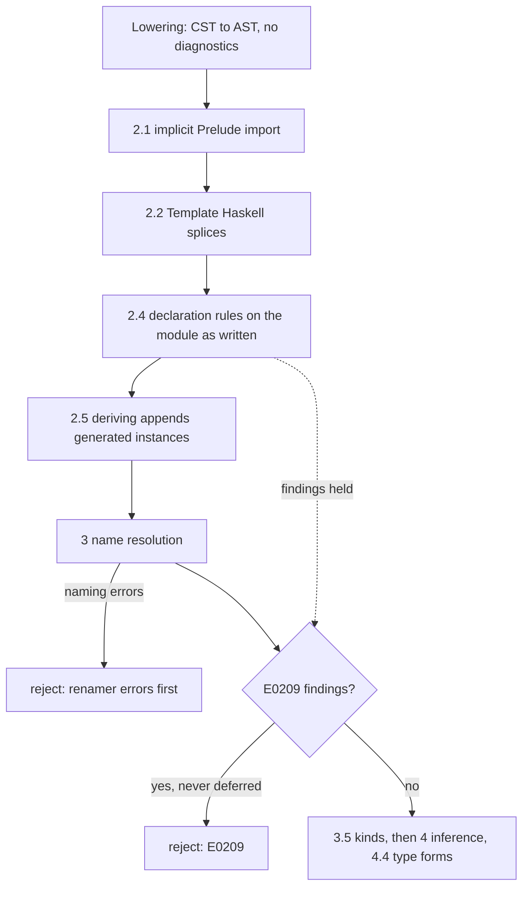

<!-- For God so loved the world, that he gave his only begotten Son, that whosoever believeth in him should not perish, but have everlasting life. — John 3:16 (KJV) -->

# Declaration validity Chirho

GHC judges each declaration's written shape before using it. Haskelujah's type-form checks
(`GHC-91510`, Phase 4.4) are one family of those rules; this phase holds the
declaration-shape family (row 683). The code is
`crates/haskelujah-typing-chirho/src/validity_chirho/declarations_chirho.rs`, and every
finding is reported as `E0209`.

## Rules

1. A named Haskell 98 newtype constructor has exactly one field (`GHC-23517`). A record
   counts field names. Lowering's empty-name placeholder is never judged: it stands for a
   constructor lowering could not read (`newtype N = (:|) Int`, which GHC accepts).
2. A GADT-syntax newtype constructor has no context in its own signature (`GHC-17440`).
   A context inside an argument is a rank-N field, which GHC allows.
3. One written instance body binds each name once (`GHC-10498`). Lowering already merges
   adjacent equations, so a repeat was written apart. Signatures are not bindings.

A fourth rule, a default signature needs a default binding (`GHC-59794`), is held (#30831).
`collect_instance_methods_chirho` stops reading a class body at the first non-method member
after a method, such as a fixity declaration. A default binding written after one is lost,
while the default signature is read separately from the CST, so the rule would reject
programs GHC accepts. It returns with the unit that repairs that member walk; its source
and controls are kept as receipts.

## Why the rules run before deriving and report after naming

Deriving appends generated instances to the same declaration list. Judging after it
would treat a derived `Typeable` or generated method list as written. Reporting after name
resolution keeps GHC's order: a renamer error is reported before a validity error.

## Boundaries

- Shapes lowering drops are not judged: a Haskell 98 constructor's `forall` and context,
  a missing newtype constructor, class-body bindings without a signature, instance pattern
  bindings and operator-class heads. They wait on the AST
  (`spec-chirho/bug-existential-constructor-scope-dropped-chirho.md`).
- Special-class instances, deriving eligibility and the DatatypeContexts head name are
  outside this phase.

## Controls

Typing unit tests on hand-built AST sit beside the rules. Driver controls live in
`tests/typing_integration_chirho/declarations_chirho/declaration_validity_chirho.rs`:
negatives through the frontend, should_compile files that check clean, and direct
validator tests on the AST lowering really produces.
