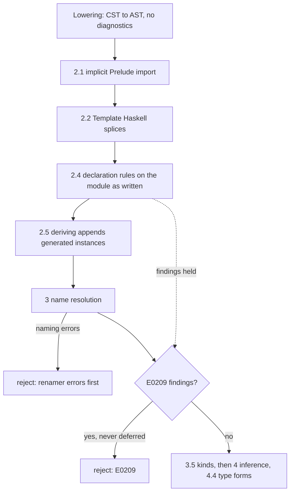

<!-- For God so loved the world, that he gave his only begotten Son, that whosoever believeth in him should not perish, but have everlasting life. — John 3:16 (KJV) -->

# Declaration validity Chirho

GHC judges each declaration's written shape before using it. Haskelujah's type-form checks
(`GHC-91510`, Phase 4.4) are one family of those rules; this phase holds the
declaration-shape family (row 683). The code is
`crates/haskelujah-typing-chirho/src/validity_chirho/declarations_chirho.rs`, and every
finding is reported as `E0209`.

## Rules

1. A named Haskell 98 newtype constructor has exactly one field (`GHC-23517`). A record
   counts field names. Lowering's empty-name placeholder is never judged: it stands for a
   constructor lowering could not read (`newtype N = (:|) Int`, which GHC accepts).
2. A GADT-syntax newtype constructor has no context in its own signature (`GHC-17440`).
   A context inside an argument is a rank-N field, which GHC allows.
3. One written instance body binds each name once (`GHC-10498`). Lowering already merges
   adjacent equations, so a repeat was written apart. Signatures are not bindings.
4. A default signature has a default binding (`GHC-59794`). Lowering extracts only
   `default name ::` signatures, so an operator's default signature is not judged.
5. A closed type-family equation is complete (`GHC-58481`), headed by a type constructor
   (`GHC-47568`) that names its own family (`GHC-88221`), with the declared number of
   visible arguments (`GHC-12985`). The code is `validity_chirho/family_equations_chirho.rs`.

Rule 5 reads the equation carrier row 686 added. The CST gives each closed equation its own
node and parses its left side as a type, so lowering finds the written head in every form
GHC accepts: prefix, infix (with the module's fixities, even when declared after the family),
`(op)` prefix, backtick, a parenthesized partial head `(F a) b`, and a head qualified by the
module's own name. The AST keeps that head, the arguments in order, the explicit `forall`
binders as full `TyVarChirho`s, the binders the left side never uses (read from the CST
before pattern kinds are erased), a malformed flag and a span per equation. An unbound
head is a naming error first, as in GHC's renamer. An equation that is malformed, headless or
binds an unused name is held: registration stops at the first held equation, so no later
closed equation reduces in its place. GHC's unused-binder error (`GHC-30337`) is not a rule
here; the hold keeps such a program refused rather than newly accepted.

The right side may carry a kind annotation, as GHC's KindSigs writes `Foo a = Int :: Type`.
It parses as one kind-annotated type. A `::` with no kind after it leaves the equation
incomplete, as GHC rejects it.

The arity check counts the header's binders, so the header keeps every one. A binder whose
kind the binder kind grammar cannot read, such as `(e :: Either a b)`, stays unannotated and
its whole parenthesized group is skipped. Its `::` is then never taken for the result-kind
marker, and the binders after it survive (row 686, H01).

Rule 4 depends on lowering reading the whole class body. `collect_instance_methods_chirho`
ends its walk at the first non-method member after a method, a defence against sibling
declarations leaked by layout. Row 683 held the rule because a legal fixity declaration
ended the walk and lost a default binding written after it (#30830). Row 685 admits a
fixity declaration whose operators are all names the class body declares (its method
signatures and associated families, read from every member first, so the fixity may precede
them, as in T10816). Every other non-method member still ends the walk. An instance body
admits no fixity: GHC 9.14.1 rejects one there ("misplaced fixity signature"), and that
program stays a residual boundary.

## Why the rules run before deriving and report after naming

Deriving appends generated instances to the same declaration list. Judging after it
would treat a derived `Typeable` or generated method list as written. Reporting after name
resolution keeps GHC's order: a renamer error is reported before a validity error.

## Boundaries

- Shapes lowering drops are not judged: a Haskell 98 constructor's `forall` and context,
  a missing newtype constructor, class-body bindings without a signature, instance pattern
  bindings and operator-class heads. They wait on the AST
  (`spec-chirho/bug-existential-constructor-scope-dropped-chirho.md`).
- Special-class instances, deriving eligibility and the DatatypeContexts head name are
  outside this phase.

## Controls

Typing unit tests on hand-built AST sit beside the rules. Driver controls live in
`tests/typing_integration_chirho/declarations_chirho/declaration_validity_chirho.rs`:
negatives through the frontend, should_compile files that check clean, and direct
validator tests on the AST lowering really produces.
