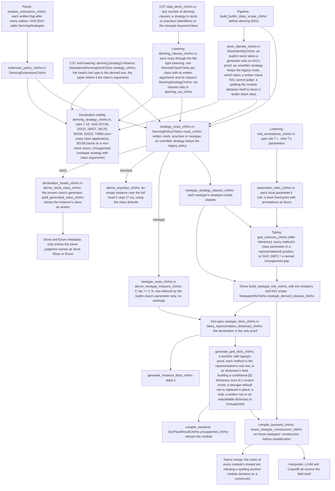

<!-- For God so loved the world, that he gave his only begotten Son, that whosoever believeth
in him should not perish, but have everlasting life. — John 3:16 (KJV) -->

# Deriving strategies workflow

Row 694 (D01). `newtype AgeChirho = AgeChirho Int deriving newtype Show` must print `7`, as
GHC 9.14.1 does, never the stock `AgeChirho 7`. A deriving clause therefore keeps its
strategy for every class it lists, an explicit strategy chooses the deriving mechanism, and a
newtype that takes a class through the newtype strategy (GND) shares its representation's
dictionary and its representation itself.

## Rules

- An explicit `newtype` never falls back to a stock instance. On a data type it derives
  nothing and declaration validity reports GHC-10333.
- A written instance with a context on a newtype head (`instance Show Int => Show Wrap`) is
  not GND: only the newtype's own deriving declarations put a class in
  `newtype_derived_classes_chirho`, so the dictionary pass never replaces its methods.
- A GND head drops the trailing variables the class's last parameter needs, read from the
  builtin class scope naming proved: `Functor`, `Applicative` and `Monad` drop one. A local or
  imported source class keeps the full head, as before.
- A class keeps its written arguments. The anyclass route derives `C args (T vs)` through the
  ordinary multi-parameter instance path. The stock generators and the GND dictionary write one
  head type, so declaration validity refuses a class applied to arguments there: GHC-73993 for a
  stock class, which takes none, and Unsupported for the newtype strategy. GHC accepts the
  latter (W3 prints `MeterChirho 12`), so it is a compatibility gap, not GHC coverage.
- An explicit `stock` runs the generator of the builtin class K01 proved for the written
  spelling, and names the instance's class as written, so `deriving stock (P.Eq)` under a
  qualified Prelude import is the Prelude's `Eq`. `deriving stock (Eq)` beside a local
  `class Eq`, or a proven builtin class GHC does not derive that way, is GHC-00158. K01
  excludes a source re-export as well as a local declaration, so an exclusion is neither a
  disproof nor an authority: every other unproven spelling (an imported or re-exported source
  class, Read, Generic) is a named Unsupported gap (#31786). An unwritten strategy keeps the
  legacy route, which takes a written name K01 cannot judge.
- The native backends box an ordinary constructor as a tag word plus its fields. Only the
  constructors of newtypes with a newtype-routed class are erased from Core; every other
  newtype keeps its native representation.

- A newtype takes its representation's method rows only with a typed proof, per (newtype,
  class), that every method's class parameter stands where a coercion may change it: directly,
  under `->`, a list or a tuple, as an eta-reduced head, or under a local type's
  representational parameter. A local nominal parameter is GHC-18872 (R1, R2 measured); a
  position whose role the module cannot prove (another named constructor, a family, a type
  variable's application, a constraint), an associated family (R5) or a multi-parameter class
  is a named Unsupported gap. A method that never mentions the parameter proves (R4).
- The alias loop requires typing's proof and never aliases a generated missing-method stub.
  A representation's method is its real row, or its dictionary's field; for a list
  representation whose class instance is conditional, the existing list machinery builds the
  `[E]` dictionary once `E`'s context dictionaries exist, which may be another GND newtype's
  (`[Age]`), so a worklist, not pass or table order, decides. The desugarer names the rows it
  fills from class defaults, and only those are replaced; anything unbuildable is a compile
  error. The list machinery finds a list instance's rows under the variable its head is
  written with (`[aChirho]`).
- One builtin class K01 proves has at most one instance for a type's whole head, however each
  spells it (`P.Show` and `Show`): GHC-59692, measured.
- Root's fresh GHC 9.14.1 contracts (A1-A3, B1-B4, C1-C5, D1-D2, O1-O4) pin the policy: a
  written strategy needs DerivingStrategies or DerivingVia; anyclass needs DeriveAnyClass; an
  unwritten non-stock class needs DeriveAnyClass, or GND on a newtype; DeriveAnyClass wins over
  GND (warning GHC-20042); the last edition decides, and a written flag beats any edition.
- Each module erases its own GND-represented constructors; the native merge erases the union in
  every module, and refuses by name a spelling another module also declares as a constructor.

## Residuals

- A standalone `deriving via` keeps its existing route.
- The newtype strategy for a class applied to arguments (W3) waits for a dictionary key that
  names every head type.
- Typing still keys classes by unqualified name, so a module with a local `class Eq` and the
  Prelude's `Eq` in one program is not yet told apart past deriving (S2's end-to-end run).
- Generated method bodies name their helpers unqualified, so a module that hides or qualifies the
  Prelude's `==`, `&&` or `showString` gives them its own binding.
- Classes over a higher-kinded parameter that naming does not prove keep the full GND head.
- GHC2024's additions other than DerivingStrategies belong to the D03 lane.
