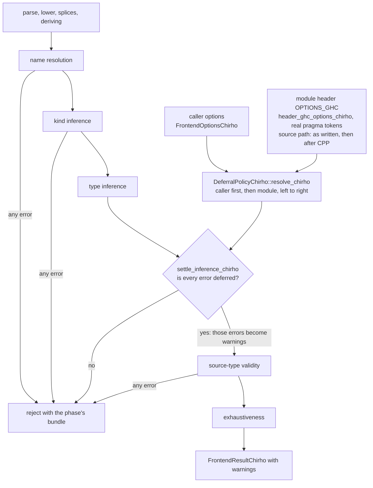

<!-- For God so loved the world, that he gave his only begotten Son, that whosoever believeth in him should not perish, but have everlasting life. — John 3:16 (KJV) -->

# Error deferral Chirho

Row 695. A typed hole is an error by default, as in GHC (GHC-88464). Three independent GHC switches can turn particular inference errors into warnings. Every other error stops the module.

## Rules

- `-fdefer-type-errors` turns on all three switches: type errors, typed holes and out-of-scope variables.
- `-fno-defer-type-errors` turns off only the general switch.
- `-fdefer-typed-holes` and `-fdefer-out-of-scope-variables`, and their `-fno-` forms, change only their own category.
- Options apply left to right. With `-fdefer-type-errors -fno-defer-typed-holes` (T9497d) the hole stays an error. With the reverse order it defers.
- The caller's options come first, then the module header's `OPTIONS_GHC` (and legacy `OPTIONS`) pragmas.
- Header pragmas come from real pragma tokens, read only until the first token that is neither a pragma nor a comment. A flag in a comment, in a string literal, or in a pragma after `module` is not an option.
- On the source path that runs CPP (`typecheck_source`, `compile_source`, `eval_source`), the header is read twice, both times after the caller's options:
  - first as written, before preprocessing, so CPP cannot drop one of its options;
  - then after preprocessing, as GHC re-reads the pragmas once CPP has run, so an `OPTIONS_GHC` that CPP selects applies too.
- Direct frontend callers read the header of the text they pass in.
- Option words follow GHC's `toArgs`:
  - A word that starts with `"` is a Haskell string literal, read without its quotes. Only `\"` and `\\` are decoded.
  - A quoted part inside a word keeps its quotes and may hold spaces.
  - Single quotes are ordinary characters: GHC accepts `"-fdefer-typed-holes"` and rejects `'-fdefer-typed-holes'`.
  - A body GHC cannot read, such as an unterminated or misplaced quote, gives no options.
- An unbound unqualified `_` or `_name` in an expression is a hole (E0210).
  - A bound `_name` is an ordinary variable.
  - A qualified spelling is an unbound variable.

## What can defer

Only inference errors whose code the typing crate names as deferrable:

| Switch | Codes |
|---|---|
| typed holes | E0210 |
| out-of-scope variables | E0202 (unbound variable) |
| type errors | E0200 mismatch, E0201 occurs check, E0203 tuple arity, E0204 unsatisfied constraint, E0205 signature mismatch |

Other errors stay fatal under every switch:

- **Inference codes:**
  - E0206 record field;
  - E0207 strict field;
  - E0208 pattern signature;
  - E0211 unbound record constructor;
  - E0212 duplicate instance;
  - E0213 signature-converter invariant;
  - E0214 `RecordWildCards` field with no variable in scope;
  - uncoded errors.
- **Whole phases:** name resolution, kind inference, declaration and source-type validity, and exhaustiveness.

E0211 to E0214 were separated from the deferrable E0202, E0204, E0205 and E0200, because no GHC switch defers any of them.

## Boundaries

- **Qualified out-of-scope names:** a qualified out-of-scope name (`Q.x`, name resolution's E0100) never defers. GHC defers such a variable under `-fdefer-out-of-scope-variables`, but E0100 also covers data constructors, which GHC never defers.
- **CPP-selected options:** an `OPTIONS_GHC` that only a header `#if` selects is read from the preprocessed text alone. Whether CPP runs at all is still decided by the existing line heuristic.
- **Option word forms not modeled:**
  - the `["..."]` list form that GHC also reads;
  - Haskell escapes other than `\"` and `\\`.
- **`-X` extensions:** the `-X` words of an `OPTIONS_GHC` pragma still split on whitespace, so a quoted `-X` word names no extension.
- **Unreadable pragmas:** a malformed or unknown option does not reject the module as GHC does; it is simply not a switch.
- **No runtime claim:** a deferred module compiles. Evaluating a deferred hole, unbound variable or type error does not raise GHC's deferred runtime error; it does whatever the existing lowering does.
- **Callers without options:**
  - The CLI, multi-module and dependency-package builds pass no caller options; only the module header's pragmas apply there.
  - Warning-only flags such as `-fno-warn-typed-holes`, and `-Werror`, are not modeled.
- **Corpus harness:** the directory-label corpus harness applies no `all.T` options. Should-compile hole tests whose `all.T` passes `-fdefer-typed-holes` or `-fdefer-type-errors` become nominal rejects there. That is a harness boundary, not compiler behavior.

## Controls

- `tests_chirho/extensions_chirho/deferral_flags_chirho.rs`: flag implications, both orders, caller-then-module precedence, unrelated options, header option words, quoted option words, and fake flags in comments, strings and misplaced pragmas.
- `tests_chirho/extensions_chirho/typed_hole_policy_chirho.rs`: end-to-end checks on typed `main :: IO ()` programs:
  - default `_` and `_missing` rejection;
  - bound `_x`;
  - deferred unused-hole execution;
  - both flag orders;
  - module-over-caller precedence;
  - fake flags;
  - category separation;
  - kind, duplicate-instance and record-constructor errors that stay fatal;
  - a CPP module's header options on the source path;
  - double- versus single-quoted switches.
- The three earlier `typed_hole_*` tests in `extensions_chirho.rs` keep their sources and expectations and now ask for `-fdefer-typed-holes` explicitly. Their unsigned `main = 42` keeps any inherited row 692 numeric-entry failure as it was.
