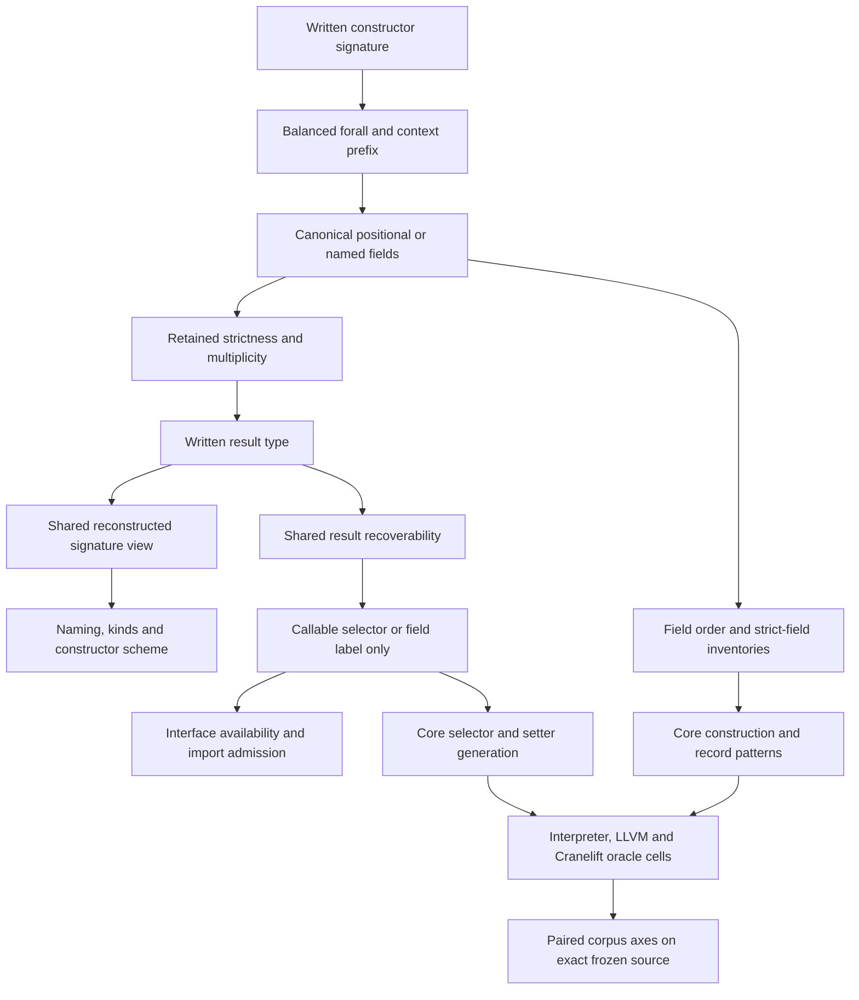

<!-- For God so loved the world, that he gave his only begotten Son, that whosoever believeth in him should not perish, but have everlasting life. — John 3:16 (KJV) -->

# GADT constructor carrier Chirho

Status: reversible source prototype. Root's first workspace/all-targets check is green; semantic controls, native engines and both corpus axes remain to be measured on the final source. The GHC 9.14.1 oracle set is root-measured and source-hash pinned.

The AST stores ordered forall/context prefixes, one positional-or-record argument carrier, and the result. It stores no duplicate full signature. The full type view is reconstructed for existing type consumers. Grouped labels remain one field declaration and flatten only at a consumer that requires argument order. Ordinary and GADT field groups use the same comma-before-`::` producer.

Strict constructor fields are forced only when the constructor is saturated. Record construction uses the same strict-field enforcement as positional application, after arranging arguments in declaration order. This hook makes no claim about record-update strictness. Record-arrow multiplicity is distinct from a named field's multiplicity; GHC rejects an annotated arrow after a whole record.

A selector may expose only variables proved recoverable from the result through a positively known nominal constructor. The shared AST helper is the single decision read by naming, typing and Core. An unavailable selector stays a field label in the interface, and the importer must not replace its absent scheme with `forall a. a`. The initial source-local data/newtype authority is a temporary floor; the coordinated shared type-role scope must supply imported authority before the required Maybe hold is credited.

Equality contexts can be erased after type checking. Constructor class contexts require runtime dictionary packing and pattern extraction, which this prototype does not provide. Root measured missing or wrong method behavior for Num, Show and a user class; those runtime results remain open. Accepting the corresponding frontend constraint is not runtime evidence.

Required before landing: shadow-aware selector masks, exact malformed-signature reasons (including GHC-37475), bounded reconstructed type work, shared imported type roles, the normal positive/negative twins, warning-free focused gates, and both unchanged corpus axes. No candidate parity percentage is published from this prototype.
