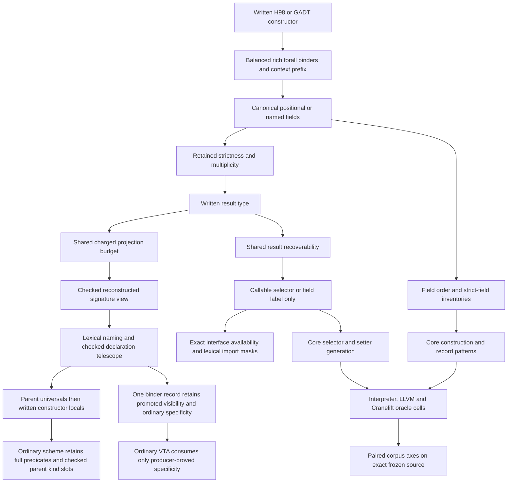

<!-- For God so loved the world, that he gave his only begotten Son, that whosoever believeth in him should not perish, but have everlasting life. — John 3:16 (KJV) -->

# GADT constructor carrier Chirho

Status: reversible source prototype. Root's first workspace/all-targets check is green; semantic controls, native engines and both corpus axes remain to be measured on the final source. The GHC 9.14.1 oracle set is root-measured and source-hash pinned.

Haskell 98 positional, infix and record syntax uses one prefix producer before choosing a constructor form. Its existing `ConPrefixChirho` stores full `TyVarChirho` binders, their kind annotations and specificity, the context, an explicit-empty-forall mark and an unread mark. Naming checks actual binders and restores their lexical scope; source spans and extension presence do not invent an existential binder. A context without `forall` may use already-bound datatype parameters.

An ordinary constructor scheme places the actual datatype universals before written constructor locals. The reconstructed result uses every slot of the checked parent catalogue, including hidden kind arguments, with its canonical owner; placeholder spellings cannot supply or capture a slot. Parent binder kinds and constructor syntax use the same charged projection allowance before cloning. Ordinary type application and type-level promotion may expose different binders, so `DeclarationBinderChirho` retains ordinary specificity on the same canonical slot separately from promoted visibility. Publication and instantiation preserve the scalar; absent producer proof remains absent. Constructor contexts feed the existing wanted/given machinery. Generalization refuses a fixed predicate head only when the actual complete class records rule out every instance; open heads, unknown records and non-ground predicates under givens remain unproved.

The AST stores ordered forall/context prefixes, one positional-or-record argument carrier, and the result. It stores no duplicate full signature. The full type view is reconstructed for existing type consumers. Grouped labels remain one field declaration and flatten only at a consumer that requires argument order. Ordinary and GADT field groups use the same comma-before-`::` producer.

Strict constructor fields are forced only when the constructor is saturated. Record construction uses the same strict-field enforcement as positional application, after arranging arguments in declaration order. This hook makes no claim about record-update strictness. Record-arrow multiplicity is distinct from a named field's multiplicity; GHC rejects an annotated arrow after a whole record.

A selector may expose only variables proved recoverable from the result through a positively known nominal constructor. The shared AST helper is the single decision read by naming, typing and Core. The header-only shared type-constructor scope supplies producer-backed local and imported roles, including nominal data families. Unknown and synonym-family roles prove nothing. The structured source-driver entry supplies that scope; the scope-free compatibility APIs remain conservative and do not claim selector closure.

An unavailable selector stays a field label in the interface, and the importer must not replace its absent scheme with `forall a. a`. One environment entry is either a value or a mask. Exact imported spellings are masked, lexical values replace their own mask, and a mask prevents an outer or suffix fallback from resurrecting the same name. Qualified Prelude calls retain their own spelling. An imported label's availability does not settle independent ambiguity rules.

Before reconstruction or grouped-field expansion, the shared AST budget charges stored input, names and transport metadata, checked output amplification and depth. Ordinary constructor headers and record accessor generation use adapters to the same budget; Core's accessor adapter charges its quadratic generated output. A failed budget poisons the stream. Resource errors and retained malformed-signature reasons are separate, and source iface, Core and TH APIs return the named error without publishing a partial value. GHC-37475 describes an illegal arrow after a record; a compiler resource boundary has no invented GHC code.

Equality contexts can be erased after type checking. Constructor class contexts require runtime dictionary packing and pattern extraction, which this prototype does not provide. Root measured missing or wrong method behavior for Num, Show and a user class; those runtime results remain open. Accepting the corresponding frontend constraint is not runtime evidence.

Root's fresh selector oracle rejected the original top-level `head` shadow, unqualified imported `head` record labels, and equality-recovered existential selector probes. Those intended positives remain unchanged as measured negatives. Separate qualified corrections print 42 and 17. The required Maybe and qualified-Maybe oracle holds both print 4; candidate execution is still pending.

An inner field forall retains free variables from its binder kinds. A result binder also determines its directly written kind, with a charged, transitive worklist over actual constructor telescope binders. Structural arrow kinds decompose; an applied or unknown kind supplies no injectivity proof. Root measured an escaping existential kind as rejected and both result-determined and field-local quantified kinds as accepted.

GHC's TH declaration view intentionally projects field arrows into `BangType`: Many, One and a multiplicity variable therefore yield the same field representation. The shared full-type converter preserves `MulArrowT` and visible-forall types for complete constructor-type observations. GHC rejects a visible constructor forall in declaration reification with GHC-75721; a TH-specific error reports that representational boundary without marking the source AST malformed. Initial TH oracle definitions failed at their missing declaration-group barrier and remain preserved beside the separate corrected definitions.

Required before landing: compile and run the source-only masks, typed malformed reasons, bounded projection and imported-role integration; run the normal positive/negative twins, warning-free focused gates and both unchanged corpus axes. TH declaration projection and the complete constructor type are distinct external observations; no rejection is added merely because the declaration representation lacks an arrow slot. No candidate parity percentage is published from this prototype.
