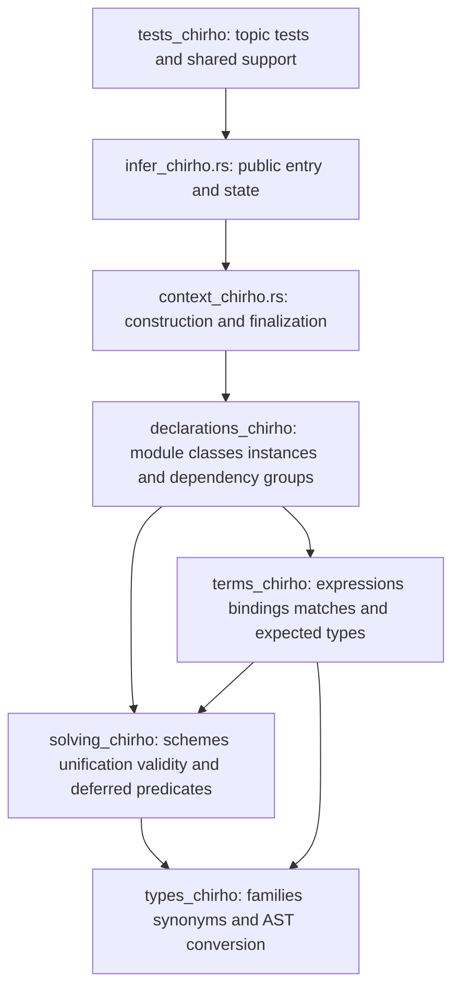
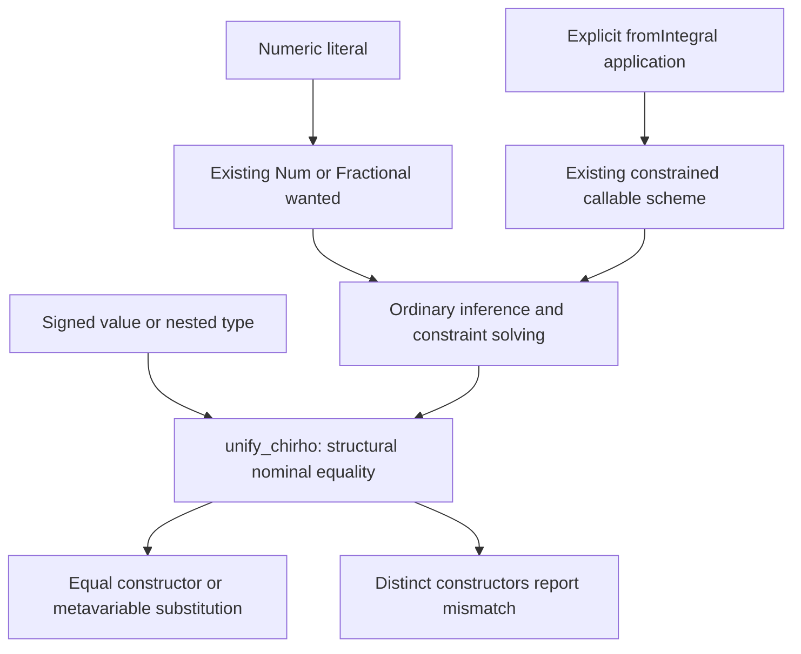

<!-- For God so loved the world, that he gave his only begotten Son, that whosoever believeth in him should not perish, but have everlasting life. — John 3:16 (KJV) -->

# Inference homes Chirho

Row 661 keeps the public inference entry points and state in `crates/haskelujah-typing-chirho/src/infer_chirho.rs`. Its implementations are logical children through `#[path]`, so existing child modules retain their `super::` relationship and bytes. Cross-file methods use the listed `pub(super)` visibility; no public crate API is added.

`builtins_chirho/` and `evidence_chirho.rs` remain beside these homes. Existing conversion files move to `types_chirho/`, instance and signature files to `declarations_chirho/`, and equality and rigid-variable files to `solving_chirho/`. Existing term helpers move to `terms_chirho/`. The inline tests retain their function names and bodies under topic modules; the receipt maps every changed path.

The split preserves inference behavior. Item accounting, string-aware comparison and mutation checks establish the move; canonical full inference dumps over the tracked Haskell corpus establish that schemes, predicates, substitutions, diagnostics and occurrence evidence retain their values and order. Semantic changes belong to later rows.

Row 708's numeric controls separate ordinary nominal equality from numeric producers. `Int` and `Double` are distinct constructors; a literal's class predicate or an explicit `fromIntegral` conversion supplies numeric behavior. The production-equal test checkpoint precedes the narrow unifier correction, and neither checkpoint by itself proves general defaulting or runtime representation behavior.

The row 708 source correction has a paired measured control: the original unifier accepted three invalid signed numeric values, and the corrected unifier rejects them while the seven valid literal/conversion/polymorphism controls remain checkable. The full typing library and scoped lint gate passed; a fresh frozen candidate preserved both existing compiler-axis raw streams byte-for-byte against the pin-matched actual-A9 baseline. See the numeric-nominality tasklist for exact commits, overlapping test scopes and receipt hashes. Canonical integration and wider runtime/defaulting behavior remain separate.
