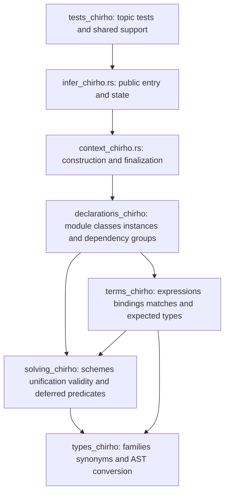

<!-- For God so loved the world, that he gave his only begotten Son, that whosoever believeth in him should not perish, but have everlasting life. — John 3:16 (KJV) -->

# Inference homes Chirho

Row 661 keeps the public inference entry points and state in `crates/haskelujah-typing-chirho/src/infer_chirho.rs`. Its implementations are logical children through `#[path]`, so existing child modules retain their `super::` relationship and bytes. Cross-file methods use the listed `pub(super)` visibility; no public crate API is added.

`builtins_chirho/` and `evidence_chirho.rs` remain beside these homes. Existing conversion files move to `types_chirho/`, instance and signature files to `declarations_chirho/`, and equality and rigid-variable files to `solving_chirho/`. Existing term helpers move to `terms_chirho/`. The inline tests retain their function names and bodies under topic modules; the receipt maps every changed path.

The split preserves inference behavior. Item accounting, string-aware comparison and mutation checks establish the move; canonical full inference dumps over the tracked Haskell corpus establish that schemes, predicates, substitutions, diagnostics and occurrence evidence retain their values and order. Semantic changes belong to later rows.
