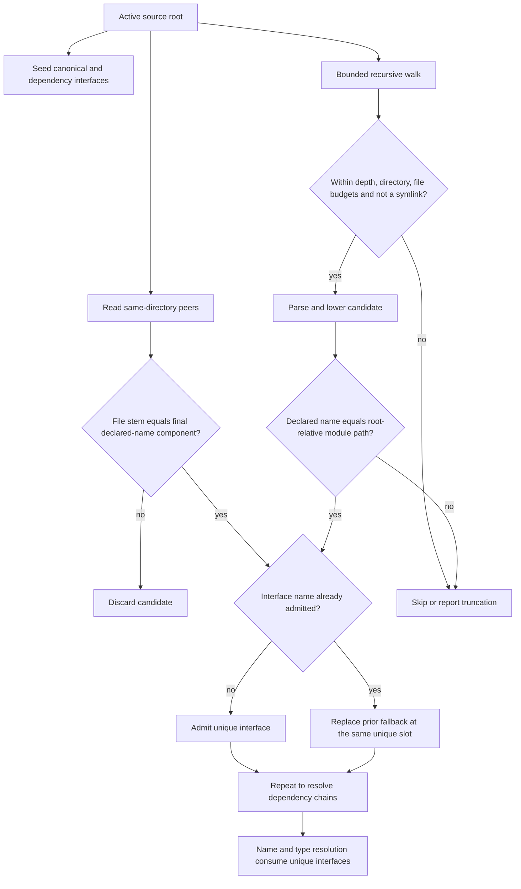
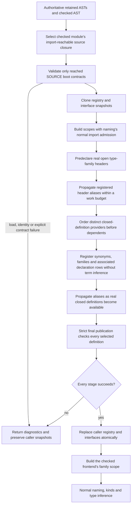

<!-- For God so loved the world, that he gave his only begotten Son, that whosoever believeth in him should not perish, but have everlasting life. — John 3:16 (KJV) -->
# Module-search authority workflow

The filesystem walk discovers candidates; it does not make them modules. Authority comes from the active source root, the candidate's path, its declared module name, and uniqueness among interfaces already admitted.

## Discovered source family declarations

The two search-path frontends retain each successfully lowered authoritative source AST and its actual discovered path beside its interface. A recovery stub carries no declaration metadata. The AST retains its own origin supply; this pass borrows it and never clones a module or infers its expressions.

- The import closure comes from actual retained `ImportDeclChirho` records. A nearby unimported module cannot supply a family declaration or cause a registration error.
- The import AST preserves the explicit `SOURCE` pragma on its edge. Only a reached SOURCE edge loads `<authoritative-target.hs>-boot`; a nearby unused boot is ignored. The boot must parse and declare the exact target module. The contract check rejects the explicit contradiction between an abstract boot `data S` promise and an explicit actual `type S = ...` declaration. Failure preserves the caller's registry and interfaces.
- File-reading callers supply the checked source's actual path. The CLI preserves that path through file-specific compile and interpreter entry points, including the optional run dumps. The legacy source-string search wrapper has no checked-path authority: a reached SOURCE back-edge requiring that path reports the boundary instead of guessing from the synthetic source name. The existing in-memory evaluation APIs retain their single-module, builtin-interface route. File evaluation uses the file parent as its search root and links only the checked module's Core.
- The checked AST participates in the header stage. This lets an imported companion extend the checked module's open family, including a `SOURCE` cycle. A single closed-definition provider may coexist with open companions; returning to that same provider is not a dependency on a different closed definition.
- Only source AST declarations establish family category and defining identity. An `IfaceTypeChirho` entry or matching spelling never establishes that a type is a family. DATA family headers remain generative ordinary types rather than noninjective type-family definitions.
- Header publication is provisional and private to the cloned snapshots. Its interface omits a family whose real definition is not registered yet, then calls the ordinary strict publisher. It never installs an empty closed definition. Final publication is mandatory after registration and requires every selected target to exist.
- The declaration-only typing adapter reuses the normal family converters and class/instance declaration registration. It receives the same naming-derived family and promotion scopes and imported type-name preferences as the frontend. Constructor, signature and instance-method bodies are not checked here.
- Cold traversal and alias propagation share a work budget. Each alias publication replaces the module's owned alias set rather than cumulatively appending another snapshot.

### Named limits

- Discovery does not yet export a newly discovered sibling's type-synonym RHS into the caller's imported-synonym table. Registration seeds the supplied imported synonyms and the source module's own local synonyms. Source synonym transport needs its own faithful export/import stage.
- Ordering is conservative at module granularity: real import reachability to a distinct module that owns closed families creates a dependency, even if a particular equation does not use those families. A cycle between distinct closed-definition providers reports a registration limitation; it is not asserted to be a GHC rejection. No placeholder replaces either body.
- Associated defaults imported from another source class remain subject to the existing frontend's metadata boundary. This pass does not claim to complete that transport.
- Boot checks are deliberately incomplete: missing declarations in a lowered/spliced AST are not used as refutations; type-synonym equations, value schemes, kinds, roles, data/newtype equivalence and the remaining boot contracts are not compared. The project's existing SCC boot-loading policy is unchanged by this search-path unit.

## Authority contract

- `check_source_path_chirho` uses the checked file's parent as its active root. CLI compilation uses the Cabal `hs-source-dirs` root when available and otherwise the file parent.
- A direct peer may declare a qualified module, but its filename must equal the declaration's final component: `Bar.hs` may declare `Foo.Bar`; `Unrelated.hs` may not silently declare `Prelude` for that directory.
- A recursive candidate must match its complete root-relative path: `Deep/Nested.hs` may declare `Deep.Nested`; `fixtures/Deep/Nested.hs` may not.
- Both full interfaces and panic-recovery stubs pass through the same authority and uniqueness checks. Recovery is not permission to weaken provenance.
- An authoritative source-root module replaces a seeded fallback at that module's existing unique slot. Thus a genuine root-level `Prelude.hs` remains usable, while a nested fixture whose path does not declare `Prelude` never reaches admission.
- The resolver's deliberate newest-interface precedence remains available to explicit callers. Filesystem discovery never supplies duplicate names, preventing first-match and last-match consumers from disagreeing.

## Proof boundary

The declaration-registration controls use real lowered source/import/export syntax and the normal frontend. They cover an imported closed family, a companion extending the checked module's open family, an unrelated unimported source, value versus explicit-type operator exports, closed-family forwarding and atomic failure. These controls do not establish filesystem authority.

A filesystem regression must pass a path with a nonempty parent (an absolute scratch path or `./File.hs`); bare `File.hs` currently yields an empty parent path and does not scan. The focused driver test creates a nested narrow `Prelude.hs`, checks another file through its absolute path, and depends on the seeded Prelude remaining authoritative. Corpus accept/reject changes require the separate frozen-CLI paired-axis measurements; this registration workflow alone is not a compatibility percentage or a fixed-axis gain.
