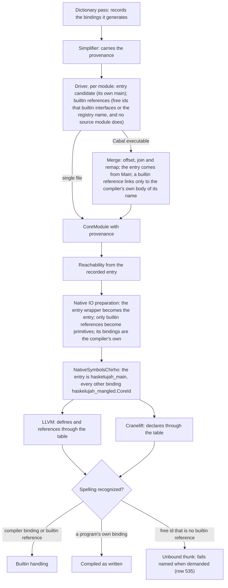

<!-- For God so loved the world, that he gave his only begotten Son, that whosoever believeth in him should not perish, but have everlasting life. — John 3:16 (KJV) -->
# Native symbol identity Chirho

Row 628. The native backends name every top-level binding by its CoreId, and they recognize a spelling only where the provenance allows it. Two modules' `helper`s stay apart, as do `f'` and `f_prime`. A program's own `show` keeps its body, and a dependency's `main` is never the program's entry.

## The symbol table

- `haskelujah_` plus the mangled spelling, then `.` and the CoreId. The mangler alone is not injective: `f'` and `f_prime` both give `haskelujah_f_prime`. The CoreId makes the symbol injective.
- The `.` keeps a binding apart from every symbol a backend writes by name: builtin runtime functions, RTS and libc imports, lifted lambdas and trampolines. None of these contains a `.`.
- The CoreId identifies a binding within one compiled program. It is not an ABI across builds.
- Only the recorded entry keeps `haskelujah_main`, which the C `main` reaches. Foreign exports and imports keep their declared names.

## Provenance

`CoreProvenanceChirho` sits on every `CoreModuleChirho`:

- the entry;
- the compiler's own bindings;
- the builtin references, which are free ids that name a builtin or runtime function.

Producers fill it, and the backends only read it:

- `dict_chirho/rewrite_chirho.rs` records its generated bindings.
- `simplify_module_chirho` carries the provenance.
- `native_link_chirho/native_provenance_chirho.rs` records the entry and the builtin references after simplification. A free id counts as builtin when one of these names it and no source-module interface does:
  - the interfaces of the module's builtin imports;
  - the builtin type environment.
- `merge_compile_results_core_chirho` offsets each module's provenance and joins the modules together. It takes the entry from `Main`, and follows link and dedup renames. A builtin reference links only to the compiler's own body of its name, never to a program's binding.
- `prepare_native_io_actions_chirho` names its wrapper as the entry and records what it generates.

A program's own binding is never recognized by its spelling. A free id that is not a builtin reference takes the unbound route and fails closed.

## Code

- Table and provenance: `haskelujah-core-chirho/src/expr_chirho.rs`.
- Free references: `haskelujah-core-chirho/src/transform_chirho.rs`.
- The merge: `haskelujah-driver-chirho/src/native_link_chirho/core_merge_chirho.rs` (row 634 moved it out of the driver's `lib.rs`).
- LLVM:
  - `toplevel_symbol_chirho` and `recognized_name_chirho` in `codegen_chirho.rs`;
  - the lazy nullary reference in `codegen_chirho/lazy_chirho.rs`.
- Cranelift:
  - declarations in `codegen_chirho.rs`;
  - `recognized_names_chirho` in the lowering context;
  - the `undefined` route in `lower_chirho/failures_chirho.rs` and `lower_chirho/lazy_chirho.rs`.
- Fixtures: `haskelujah-test-harness-chirho/src/fixtures_chirho.rs` records a hand-built module's provenance as its producers would. `native_chirho.rs` builds a multi-module program as one Cabal executable.

## Controls

`haskelujah-driver-chirho/tests/native_symbol_identity_chirho.rs` runs GHC-measured programs on LLVM and Cranelift, each alone with no fallback:

- namesakes in different modules (N2, N4, N8, with N3 as the ordinary control);
- a dependency's `main` (E1-E3);
- a program's own print, show, compare, undefined, putStrLn and getLine (B1-B8, U1);
- a program's own `strcmp` beside string comparison (L5);
- the old mangler's collisions (M1, M2).

Row 629 owns namesakes that resolve by bare name before the backend: interfaces, desugaring and merge linking.
