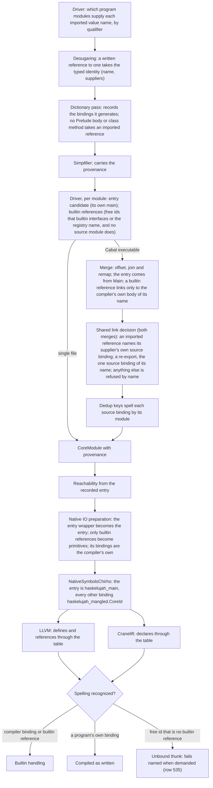

<!-- For God so loved the world, that he gave his only begotten Son, that whosoever believeth in him should not perish, but have everlasting life. — John 3:16 (KJV) -->
# Native symbol identity Chirho

Row 628. The native backends name every top-level binding by its CoreId, and they recognize a spelling only where the provenance allows it. Two modules' `helper`s stay apart, as do `f'` and `f_prime`. A program's own `show` keeps its body, and a dependency's `main` is never the program's entry.

Row 629. A reference to another module of the program names that module's binding, on the interpreter and on both native backends. `A.limit` and `B.limit` stay apart, and a dependency's own `show` stays the user's. A link that would have to guess is refused by name.

## The symbol table

- `haskelujah_` plus the mangled spelling, then `.` and the CoreId. The mangler alone is not injective: `f'` and `f_prime` both give `haskelujah_f_prime`. The CoreId makes the symbol injective.
- The `.` keeps a binding apart from every symbol a backend writes by name: builtin runtime functions, RTS and libc imports, lifted lambdas and trampolines. None of these contains a `.`.
- The CoreId identifies a binding within one compiled program. It is not an ABI across builds.
- Only the recorded entry keeps `haskelujah_main`, which the C `main` reaches. Foreign exports and imports keep their declared names.

## Provenance

`CoreProvenanceChirho` sits on every `CoreModuleChirho`:

- the entry;
- the compiler's own bindings;
- the builtin references, which are free ids that name a builtin or runtime function.

Producers fill it, and the backends only read it:

- `dict_chirho/rewrite_chirho.rs` records its generated bindings.
- `simplify_module_chirho` carries the provenance.
- `native_link_chirho/native_provenance_chirho.rs` records the entry and the builtin references after simplification. A free id counts as builtin when one of these names it and no source-module interface does:
  - the interfaces of the module's builtin imports;
  - the builtin type environment.
- `merge_compile_results_core_chirho` offsets each module's provenance and joins the modules together. It takes the entry from `Main`, and follows link and dedup renames. A builtin reference links only to the compiler's own body of its name, never to a program's binding.
- `prepare_native_io_actions_chirho` names its wrapper as the entry and records what it generates.

A program's own binding is never recognized by its spelling. A free id that is not a builtin reference takes the unbound route and fails closed.

## Code

- Table and provenance: `haskelujah-core-chirho/src/expr_chirho.rs`.
- Free references: `haskelujah-core-chirho/src/transform_chirho.rs`.
- The merge: `haskelujah-driver-chirho/src/native_link_chirho/core_merge_chirho.rs` (row 634 moved it out of the driver's `lib.rs`).
- LLVM:
  - `toplevel_symbol_chirho` and `recognized_name_chirho` in `codegen_chirho.rs`;
  - the lazy nullary reference in `codegen_chirho/lazy_chirho.rs`.
- Cranelift:
  - declarations in `codegen_chirho.rs`;
  - `recognized_names_chirho` in the lowering context;
  - the `undefined` route in `lower_chirho/failures_chirho.rs` and `lower_chirho/lazy_chirho.rs`.
- Fixtures: `haskelujah-test-harness-chirho/src/fixtures_chirho.rs` records a hand-built module's provenance as its producers would. `native_chirho.rs` builds a multi-module program as one Cabal executable.

## Controls

`haskelujah-driver-chirho/tests/native_symbol_identity_chirho/main.rs` runs GHC-measured programs on LLVM and Cranelift, each alone with no fallback:

- namesakes in different modules (N2, N4, N8, with N3 as the ordinary control);
- a dependency's `main` (E1-E3);
- a program's own print, show, compare, undefined, putStrLn and getLine (B1-B8, U1);
- a program's own `strcmp` beside string comparison (L5);
- the old mangler's collisions (M1, M2).

Row 629 owns namesakes that resolve by bare name before the backend: interfaces, desugaring and merge linking.

## Imported reference identity (row 629)

- **The supplier map.** `import_suppliers_chirho` (`native_link_chirho/native_provenance_chirho.rs`) records, for each import of one of the program's own modules, which value names that module supplies.
  - An unqualified import supplies them unqualified and under its qualifier; a qualified import, under its qualifier or alias only.
  - Class methods and constructors are left out: they link through their class and type.
  - A dependency package or a stdlib module brings an interface but no Core, so it supplies nothing here.
- **Desugaring.** `resolve_written_reference_chirho` gives a written reference to a supplied name the identity `ImportedReferenceChirho { name, suppliers }`: one id per identity, recorded in the provenance's `imported_references_chirho`.
- **The dictionary pass** never gives an imported reference a Prelude body (`resolve_or_fresh_id_chirho`, `module_free_id_named_chirho`). Imported references also shadow class methods of their name, as the program's own bindings do.
- **The shared link decision.** Both merges use `ImportLinkerChirho` (`project_chirho/import_links_chirho.rs`): the native one in `core_merge_chirho.rs`, the interpreter's in `multi_module_chirho.rs`.
  - A direct import links to its supplier's own source binding. Compiler bindings are never candidates.
  - A re-export, or one name through several imports, links only to the program's one source binding of that name. Row 642 will record re-export origins and lift this temporary rule.
  - Anything else is refused, naming the reference, its suppliers and the candidate modules: two suppliers defining their own; no definition; several possible origins.
- **Dedup.** The native merge's keys spell each source binding as `module::name`. Bodies that call different modules' bindings never merge, while compiler bindings keep their names and still do.
- **Controls:**
  - `haskelujah-driver-chirho/tests/native_symbol_identity_chirho/import_identity_chirho.rs` (a submodule of row 628's target), on the interpreter, LLVM and true Cranelift: n1 (row 621's p11), n5, n6, a1, x1, x2, x4, r2 and d1 exact; r1 and z1 refused by name; the recorded identities; no Prelude body taking an imported reference.
  - The link decision's own tests: `project_chirho/import_links_tests_chirho.rs`.
