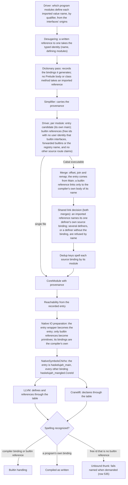
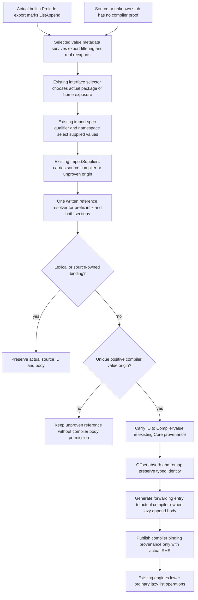

<!-- For God so loved the world, that he gave his only begotten Son, that whosoever believeth in him should not perish, but have everlasting life. — John 3:16 (KJV) -->
# Native symbol identity Chirho

Row 628. The native backends name every top-level binding by its CoreId, and they recognize a spelling only where the provenance allows it. Two modules' `helper`s stay apart, as do `f'` and `f_prime`. A program's own `show` keeps its body, and a dependency's `main` is never the program's entry.

Row 629. A reference to another module of the program names that module's binding, on the interpreter and on both native backends. `A.limit` and `B.limit` stay apart, and a dependency's own `show` stays the user's.

Row 642. An imported value names the program module that defines it, whatever module forwarded it, so one definition reached through several paths is one identity. Two definitions in scope are refused by name as ambiguous. A builtin that a program module forwards keeps the compiler's route, beside any program's own namesake.

## The symbol table

- `haskelujah_` plus the mangled spelling, then `.` and the CoreId. The mangler alone is not injective: `f'` and `f_prime` both give `haskelujah_f_prime`. The CoreId makes the symbol injective.
- The `.` keeps a binding apart from every symbol a backend writes by name: builtin runtime functions, RTS and libc imports, lifted lambdas and trampolines. None of these contains a `.`.
- The CoreId identifies a binding within one compiled program. It is not an ABI across builds.
- Only the recorded entry keeps `haskelujah_main`, which the C `main` reaches. Foreign exports and imports keep their declared names.

## Provenance

`CoreProvenanceChirho` sits on every `CoreModuleChirho`:

- the entry;
- the compiler's own bindings;
- the builtin references, which are free ids that name a builtin or runtime function.

Producers fill it, and the backends only read it:

- `dict_chirho/rewrite_chirho.rs` records its generated bindings.
- `simplify_module_chirho` carries the provenance.
- `native_link_chirho/native_provenance_chirho.rs` records the entry and the builtin references after simplification. A free id counts as builtin when it carries no user identity, one of these names it, and no source-module interface claims the name by any other route:
  - the interfaces of the module's builtin imports;
  - a builtin that a program module forwards, whose interface value has no origin (row 642);
  - the builtin type environment.

  A name a program module defines links by identity, so it no longer blocks the builtin route of another reference that shares its spelling.
- `merge_compile_results_core_chirho` offsets each module's provenance and joins the modules together. It takes the entry from `Main`, and follows link and dedup renames. A builtin reference links only to the compiler's own body of its name, never to a program's binding.
- `prepare_native_io_actions_chirho` names its wrapper as the entry and records what it generates.

A program's own binding is never recognized by its spelling. A free id that is not a builtin reference takes the unbound route and fails closed.

## Code

- Table and provenance: `haskelujah-core-chirho/src/expr_chirho.rs`.
- Free references: `haskelujah-core-chirho/src/transform_chirho.rs`.
- The merge: `haskelujah-driver-chirho/src/native_link_chirho/core_merge_chirho.rs` (row 634 moved it out of the driver's `lib.rs`).
- LLVM:
  - `toplevel_symbol_chirho` and `recognized_name_chirho` in `codegen_chirho.rs`;
  - the lazy nullary reference in `codegen_chirho/lazy_chirho.rs`.
- Cranelift:
  - declarations in `codegen_chirho.rs`;
  - `recognized_names_chirho` in the lowering context;
  - the `undefined` route in `lower_chirho/failures_chirho.rs` and `lower_chirho/lazy_chirho.rs`.
- Fixtures: `haskelujah-test-harness-chirho/src/fixtures_chirho.rs` records a hand-built module's provenance as its producers would. `native_chirho.rs` builds a multi-module program as one Cabal executable.

## Controls

`haskelujah-driver-chirho/tests/native_symbol_identity_chirho/main.rs` runs GHC-measured programs on LLVM and Cranelift, each alone with no fallback:

- namesakes in different modules (N2, N4, N8, with N3 as the ordinary control);
- a dependency's `main` (E1-E3);
- a program's own print, show, compare, undefined, putStrLn and getLine (B1-B8, U1);
- a program's own `strcmp` beside string comparison (L5);
- the old mangler's collisions (M1, M2).

Row 629 owns namesakes that resolve by bare name before the backend: interfaces, desugaring and merge linking.

## Imported reference identity (rows 629 and 642)

- **Origins (row 642).** `IfaceValueChirho.defining_module_chirho` names the source module that defines a value.
  - It is `Some` only for a source module's own definition, in `collect_all_definitions_chirho`.
  - Every re-export clones the value, through an explicit name, `module M` or a type's members, so a chain keeps its first definer and no forwarding module is ever stamped over it.
  - Builtin values and stub interfaces (module search, dependency packages) have `None`.
- **The supplier map.** `import_suppliers_chirho` (`native_link_chirho/native_provenance_chirho.rs`) records, for each import of one of the program's own modules, the defining module of each value name it brings, never the module the name travels through.
  - An unqualified import records under the bare name and its qualifier; a qualified import, under its qualifier or alias only.
  - Only the program's own modules count as definers. A value with no program definer is left out and keeps its own route: a builtin a program module forwards counts as builtin in the provenance (row 642).
  - Class methods and constructors are left out: they link through their class and type.
- **Desugaring.** `resolve_written_reference_chirho` gives a written reference to a recorded name the identity `ImportedReferenceChirho { name, defining_modules }`. It has one id per identity, recorded in the provenance's `imported_references_chirho`, so `A.f` forwarding B's `f` and `B.f` share one id.
- **The dictionary pass** never gives an imported reference a Prelude body (`resolve_or_fresh_id_chirho`, `module_free_id_named_chirho`). Imported references also shadow class methods of their name, as the program's own bindings do.
- **The shared link decision.** Both merges use `ImportLinkerChirho` (`project_chirho/import_links_chirho.rs`): the native one in `core_merge_chirho.rs`, the interpreter's in `multi_module_chirho.rs`.
  - One definer: the reference links to that module's own source binding. Compiler bindings are never candidates.
  - Several definers: the name is ambiguous, in GHC-87543's class, and the link is refused naming them.
  - A definer with no source binding of the name: refused too. No other binding of the same name ever stands in.
- **Dedup.** The native merge's keys spell each source binding as `module::name`. Bodies that call different modules' bindings never merge, while compiler bindings keep their names and still do.
- **Controls:**
  - `haskelujah-driver-chirho/tests/native_symbol_identity_chirho/import_identity_chirho.rs` (a submodule of row 628's target), on the interpreter, LLVM and true Cranelift: n1 (row 621's p11), n5, n6, a1, x1, x2, x4, r2, d1 and r1 exact; z1 refused as ambiguous; the recorded identities; no Prelude body taking an imported reference.
  - `reexport_origins_chirho.rs` (row 642), on the same three engines:
    - a builtin forwarded by a program module: `map`, `show`, `putStrLn`, a project Prelude, and one builtin through two forwarders. Each is exact, and each reference is asserted to be compiler-owned or a builtin reference, never a user identity.
    - a forwarded builtin beside a program's own `map`: exact, with B's `map` one identity and A's on the compiler's route.
    - a chain of forwarders, two paths to one definition (one identity), a `module B` re-export and a qualified alias of a forwarder, each beside a namesake: exact. A two-definition scope is refused as ambiguous.
    - interface origins: a module's own definitions carry it, every re-export path keeps the definer, a chain keeps the first, and every builtin value has none.
  - The link decision's own tests: `project_chirho/import_links_tests_chirho.rs`.
  - `synonym_closure_chirho.rs` (rows 656 and 668) only shares this target's harness. It tests type-synonym expansion, recorded in `type-scope-resolution-chirho.md`.
- **Residuals (not row 642).**
  - `check` rejects a two-level chain and a project Prelude: its single-file stub interfaces carry no types for re-exported values.
  - The frontend does not reject an ambiguous unqualified name; only the link refuses it.
  - Class methods and constructors still link through their class and type.

## Polymorphic list append Chirho

Frozen row 709 Phase A confirmed that ordinary `(++)` at `[[Char]]` was emitted as string-only `++#`: the actual Core and Cranelift binary passed cons cells holding String pointers into `haskelujah_append_str_chirho`. ASCII literal, replicate-only and the String header append passed; list-of-String append without replicate failed with the same named character-encoding error as the package ladder. The candidate below is source-only until its own scheduler gate; old RED evidence remains immutable.

`RawName.origin_chirho` is occurrence identity, never a binding certificate. An absent source definer, free spelling, generic builtin bit or reserved alias cannot synthesize a compiler value origin. The positive enum is minted only by the actual builtin export producer and is copied with that selected `IfaceValue`. Source re-exports preserve real metadata; unknown/stub values do not invent it. If conflicting fragments disagree about a value's marker or source definer, their generic union loses the marker. A module merely having Source origin does not erase a genuine forwarded builtin's marker.

Selected complete source interfaces are admitted by the existing exact `(name, exposure)` replacement helper before generic fragment merging. This applies to seeded source views and freshly checked home exports converted to package exposure; other package views survive. It prevents a fallback interface from retaining builtin exports/proof that the selected source actually replaces. The existing generic fragment merger remains available for genuine fragments.

All four source append forms enter the same identity route. The dictionary pass reuses one generic lazy append implementation and generates a two-argument forwarding entry from typed compiler-value provenance. The forwarding target is the actual compiler-owned append ID, so a source binding named `append` cannot capture it. Existing native list-case normalization handles literal buffers when the generic body demands their spine. Explicitly string-specific generated `++#` operations, native backend contracts and the strict RTS packer remain unchanged.

Acceptance includes typed String, `[Int]` and `[[Char]]` append in prefix/infix/both sections; an undemanded tail and element must remain lazy. Local, top-level, qualified/imported and source Prelude namesakes retain their own bodies. A real source re-export of builtin append retains its positive origin. Hiding, NoImplicitPrelude, unknown qualifier and stub boundaries cannot acquire a compiler body. Metadata controls separately check typed provenance transport, source/exposure precedence and rejection of fake builtin-bit/alias authority. These are source/semantic controls, not a passing package-ladder claim; unchanged ladder execution with exact source/binary/RTS identities remains required.
