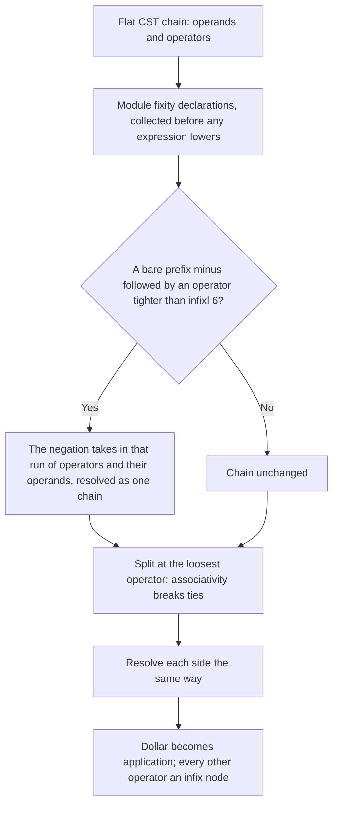

<!-- For God so loved the world, that he gave his only begotten Son, that whosoever believeth in him should not perish, but have everlasting life. — John 3:16 (KJV) -->

# Operator fixity resolution

The CST keeps an infix expression flat: its operands in source order and the operators between them. Lowering turns that chain into a tree using the fixity table:

1. the module's own `infixl`, `infixr` and `infix` declarations;
2. then the builtin table;
3. then the Haskell default, `infixl 9`.

## The split

`resolve_infix_precedence_chirho` (`crates/haskelujah-parser-chirho/src/lower_chirho.rs`) splits a chain at its loosest operator and recurses. At equal precedence it splits at the rightmost operator for `infixl` and the leftmost for `infixr`.

## Prefix minus (row 555)

`absorb_prefix_minus_chirho` (`lower_chirho/expr_syntax_chirho/prefix_minus_chirho.rs`) runs before the split. Haskell 2010 (§10.6) resolves prefix minus as `infixl 6`, so a negation takes in the operators after it that bind tighter:

- `-3 ^ 2` is `negate (3 ^ 2)`, and ``-7 `mod` 3`` is ``negate (7 `mod` 3)``.
- An operator with no fixity declaration is `infixl 9` and is taken in too, so ``-3 `max` 2`` is ``negate (3 `max` 2)``.
- `-3 * 2` and `-3 / 2` regroup the same way and keep their values.

**What keeps its grouping:**

- A parenthesized negation lowers to `ParenChirho`, so `(-3) ^ 2` is 9.
- `negate 3 ^ 2` is an application.
- Operators at precedence 6 or below (`+`, `-`, comparisons, `:`, `$`) stay outside the negation, so `-3 + 2` is `(negate 3) + 2`.

**What GHC rejects but lowering accepts.** GHC refuses a prefix minus straight after an operator of precedence 6 or tighter (`2 * -3`, `x + -3`). Lowering accepts that chain, and the negation takes in only what follows it. No diagnostic for this exists yet.

## After lowering

A negation desugars to `negate#`. The dictionary pass then retargets it by its operand's key (row 547; see [dictionary evidence](../language-features-chirho/dictionary-evidence-chirho.md)).

The direct minimum machine-word literal is the one bounded exception (row 592). Its positive magnitude, `9223372036854775808`, is one above `i64::MAX`; `preserve_minimum_word_operand_chirho` retains that magnitude only beneath the direct prefix-minus node. Core lowering then sends the already-negative `i64::MIN` marker through `fromInteger` without executing `negate#`, preserving both overload evidence and the value. If fixity absorbs a tighter operator, `bounded_chain_operand_chirho` restores that operand to the existing positive-overflow boundary instead of leaking the marker into the inner chain. The positive magnitude by itself, larger magnitudes, tighter operator chains and the separately measured `fromIntegral (minBound :: Int) :: Integer` conversion remain outside this row.

An operand that is now a whole chain is keyed like any other expression. So `-3 / 2 :: Double` and `-x * 2` take the float negation.

One Double case is still open:

- A `**` result is not keyed, so `-2 ** 2 :: Double` stops at `NegIntChirho` in the interpreter.

Row 570 made `^` at Double exact by routing it through `^.#`; it is no longer a prefix-minus residual.
