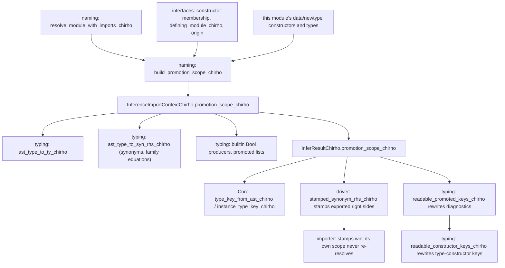

<!-- For God so loved the world, that he gave his only begotten Son, that whosoever believeth in him should not perish, but have everlasting life. — John 3:16 (KJV) -->

# Promoted constructor identity Chirho

Row 686. A promoted data constructor, `'True` or an unquoted `True` where no type `True`
is in scope, is identified by the constructor it names, never by its spelling:

- `'A.T` and `'B.T` are different constructors.
- An alias or a re-export of one constructor is the same one.
- A source `data Bool = True` is not the standard `True`.

Ordinary datatype names, instance keys for ordinary types, `Ty::Display` and the `TyChirho`
enum are unchanged.

## Identity

A key is `%promoted:<tag>:<len>:<module><name>` (`PromotedKeyChirho`):

- The `%` never starts a Haskell name.
- The module's byte length delimits it from the constructor.

The tag is one of:

- **`source`:** the constructor's defining module, from an interface's recorded `defining_module_chirho`. That field survives re-exports, so an alias or re-export reaches the same key. A local declaration is keyed with this module.
- **`builtin`:** only when the providing interface is a trusted builtin one (`IfaceOriginChirho::BuiltinChirho`) and the parent type is in the compiler's table. Bool and Ordering are trusted from any builtin interface. Maybe is trusted only from Prelude and Data.Maybe, Either only from Prelude and Data.Either, and Levity and RuntimeRep only from GHC.Exts. The key names GHC's defining module: GHC.Types, GHC.Maybe or Data.Either. A builtin homonym elsewhere, and a source module forwarding a standard constructor, stay unproven. The constructors only the compiler can define are keyed by their own syntax, with no scope: list cons `':` and nil `'[]`, unit `'()` and the tuple constructors `'(,)`, `'(,,)`, and so on.
- **`unknown`:** anything naming cannot prove. This covers a stub interface, a builtin constructor outside the table, an ambiguous bare spelling, and a function, field or pattern synonym, which are not constructors. It is an ordinary reflexive identity: the same spelling meets itself. It is never apart from another constructor, and rigidity never trusts it.

## Roles

- An explicit quote makes the name promoted.
- An unquoted name follows GHC: the type namespace comes first. An unquoted homonym (`data T = T`, then `T`) is the type, and only a name the type namespace lacks is a promoted constructor.

## Promoted forms opening with `'(`

The unit `'()`, the tuple constructors `'(,)`, `'(,,)`, … and a prefix operator constructor such as `'(:)` or `'(:+:)` are each one promoted constructor. Anything else is a promoted tuple. `'(t1, …, tn)` lowers as the tuple constructor `'(,…,)` applied to its elements, each of which may carry a kind annotation. Naming, kinds and this identity then treat it like any applied promoted constructor.

## Gateways

All of these read one scope, or a name's stamp, and must agree:

- **Both typing converters.** They share the spelling rule `quoted_promoted_spelling_chirho` / `unquoted_promoted_spelling_chirho` in the AST crate.
- **Required type arguments** written in expression syntax.
- **Builtin family results.** `&&`, `||`, `Not` and `<=?` produce keyed `True`/`False`, and the readers accept keys whole.
- **Promoted lists.** Nil and cons are the compiler's keys.
- **Core's type key helper.** It keys a ticked or unquoted promoted instance head as its constructor. Before row 686 it keyed every ticked head `_`.
- **Unification.** Qualified-suffix equality is exact for keys.
- **The imported-name normalizer and the family-name canonicaliser.** Both leave keys whole.
- **Rigidity.** It does not trust Unknown keys.

## Diagnostics

Keys are the checker's identities, not text for people. When inference returns, every diagnostic's message, labels, notes and suggestion descriptions pass through `readable_promoted_keys_chirho`, which writes each key back as the constructor it names (`'True`, `'Z`, or `'M.T` for an unproven qualified spelling). Display itself stays canonical.

The same boundary then passes the text through `readable_constructor_keys_chirho`. It inverts the type-constructor keys `TypeConstructorIdentityChirho::key_chirho` produces, `%constructor:source:<n>:<module>:<n>:<name>` and `%constructor:compiler:<n>:compiler-standard:<name>`, by their byte lengths. Each becomes the constructor's name, so a source `Maybe` reads `Maybe` and the compiler's `Proxy` reads `Proxy`. When one text names two different constructors with one spelling, each source one is qualified by its module, the policy the promoted rewrite uses, so f02's hidden kinds read `DefChirho.KChirho` against `Main.KChirho`. A prefix that starts no whole key stays verbatim: a length that is not plain digits, overflows, runs past the end or ends inside a character, and an unknown tag or identity. Both rewrites are presentation only; lookup, matching and equality read whole keys.

## Without naming

A direct typing caller that never ran naming has no scope. Promoted spellings then keep their legacy forms: the use-site converter writes `True`, synonym conversion writes `'True`, and Core keys a ticked head `_`. These forms are not the corrected identity, and they disagree. Tests pin them only as legacy.

## Controls

- **AST:** `promotion_chirho/tests_chirho.rs` covers the compiler's own constructors and readable promoted and type-constructor keys, including keys that stay verbatim.
- **Typing:** `infer_chirho/tests_chirho/promotion_identity_tests_chirho.rs`.
- **Naming:** `promotion_scope_tests_chirho.rs`, including a guard that every table parent naming its providers is listed by exactly those builtin interfaces.
- **Parser:** `lower_chirho/classes_chirho/family_equation_tests_chirho.rs` covers promoted tuples and prefix forms.
- **Core:** `desugar_chirho/promoted_keys_tests_chirho.rs`.
- **Driver:** `typing_integration_chirho/declarations_chirho/promoted_constructor_identity_chirho.rs`, with oracles A04, C17, C15b and E03 on all three engines, and P04, a GHC-rejected mismatch whose diagnostic names `'ZChirho` and no key.
- **Multi-module:** C18b and E01 are build-run cells.
