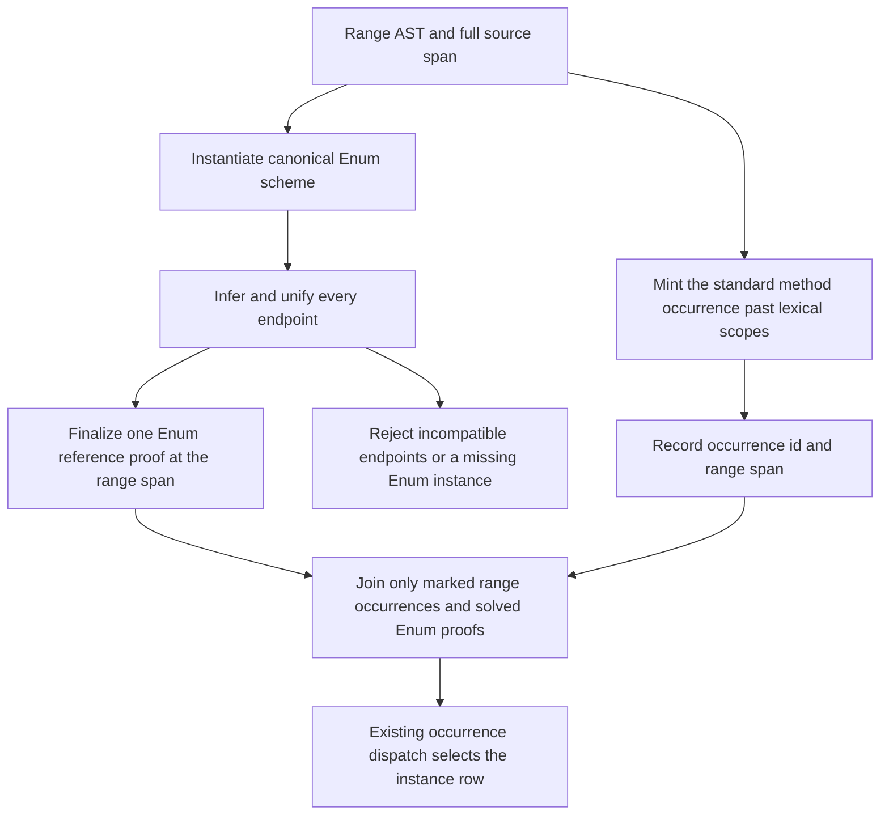

<!-- For God so loved the world, that he gave his only begotten Son, that whosoever believeth in him should not perish, but have everlasting life. — John 3:16 (KJV) -->

# Range syntax evidence Chirho

Range syntax selects the standard Enum enumeration method. A source function with that spelling answers written calls. RebindableSyntax changes endpoint literal resolution but does not change the selected enumeration method.

The checker shares the four canonical schemes with builtin seeding, instantiates the selected one, infers every endpoint and unifies them at its element type. The range produces a list and an Enum obligation. Its full source span identifies its reference evidence until range AST nodes carry origins.

The desugarer mints a method occurrence independently of its lexical scopes and records it in a dedicated range-span map. The driver joins this producer-marked occurrence with the checker's one solved Enum proof. It validates the selected method name and rejects missing, synthetic or conflicting identity. Source-written functions retain the existing authority checks, so a lexical namesake cannot acquire this syntax proof.

The existing dictionary pass consumes the occurrence proof and reads the key's row. Row 669 supplies missing monomorphic defaults; a control defining all four methods isolates this route from default generation. Polymorphic Enum dictionary slots are row 671 and Enum Double is row 670.

Implementation: typing's `infer_chirho/terms_chirho/ranges_chirho.rs`, core's `desugar_chirho/syntax_methods_chirho.rs`, and driver's `evidence_join_chirho.rs`. Controls live in `tests/dictionary_evidence_chirho/enum_chirho/range_syntax_chirho.rs`.

Row 665's finite controls are GHC-exact on the interpreter and both native backends, including an imported source namesake. Endpoint rejection also covers the unchanged GHC fixture `tcfail009.hs`. The source is held until rows 670 and 671 supply the Double and polymorphic dictionary routes: without Enum Double, its new obligation refuses a Double range that the baseline accepted and then failed to run.
