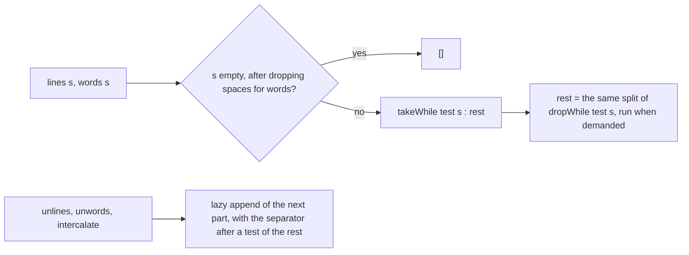

<!-- For God so loved the world, that he gave his only begotten Son, that whosoever believeth
in him should not perish, but have everlasting life. — John 3:16 (KJV) -->

# Runtime primitive evaluation Chirho

The interpreter evaluates a lowered primitive only after its arguments reach weak head normal
form. Primitive identity is preserved from Core through STG lowering; an implementation must
therefore match the Haskell operation rather than a similarly named host-language operation.

## Numeric rounding

- `ceiling#`, `floor#`, and `truncate#` use their corresponding directed `f64` operations.
- `round#` uses nearest-integer rounding with exact half ties resolved to the even integer,
  matching `round :: Double -> Int` in GHC rather than Rust's away-from-zero `f64::round`.
- Native LLVM and Cranelift route all four conversions through the shared RTS implementation
  (row 562), avoiding backend-specific poison or saturation for exceptional inputs. The
  interpreter still saturates those exceptional casts and keeps that difference as a named residual.

## String lines and words

The generated Prelude's `lines`, `words`, `unlines`, `unwords` and String `intercalate` are lazy
Core (row 579, `dict_chirho/prelude_chirho/report_chirho/report_text_chirho.rs`). They no longer
reach `lines#`, `wordsStr#`, `unlines#`, `unwordsStr#` or `intercalateStr#`. Those primops read
only a literal, so they still stand behind the runtime, STG and backend handlers, kept until a
repository-wide cleanup is ruled.

- `lines` splits only on `\n`, so `\r` stays content.
- Empty input produces no lines.
- A final `\n` ends the line before it and adds no empty line; repeated terminators keep the
  empty lines between them.
- `words` splits on GHC 9.14.1's `isSpace` code points: 9-13, 32, 160, 5760, 8192-8202, 8239,
  8287 and 12288. U+0085, U+2028 and U+2029 are not spaces.
  - The test is one generated binding, `$is_space_chirho`.
  - The public `isSpace` is a guarded Prelude alias of it, so the two agree on every Char. A
    program's own top-level `isSpace` stays its own.
  - The not-space test comes from the same table, not from negating the space test.
- `unlines` appends one `\n` per element. `unwords` and `intercalate` emit a part before testing
  what follows it.
- All of them hold for a String built at run time and for an infinite one.
- They walk their input one Char at a time. On the interpreter that spends the shared run
  budget, `DEFAULT_STEP_LIMIT_CHIRHO` (100000 steps), as every other Prelude list function does.
  The primops they replaced bypassed it.
- The measured thresholds describe one build (row 579); they are not a guaranteed minimum.
  - `length (words s)` of a literal stayed exact through 846 words (2,538 chars).
  - `length (lines s)` of a literal stayed exact through 1,958 lines (5,874 chars).
  - Past those, the run stops with the named step-limit failure.
