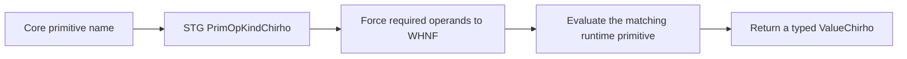

<!-- For God so loved the world, that he gave his only begotten Son, that whosoever believeth
in him should not perish, but have everlasting life. — John 3:16 (KJV) -->

# Runtime primitive evaluation Chirho

The interpreter evaluates a lowered primitive only after its arguments reach weak head normal
form. Primitive identity is preserved from Core through STG lowering; an implementation must
therefore match the Haskell operation rather than a similarly named host-language operation.

## Numeric rounding

- `ceiling#`, `floor#`, and `truncate#` use their corresponding directed `f64` operations.
- `round#` uses nearest-integer rounding with exact half ties resolved to the even integer,
  matching `round :: Double -> Int` in GHC rather than Rust's away-from-zero `f64::round`.
- Native LLVM and Cranelift route all four conversions through the shared RTS implementation
  (row 562), avoiding backend-specific poison or saturation for exceptional inputs. The
  interpreter still saturates those exceptional casts and keeps that difference as a named residual.
