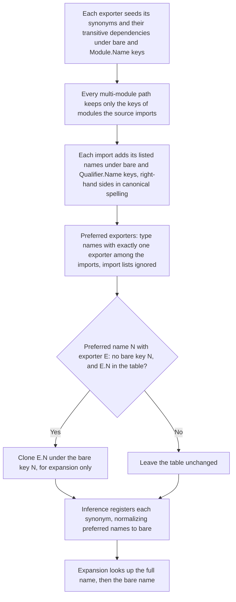

<!-- For God so loved the world, that he gave his only begotten Son, that whosoever believeth in him should not perish, but have everlasting life. — John 3:16 (KJV) -->
# Type-scope resolution workflow

This workflow is owned by `resolve_module_with_imports_chirho` and `check_module_type_scope_chirho`. It runs after imports and all module-local type definitions have populated `NameEnvChirho`, but before kind and type inference.

```mermaid
flowchart TD
    lexed_tokens_chirho[Lexed source tokens] --> layout_normalization_chirho[Normalize explicit and implicit layout contexts]
    layout_normalization_chirho --> explicit_close_chirho{Explicit right brace closes nested implicit contexts?}
    explicit_close_chirho -->|Yes| unwind_layout_chirho[Emit virtual closes before the explicit close]
    explicit_close_chirho -->|No| source_cst_chirho[Source CST]
    unwind_layout_chirho --> source_cst_chirho
    source_cst_chirho --> faithful_lowering_chirho[Lower namespace-bearing declaration shapes]
    faithful_lowering_chirho --> lowered_shape_chirho{Shape represented faithfully?}
    lowered_shape_chirho -->|Yes| module_ast_chirho[Lowered module AST]
    lowered_shape_chirho -->|No, but retained AST proves the boundary| ast_boundary_chirho[Defer only the affected check at a documented trust boundary]
    ast_boundary_chirho --> module_ast_chirho
    lowered_shape_chirho -->|No faithful carrier| preserve_sibling_chirho[Consume only the unsupported construct's own layout region]
    preserve_sibling_chirho --> representation_blocker_chirho[Keep the construct gap explicit while preserving following declarations]

    module_ast_chirho --> local_iface_chirho[Collect canonical local type/value exports]
    local_iface_chirho --> associated_iface_chirho[Retain class-to-associated-family relationships]
    associated_iface_chirho --> import_filter_chirho[Apply all/selected/hiding import and export rules]
    import_filter_chirho --> imports_chirho[Resolve imported interfaces]
    imports_chirho --> import_result_chirho{Every interface available?}
    import_result_chirho -->|No| import_error_chirho[Retain causal import diagnostic and skip dependent lookups]
    import_result_chirho -->|Yes| local_defs_chirho[Bind all local type constructors and classes]
    local_defs_chirho --> associated_defs_chirho[Bind associated type-family names]
    associated_defs_chirho --> walk_uses_chirho[Walk source-level type uses]

    walk_uses_chirho --> tycon_use_chirho{Type constructor or class use?}
    tycon_use_chirho -->|Yes| wired_type_chirho{Wired-in equality, active StarIsType, list, function, unit or tuple constructor?}
    wired_type_chirho -->|Yes| continue_chirho
    wired_type_chirho -->|No| qualified_chirho{Qualified?}
    qualified_chirho -->|No| unqualified_lookup_chirho[Lookup type namespace then DataKinds constructor namespace when licensed]
    qualified_chirho -->|Yes| qualified_lookup_chirho[Lookup current-module local or imported qualified namespace then licensed constructor namespace]
    unqualified_lookup_chirho --> lookup_result_chirho{Found?}
    qualified_lookup_chirho --> lookup_result_chirho
    lookup_result_chirho -->|No| undefined_type_chirho[Emit E0101 once per source use]
    lookup_result_chirho -->|Yes| continue_chirho[Continue bounded AST walk]

    associated_iface_chirho --> selected_parent_chirho{Class member selection}
    selected_parent_chirho -->|Class(..)| all_associated_chirho[Expose every associated type plus the parent relation]
    selected_parent_chirho -->|Class(F)| selected_associated_chirho[Expose only selected associated types plus the parent relation]
    selected_parent_chirho -->|Class| parent_only_chirho[Expose only the class]
    all_associated_chirho --> import_filter_chirho
    selected_associated_chirho --> import_filter_chirho
    parent_only_chirho --> import_filter_chirho

    walk_uses_chirho --> associated_instance_use_chirho{Bare associated family inside an instance?}
    associated_instance_use_chirho --> parent_instance_chirho[Resolve the qualified or unqualified parent class]
    parent_instance_chirho --> member_visible_chirho{Interface says member belongs to that visible parent?}
    member_visible_chirho -->|Yes| continue_chirho
    member_visible_chirho -->|No| undefined_type_chirho

    walk_uses_chirho --> promoted_use_chirho{Explicit promoted constructor?}
    promoted_use_chirho --> wired_promoted_chirho{Wired-in list, unit or tuple constructor?}
    wired_promoted_chirho -->|Yes| continue_chirho
    wired_promoted_chirho -->|No| promoted_lookup_chirho[Lookup value/data-constructor namespace]
    promoted_lookup_chirho --> lookup_result_chirho

    walk_uses_chirho --> tyvar_use_chirho{Type-variable use?}
    tyvar_use_chirho --> explicit_scope_chirho[Track declaration and explicit forall binders]
    explicit_scope_chirho --> policy_chirho{Declaration policy}
    policy_chirho -->|Signature without outer forall, explicit existential or family scope| implicit_quantification_chirho[Preserve permitted implicit quantification]
    policy_chirho -->|Type synonym or ordinary field| lexical_lookup_chirho{Lexically bound?}
    lexical_lookup_chirho -->|No| undefined_tyvar_chirho[Emit E0101 type-variable diagnostic]
    lexical_lookup_chirho -->|Yes| continue_chirho

    explicit_scope_chirho --> binder_order_chirho[Check explicit forall binder annotations left-to-right]
    binder_order_chirho --> prior_binder_chirho{Kind variable introduced earlier?}
    prior_binder_chirho -->|No| undefined_tyvar_chirho
    prior_binder_chirho -->|Yes| continue_chirho

    walk_uses_chirho --> signature_root_chirho{Outermost invisible forall?}
    walk_uses_chirho --> gadt_header_chirho{GADT constructor signature?}
    gadt_header_chirho --> independent_gadt_scope_chirho[Do not inherit declaration-head binders]
    independent_gadt_scope_chirho --> signature_root_chirho
    signature_root_chirho -->|Yes| forall_all_chirho[Require every free variable to be explicitly or lexically bound]
    signature_root_chirho -->|No| implicit_signature_chirho[Implicitly quantify otherwise-free signature variables]
    forall_all_chirho --> lexical_lookup_chirho
    implicit_signature_chirho --> continue_chirho

    walk_uses_chirho --> record_field_chirho{Record field contains unreliable invisible-forall or quantified syntax?}
    record_field_chirho -->|Yes| defer_record_chirho[Defer until flat record-field lowering preserves source scope]
    record_field_chirho -->|No| continue_chirho

    walk_uses_chirho --> constructor_prefix_chirho{Constructor span proves lowering dropped an existential prefix?}
    constructor_prefix_chirho -->|Yes| defer_existential_chirho[Defer only that constructor's field-variable scope]
    constructor_prefix_chirho -->|No| continue_chirho

    undefined_type_chirho --> driver_gate_chirho[Driver stops before kind inference unless errors are deferred]
    undefined_tyvar_chirho --> driver_gate_chirho
```

The walker performs no filesystem lookup or module scanning. Its successful-resolution path is linear in the lowered AST with hash-backed namespace lookups; the error-only suggestion path compares against the already-populated in-memory environment, and duplicate diagnostics are suppressed by issue/name/span.

Canonical interface maps are the authority for imported names. Type and value operators are normalized once at that boundary, and associated families remain first-class type exports while carrying their parent-class relation through selected imports, hiding, explicit exports, and module re-exports. An associated member imported through a qualified class may be used bare only inside an instance of that same visible class; it is not inserted into the module's general unqualified type namespace. This is the `GHC.Exts.IsList` / `Item` boundary exercised by the real `containers` projects.

Layout and lowering preserve scope before naming sees the AST. An explicit right brace first closes implicit contexts nested inside its matching explicit context, so the enclosing module regains its virtual declaration separator. Unsupported data/newtype-family instances are still representation blockers, but their scanner stops at their own layout boundary; it must never consume a following signature or declaration. Data and newtype GADT constructor blocks share one parser, while standalone kind signatures retain their complete flat child sequence for the common type reconstruction path.

The kind/type layer uses the same faithful shape downstream: required foralls contribute the kind of their body; symbolic standalone kind operators preserve application order; imported closed Boolean families reduce only when their leading argument selects an equation and otherwise remain stuck.

Ordinary and record constructor fields require lexically bound variables even when `ExistentialQuantification` is enabled by the default GHC2021 edition. That extension permits a written existential prefix; it does not invent one for `data T a = MkT b`. A standalone kind signature quantifies its own variables and does not bind those names in an H98 constructor body. Fresh GHC 9.14.1 controls retain bare ordinary/record negatives and explicit-forall positives; the original N05 source remains unchanged.

Two deliberately narrow AST trust boundaries remain. The record-field branch covers `bug-record-field-forall-lowering-chirho.md`; ordinary and required-forall fields remain checked. The constructor-prefix branch covers `bug-existential-constructor-scope-dropped-chirho.md`; it requires a prefix constructor name whose source span begins after its enclosing constructor span, excludes infix constructors, and defers only that constructor's field-variable scope. Both branches should disappear when the AST can carry the source binders and contexts directly.

## Imported synonym expansion keys (row 656)

Naming above decides which imported type names a source may write. Separately, the driver frontend (`run_frontend_with_type_synonyms_families_and_class_env_chirho`) hands inference one table of imported type synonyms per module, and that table decides only how a synonym expands. Every multi-module path shares it: the project directory, both dependency-package paths behind `haskelujah build-run`, and the interpreter.



- **Why a bare key.** Since b32bcc14 the import rewrite (`qualify_imported_ast_type_chirho`) and inference (`normalize_imported_type_name_chirho`) both spell a preferred name bare, whether or not an import lists it. Before row 656 a bare key existed only for a listed name, so a re-exported alias whose right-hand side names a parent the module imports without listing it stopped expanding at that parent. GHC 9.14.1 accepts that Parsec-style chain; every Cabal build refused it with `type mismatch: expected ParsecAliasCompatMiniChirho, found (ParsecTAliasCompatMiniChirho [tokChirho])`.
- **The rule.** `align_preferred_synonym_keys_chirho` adds the bare key N only when no bare key N exists and the one exporter's `E.N` is already in the filtered, merged table. It never overwrites a bare key, never takes a synonym from a module the source does not import, and never chooses among several exporters.
- **Not a naming grant.** A source that writes the hidden parent, or a synonym from a module it does not import, is still refused by naming with E0101, as GHC refuses both with GHC-76037.
- **What the trace ruled out.** The exporters seed the parent at every step. Keeping each admitted synonym's dependencies in the filter, or keeping the rewritten reference qualified, each leaves the chain failing, because the other canonicalization spells the reference bare again.
- **The interpreter path takes the same filter (row 668).** Before, it gave each module the bare synonyms of every module compiled before it, imported or not. The import loop's bare fallback then turned a type named like one of them, even a module's own data type, into that synonym's right-hand side, so a derived `Show` became `instance Show Int` and the interpreter refused the program as a duplicate instance. Under the filter a module sees only the synonyms of the modules it imports, as every native build does, and row 656's bare keys keep its alias chains exact.

### Code and controls

- **The rule:** `align_preferred_synonym_keys_chirho` in `crates/haskelujah-driver-chirho/src/lib.rs`, called once after the frontend's import loop.
- **Unit pins:** `crates/haskelujah-driver-chirho/src/frontend_chirho/synonym_keys_tests_chirho.rs`. A unique exporter adds the bare key; two exporters add none; a missing qualified source adds none; an existing bare key is kept.
- **The interpreter's filter:** `compile_modules_chirho` in `crates/haskelujah-driver-chirho/src/project_chirho/multi_module_chirho.rs` (row 668).
- **GHC-measured programs:** `crates/haskelujah-driver-chirho/tests/native_symbol_identity_chirho/synonym_closure_chirho.rs`, each on the interpreter, LLVM and true Cranelift. They live in that target for its multi-module harness, not for symbol identity.
  - Row 656: the chain and an import of only the forwarder are exact; the hidden parent and an unimported synonym are refused.
  - Row 668: a local and an imported type named like another module's synonym keep their own instances, a synonym used only upstream stays there, and qualified and aliased uses resolve, all exact; qualified-only, hidden and unexported synonyms are refused.
- **Holds:** `frontend_imported_type_alias_expands_through_parent_alias_chirho` and `frontend_reexported_type_alias_expands_through_hidden_parent_alias_chirho` in `crates/haskelujah-driver-chirho/src/tests_chirho/compile_chirho.rs`.
