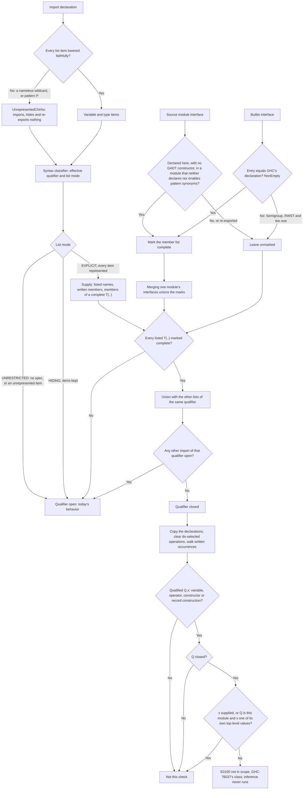

<!-- For God so loved the world, that he gave his only begotten Son, that whosoever believeth in him should not perish, but have everlasting life. — John 3:16 (KJV) -->
# Value-scope resolution workflow

This workflow is owned by `resolve_module_with_imports_chirho` and `check_module_value_scope_chirho` (row 536).
- It runs after the type-scope check (`type-scope-resolution-chirho.md`), once imports and every top-level definition are in `NameEnvChirho`.
- It runs before Phase 3.9 seeds the type environment, and before inference.

It closes one gap. Naming built the right qualified table for an explicit import list, but never checked a value occurrence against it. So typing's fallback dropped the qualifier and read a bare binding the list leaves out (I2: `NE.toList` under `import qualified Data.List.NonEmpty as NE (head, NonEmpty(..))`, GHC-76037).

## Rules

- **The qualifier.** It is the `as` alias, otherwise the module name (`ImportDeclChirho::effective_qualifier_chirho`). An unqualified import with a list closes its module name too: `import Data.List (sort)` closes `Data.List`.
- **The classifier is syntax only.** `ImportDeclChirho::list_mode_chirho` never answers whether a value is exposed, never reads an interface and never decides `T(..)` completeness. Row 517's core route may reuse its modes and add only its own narrow semantics.
- **A listed name is supplied even where the builtin interface omits it.** The written list is the authority, and interfaces here are partial.
- **`T(..)` closes only on a member list marked complete.** Losing a mark only leaves a qualifier open.
- **The walk.** It is the AST's exhaustive occurrence walk, over a copy of the declarations, taken only when some qualifier is closed. The operations a do statement selects are cleared first, because they are not written.

## Boundaries (row 536 claims none of these)

- Constructor patterns and record field labels, which the walk does not visit.
- `M.do`'s selected `M.>>=`, `M.>>` and reserved `M.fail`.
- Unimported qualifiers (I6, and row 532's Q01/Q02).
- Bare-seed over-exposure (I8).
- Shared-alias ambiguity (I3, I3b, M1).
- Builtin member lists not proven complete.
- Diagnostic bytes: GHC's wording is not matched.
- Naming errors are skipped in defer mode, as type-scope errors are.

## Code

- **The marker and the classifier:** `crates/haskelujah-ast-chirho/src/module_chirho.rs`, with `ImportItemChirho::UnrepresentedChirho`, `is_represented_chirho`, `ImportListModeChirho`, `effective_qualifier_chirho` and `list_mode_chirho`.
- **The producer:** `lower_import_spec_item_chirho` in `crates/haskelujah-parser-chirho/src/lower_chirho.rs`.
- **The exhaustive consumers:** `import_item_names_chirho` (`resolve_chirho.rs`), and `merge_import_item_into_exports_chirho` and `remove_import_item_from_exports_chirho` (`iface_chirho.rs`).
- **Completeness:**
  - `IfaceExportsChirho::complete_member_types_chirho`;
  - `locally_complete_type_names_chirho` (`type_exports_chirho.rs`), called by `build_iface_with_imports_chirho`;
  - the builtin `Data.List.NonEmpty` entry;
  - `merge_module_ifaces_chirho`.
- **The check:** `crates/haskelujah-naming-chirho/src/value_scope_chirho.rs`, with its tests in `value_scope_tests_chirho.rs`.

## Controls

- **GHC-measured programs:** `crates/haskelujah-driver-chirho/tests/typing_integration_chirho/qualified_import_lists_chirho.rs`. It holds 7 programs GHC 9.14.1 rejects with GHC-76037 and 15 it accepts, run through the parser and name resolution, and I2 through the whole driver.
- **The classifier's three modes:** in `module_chirho.rs`.
- **The producer:** in `lower_chirho/import_item_tests_chirho.rs`.
- **Completeness and the inert marker:** in `type_exports_tests_chirho.rs`.
