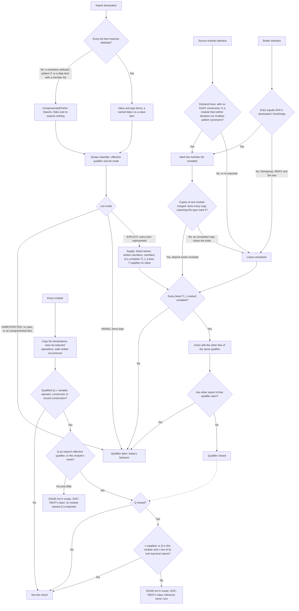
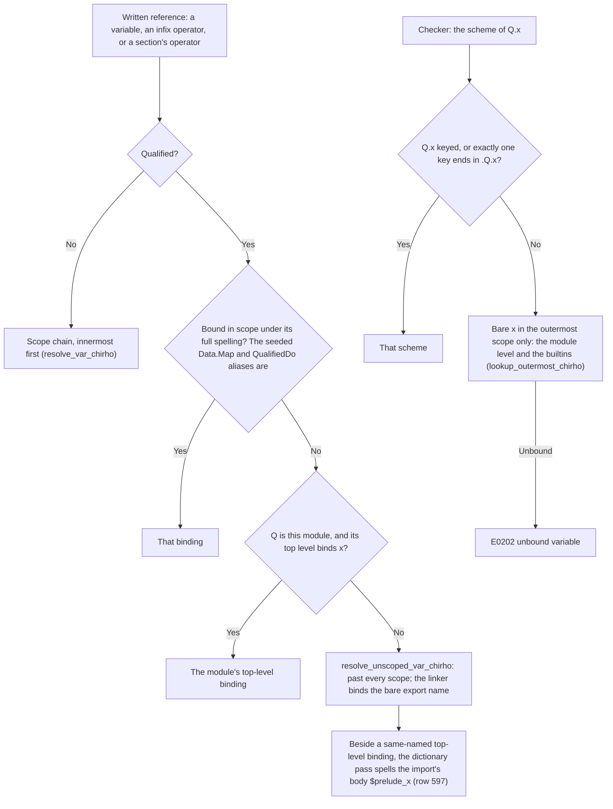

<!-- For God so loved the world, that he gave his only begotten Son, that whosoever believeth in him should not perish, but have everlasting life. — John 3:16 (KJV) -->
# Value-scope resolution workflow

This workflow is owned by `resolve_module_with_imports_chirho` and `check_module_value_scope_chirho` (rows 536 and 598).
- It runs after the type-scope check (`type-scope-resolution-chirho.md`), once imports and every top-level definition are in `NameEnvChirho`.
- It runs before Phase 3.9 seeds the type environment, and before inference.

It closes one gap. Naming built the right qualified table for an explicit import list, but never checked a value occurrence against it. So typing's fallback dropped the qualifier and read a bare binding the list leaves out (I2: `NE.toList` under `import qualified Data.List.NonEmpty as NE (head, NonEmpty(..))`, GHC-76037).

Row 598 closes two more:
- Nothing checked that a qualifier names an import. `X.reverse`, and `Data.List.reverse` with no import of `Data.List`, checked and ran.
- After naming, a qualified reference resolved by its bare text. A local `reverse` captured `L.reverse`, and a local `foo` captured `Main.foo`, on every engine. The second section below covers that.

## Rules

- **The qualifier.** It is the `as` alias, otherwise the module name (`ImportDeclChirho::effective_qualifier_chirho`). An unqualified import with a list closes its module name too: `import Data.List (sort)` closes `Data.List`.
- **The classifier is syntax only.** `ImportDeclChirho::list_mode_chirho` never answers whether a value is exposed, never reads an interface and never decides `T(..)` completeness. Row 517's core route may reuse its modes and add only its own narrow semantics.
- **A listed name is supplied even where the builtin interface omits it.** The written list is the authority, and interfaces here are partial.
- **A bare `T` item supplies no value.** `import M (T)` brings the type or class `T`, never a constructor that shares its spelling: GHC 9.14.1 reports `P.Proxy` under `Data.Proxy as P (Proxy)` as GHC-01928, and GHC's own T25877 expects the same for a source type. Only written members and the members of a complete `T(..)` supply values.
- **A named `data x` item is a value item.** The `data` keyword puts the name in the value namespace whatever its spelling, so lowering reads `data Proxy`, `data f` and `data (:+)` as value items. GHC 9.14.1 imports the constructor for `data Proxy` and never the type of the same name (gpt_chirho #28515, #28517). The list stays EXPLICIT, so every other value under its qualifier is still checked. A `data` item with a member list has no faithful item and stays unrepresented, and a named `type T` stays a bare type item.
- **`T(..)` closes only on a member list marked complete.** Losing a mark only leaves a qualifier open.
- **Marks merge per type.** When copies of one module merge (`merge_module_ifaces_chirho`), a type both copies export stays marked only when both mark it, because the unmarked copy may export a member no entry lists, such as a bundled pattern synonym. A type only one copy exports keeps that copy's mark, so disjoint marked types still union. Over many copies, a type stays marked only where every copy exporting it marks it, in any order.
- **The walk.** It is the AST's exhaustive occurrence walk, over a copy of the declarations. Row 536 took it only when some qualifier was closed; since row 598 it runs for every module. On a 149-line qualified module, `check` took 1.69-1.74 s before and 1.71-1.73 s after. The operations a do statement selects are cleared first, because they are not written.
- **Every qualifier names something (row 598).** It must be an import's effective qualifier or the module's own name. The driver injects the implicit Prelude before naming, so `Prelude` counts unless the module opts out or imports Prelude itself. An alias replaces its module's name: `import Data.List as L` binds `L`, never `Data.List`.

## After naming: a qualified reference never takes a local binder (row 598)

- **Why the bare text was wrong.** No `let`, `where`, lambda or `case` binder can be written with a qualifier, so no local binder can answer for `Q.x`.
  - The desugarer's `ExprChirho::VarChirho` arm used the full spelling only when it was bound in scope, then fell back to the bare text through the scope chain.
  - The infix and section paths resolved the operator by bare text alone.
  - The checker's fallback read the bare name through every scope, so `L.nonexistentChirho` beside a `let nonexistentChirho` checked, where GHC 9.14.1 reports GHC-76037.
- **One route.** `resolve_written_reference_chirho` (`desugar_chirho/qualified_references_chirho.rs`) serves the variable arm, the infix fallback and `build_section_body_chirho`.
- **A section's operator keeps its qualifier (row 609).** The parser lowers `(2 P.-)` through its right-section fallback whenever the trailing operator was folded into an infix node.
  - That fallback made one unqualified name, `P.-`, of the operator, and of each operator before it (`(1 P.+ 2 P.-)`).
  - The desugarer then built a constructor application named `P.-`. The interpreter printed `[P.- 2 0.5]`, and both natives printed a denormal.
  - The fallback now splits the name with `name_from_text_chirho`, as the direct-token path always did, so the route above sees `P` and `-`.
- **An operator the program owns keeps its own binding over every shortcut (row 614).**
  - **Owned:** `names_owned_binding_chirho` (`desugar_chirho/qualified_references_chirho.rs`) asks whether a written operator names a binding the module owns:
    - unqualified and bound in scope, at top level or locally;
    - or qualified by the module's own name, naming its top-level binding.
  - **Where it is checked:**
    - at the head of the infix arm, before `$`, `$!`, `$!!`, `.`, `/=`, `>>`, `>>=`, `&&`, `||`, `**`, `^`, the float-literal arithmetic and the primop table;
    - before the section table;
    - before the prefix `div`, `mod`, `quot` and `rem` rewrite, through `is_owned_binding_id_chirho` on the resolved id.
  - **The route:** an owned operator takes the reference route above, through `written_operator_application_chirho`, which the infix and section fallbacks share. Every other operator keeps its shortcut, so the Prelude's answers are unchanged.
  - **The defect:** each shortcut chose by spelling alone. A program's hidden-and-redefined `&&` gave `(True,True,False)` where GHC gives `(False,False,False)`, and a `where`-bound `/` gave the Prelude's `2.0` for `6.0 / 3.0`.
  - **Boundaries:**
    - An infix `$` is rewritten to an application by the parser's fixity resolution, before naming (row 619).
    - An operator imported from another user module is not in scope, and keeps its shortcut; a single-file run links no sibling module (#29717).
    - The definition forms `a - b = …` and `(f . g) x = …` are rows 617 and 618.
- **This module's name** takes its own top-level binding. Otherwise it takes a name no scope binds, such as one of its own class methods.
- **An import's namesake.** A top-level binding the module itself writes no longer captures an import's `L.reverse`. Row 597's `spell_compiler_owned_apart_chirho` gives the import's generated body its own native symbol. Before row 597, the two `reverse` bindings crashed LLVM (exit 139) and Cranelift refused the second declaration.
- **A sibling user module's alias.** `import qualified Lib as L` with a local `twice` used to capture `L.twice`, giving a wrong answer natively. It now reaches `Lib`'s export. A single-file native compile links no sibling module, so it fails "missing native binding `twice`", as plain `import Lib` already did (ruled #29717). The interpreter's `run` loads no sibling module at all.

## Boundaries (row 536 claims none of these)

- Constructor patterns and record field labels, which the walk does not visit.
- `M.do`'s selected `M.>>=`, `M.>>` and reserved `M.fail`.
- Unimported qualifiers in patterns (`X.Just y ->`) and in types (`1 :: X.Int`) still check where GHC reports GHC-76037: the walk does not visit patterns, and type scope is its own check (row 598).
- `Main.reverse`, where the module's own name qualifies an import rather than one of its own values, still checks where GHC reports GHC-76037 (row 598).
- A qualified alias of a builtin module takes its bare scheme only where GHC 9.14.1 types the export exactly so (row 608). The rest keep the placeholder `forall a. a`; see the builtin type environment.
- Bare-seed over-exposure (I8).
- Shared-alias ambiguity (I3, I3b, M1).
- Builtin member lists not proven complete.
- Diagnostic bytes: GHC's wording is not matched.
- Naming errors are skipped in defer mode, as type-scope errors are.

## Code

- **The marker and the classifier:** `crates/haskelujah-ast-chirho/src/module_chirho.rs`, with `ImportItemChirho::UnrepresentedChirho`, `is_represented_chirho`, `ImportListModeChirho`, `effective_qualifier_chirho` and `list_mode_chirho`.
- **The producer:** `lower_import_spec_item_chirho` in `crates/haskelujah-parser-chirho/src/lower_chirho.rs`.
- **The exhaustive consumers:** `import_item_names_chirho` (`resolve_chirho.rs`), and `merge_import_item_into_exports_chirho` and `remove_import_item_from_exports_chirho` (`iface_chirho.rs`).
- **Completeness:**
  - `IfaceExportsChirho::complete_member_types_chirho`;
  - `locally_complete_type_names_chirho` (`type_exports_chirho.rs`), called by `build_iface_with_imports_chirho`;
  - the builtin `Data.List.NonEmpty` entry;
  - `merge_module_ifaces_chirho`, through `merged_complete_member_types_chirho` (`type_exports_chirho.rs`).
- **The check:** `crates/haskelujah-naming-chirho/src/value_scope_chirho.rs`, with its tests in `value_scope_tests_chirho.rs`.

## Controls

- **GHC-measured programs:** `crates/haskelujah-driver-chirho/tests/typing_integration_chirho/qualified_import_lists_chirho.rs`. It holds 9 programs GHC 9.14.1 rejects and 16 it accepts, run through the parser and name resolution, and I2 through the whole driver. Of the 9, 8 are rejected with GHC-76037, and 1 (a bare type item's same-named constructor) with GHC-01928. A `data Proxy` item is paired: its constructor is supplied, and an unlisted `P.asProxyTypeOf` beside it is rejected, so the list stays closed.
- **The classifier's three modes:** in `module_chirho.rs`.
- **The producer, including the `data` items:** in `lower_chirho/import_item_tests_chirho.rs`.
- **Completeness, the per-type merge and the inert marker:** in `type_exports_tests_chirho.rs`.
- **The check itself, including a bare source type that supplies no constructor:** in `value_scope_tests_chirho.rs`.
