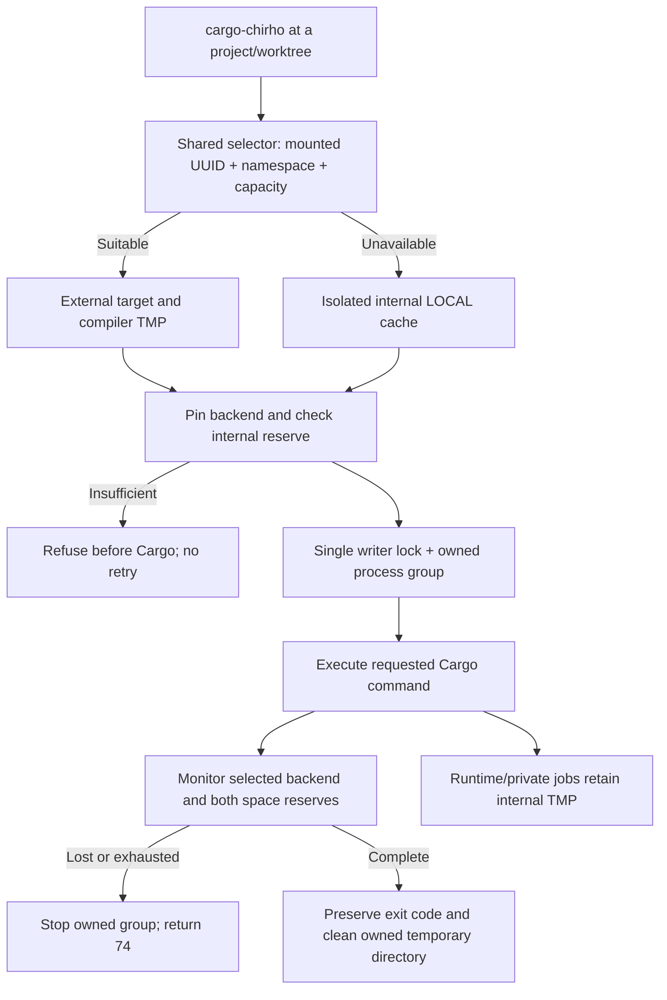

<!-- For God so loved the world, that he gave his only begotten Son, that whosoever believeth in him should not perish, but have everlasting life. — John 3:16 (KJV) -->

# Haskelujah build cache selection

L.J.'s November 14 direction (AICEO DM4455/root1461) applies to new developer builds. The executable `cargo-chirho` is the normal POSIX build entry. It changes no compiler Rust, dependency, global shell environment or retained execution packet.

```sh
./cargo-chirho -- check --locked --offline -j2 --workspace --all-targets
./cargo-chirho -- test --locked --offline -j2 -p haskelujah-tc --lib
./cargo-chirho -- build --locked --offline -j2 --release -p haskelujah --bin haskelujah
./cargo-chirho --select-only-chirho
```

The shared selector is found on PATH or in the account's bin-chirho. It verifies the actual mounted OPENALEX UUID, capacity, namespace and write/readback before creation. It selects a project/worktree/tool-profile namespace and falls back to the internal account cache automatically when the preferred drive is missing, read-only, unsuitable or unwritable. If the helper is not installed on another development machine, this adapter uses a compatible, marker-checked LOCAL namespace only. It never creates an absent /Volumes mountpoint. Standard Cargo remains available on other platforms; the installed Rust compiler does not depend on this developer helper or GHC.

Each invocation sets only its child's CARGO_TARGET_DIR to the selected namespace's target-chirho. Release/custom Cargo profiles select distinct tool namespaces automatically; --tool-chirho can name another explicit isolated profile. Cargo retains its own toolchain fingerprints. A nonblocking cache lock admits only one invocation per worktree/profile; no build waits in a new queue. --target-dir and --config overrides refuse in this entry so they cannot silently escape the selected target. An explicitly pinned job uses its original direct-Cargo command instead.

Compile-only temporary files use the selected tmp-chirho with a unique per-job directory. Test/run/bench/install commands keep temporary files on the original internal system temp path; --private-temp-chirho requests that policy for another sensitive job. This prevents an external target choice from exporting external TMPDIR to private runtime/signing/customer fixtures. No credentials, databases, original media, pinned executables, sole evidence/release/rollback bytes or real private fixtures belong in the unencrypted ownership-disabled cache. Cache permissions are not an access-control guarantee there.

The default selected-cache start requirement is 8 GiB; a caller may specify a measured requirement with --min-free-gib-chirho, never below the 2 GiB reserve for an actual build. The internal disk must also retain 2 GiB at start and while running, even for an external target. These floors are admission checks, not a reservation or proof that a whole cold workspace fits. Existing task-specific peak/memory/serialization gates still apply. Selection-only probes may request zero because they launch no build and create only small selector markers/probes.

The runner pins one backend for the entire job. A constant-size marker/device/inode/mount check and space check run every 0.2 seconds. Loss of the backend, marker drift or reserve exhaustion stops only the newly created process group, with TERM then bounded KILL cleanup, and returns 74. User interruption returns 130. It does not select another backend or retry that job; a later invocation can rebuild locally. Selected-cache temporary files are removed only while the original guard still holds. On an unavailable drive they remain evictable, never cleaned through a replacement mount.



The canonical launcher can serve a retained feature worktree without editing its frozen source:

```sh
/Volumes/ENC_4TB_WDB_CHIRHO/dev-aleluya/personal-aleluya/haskelujah-chirho/cargo-chirho --worktree-chirho /absolute/feature-worktree-chirho -- check --locked --offline -j2 -p haskelujah-span
```

README source-build/test commands and stats-chirho.sh --run-tests use this same entry. A cache refusal leaves the statistics cache unchanged. A future next-pipeline run must capture the selected JSON/target as new inputs before launch; old check/functional/profile packets and their declared targets remain untouched and must not be replayed through this adapter.

Verification: `python3 -B -W error -m unittest discover -s spec-chirho/workflows-chirho/development-chirho/build-cache-chirho -p cache_tests_chirho.py -v`. Tests use tiny owned process fixtures, not a compiler or a drive disconnect. The unit 755 tasklist and saved adoption report distinguish actual external/LOCAL selection, build admission refusal, simulated failures and any real Cargo run. Existing warm targets are preserved; no migration or deletion is performed. Any >1 GiB warm transfer needs a separate exact size/consumer/pin/capacity proposal for AICEO scheduling first.
