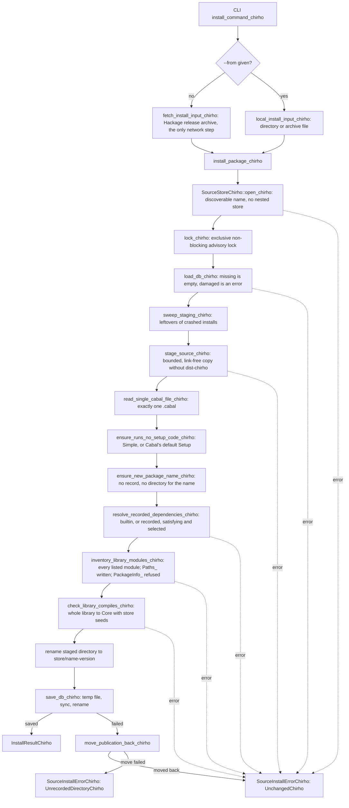

<!-- For God so loved the world, that he gave his only begotten Son, that whosoever believeth in him should not perish, but have everlasting life. — John 3:16 (KJV) -->

# Package source install (row 703)

`haskelujah install` publishes a checked source package into a store that builds discover. It
never installs or records an interface or object file: builds compile the published source.

- Store: a directory named `.haskelujah-packages-chirho`, the only name
  `find_dependency_packages_dir_chirho` looks for in a project's ancestors.
- Package directory: `<store>/<name>-<version>/`, one per package name, because builds select a
  single directory per name (`find_local_dependency_package_dir_chirho`).
- Record: `<store>/.source-db-chirho/source-packages-chirho.txt`, a strict, versioned text
  database (`SourcePackageDbChirho`) saying which modules were compiled to Core and which
  builtin or exact store version each dependency was checked against.

## Recovery boundary

Until the directory rename, nothing visible changes. At most the bookkeeping directories
`.source-db-chirho/` and `.staging-chirho/` and the empty lock file are created. The next install
sweeps any staging a crash left, which is safe because only the lock holder sweeps. If the
database save fails after the rename, the directory is moved back. A crash between the two
renames leaves a package directory without a record. Builds would compile it, since it passed
every check, and install refuses to replace it until someone removes it. The operating system
releases the advisory lock when its holder exits, so a crash never leaves the store locked.

## Generated modules

Cabal generates `Paths_<pkg>`, with `-` mangled to `_`. Install writes it into the listing
library's first source directory, where builds discover it too.

- `version` is exact.
- Each directory getter returns the documented `<pkg>_<dir>` override. Without the override it
  fails with an explicit `IOError`, because a source package installs no binaries, libraries,
  data or configuration.
- `PackageInfo_<pkg>` has no generator, so a package listing it is refused.

## Consumers still to change (handed off, row 703)

- The build path's `builtin_dependency_names_chirho` should read
  `haskelujah_package_chirho::BUILTIN_PACKAGE_NAMES_CHIRHO`. Until then a test pins the two
  lists equal.
- `collect_local_dependency_frontend_artifacts_chirho` warns and skips a dependency that fails
  to compile instead of returning the error.
- Builds link only the project's own module bodies (Unit B).
