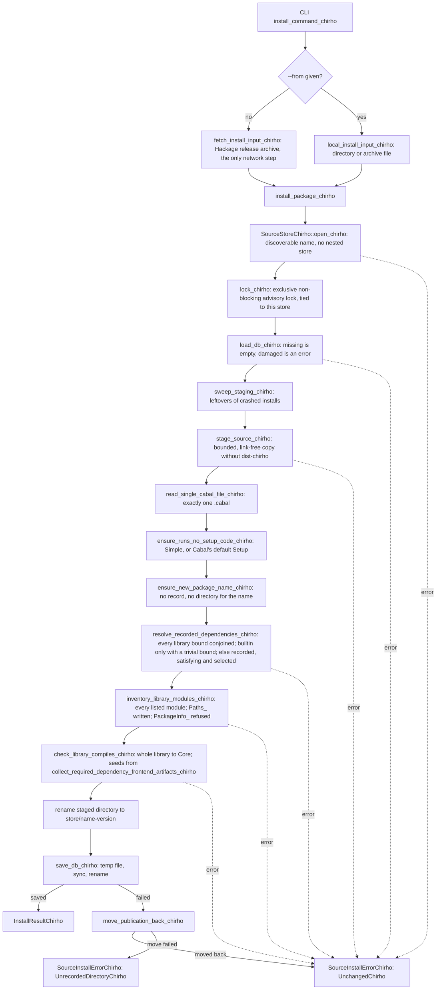
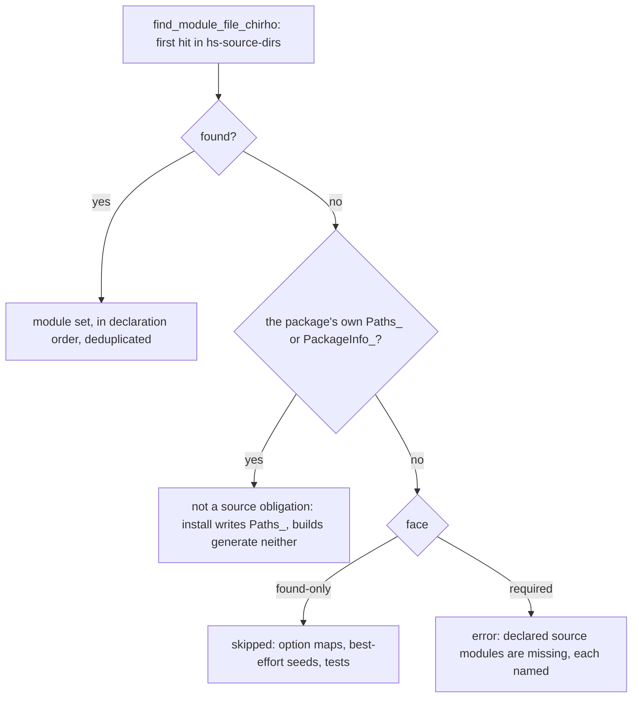
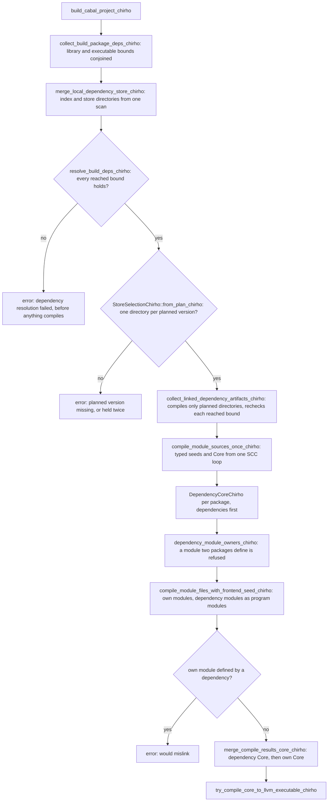

<!-- For God so loved the world, that he gave his only begotten Son, that whosoever believeth in him should not perish, but have everlasting life. — John 3:16 (KJV) -->

# Package source install (row 703)

`haskelujah install` publishes a checked source package into a store that builds discover. It
never installs or records an interface or object file: builds compile the published source.

- Store: a directory named `.haskelujah-packages-chirho`, the only name
  `find_dependency_packages_dir_chirho` looks for in a project's ancestors.
- Package directory: `<store>/<name>-<version>/`, one per package name, because builds select a
  single directory per name (`find_local_dependency_package_dir_chirho`).
- Record: `<store>/.source-db-chirho/source-packages-chirho.txt`, a strict, versioned text
  database (`SourcePackageDbChirho`) saying which modules were compiled to Core and which
  builtin or exact store version each dependency was checked against.

## Recovery boundary

Until the directory rename, nothing visible changes. At most the bookkeeping directories
`.source-db-chirho/` and `.staging-chirho/` and the empty lock file are created. The next install
sweeps any staging a crash left, which is safe because only the lock holder sweeps. If the
database save fails after the rename, the directory is moved back. A crash between the two
renames leaves a package directory without a record. Builds would compile it, since it passed
every check, and install refuses to replace it until someone removes it. The operating system
releases the advisory lock when its holder exits, so a crash never leaves the store locked.

## Generated modules

Cabal generates `Paths_<pkg>`, with `-` mangled to `_`. Install writes it into the listing
library's first source directory, where builds discover it too.

- `version` is exact.
- Each directory getter returns the documented `<pkg>_<dir>` override. Without the override it
  fails with an explicit `IOError`. That is a source-check limitation, not Cabal's behavior:
  Cabal falls back to the configured installation directories, and a source package has none.
- An unused listed `Paths_` module proves only that this shape compiles, never that Cabal's
  run-time paths work. Still to come: an override positive and a no-override `Unsupported`
  contrast at run time.
- `PackageInfo_<pkg>` has no generator, so a package listing it is refused.

## Consumers still to change (handed off, row 703)

- The build path's `builtin_dependency_names_chirho` should read
  `haskelujah_package_chirho::BUILTIN_PACKAGE_NAMES_CHIRHO`. Until then a test pins the two
  lists equal.
- `compile_cabal_project_chirho`, which compiles without linking, still collects dependency seeds
  best-effort (`collect_local_dependency_frontend_artifacts_chirho` warns and skips). Install and
  executable builds use the strict collector, which returns the first missing or failing direct or
  transitive dependency as its error.
- Executable builds gather bounds with `collect_build_package_deps_chirho`, which conjoins library
  and executable bounds. `collect_package_deps_chirho`, which `compile_cabal_project_chirho` keeps,
  still drops a later executable's bound on a package the library already names.

## Declared source modules (required discovery)

A component's declared modules are found by one probe, `find_module_file_chirho`: the first
`<Module/Path>.hs`, `.lhs` or `.hsc` in its `hs-source-dirs`, in order. Its found-only faces skip
what the probe misses, as builds once did everywhere. Its required faces refuse it by name, so a
builtin module of the same name never stands in for a missing declared one:

- `build_cabal_project_chirho` takes each executable's modules from
  `require_executable_modules_chirho`: its package's libraries, its own other modules and its
  `main-is`, which is searched in `hs-source-dirs` only.
- `compile_cabal_project_chirho`, the library-only build, uses `require_modules_chirho`: libraries
  and executables are required, and test-suite and benchmark modules stay best effort, since a
  default build does not select them.
- `DependencyWalkChirho::compile_package_chirho` reads a dependency library through
  `library_modules_chirho` under its demand. The linked and install collectors are required; the
  best-effort seed collector keeps found-only.
- Install's `inventory_library_modules_chirho` keeps its own refusal, writes `Paths_` and refuses
  `PackageInfo_`. An installed package therefore holds its `Paths_` module, while a plain store
  copy or a project build has neither generated module, and an import of one fails as an unknown
  module.
- A failed build links nothing, so `build-run` never runs an executable an earlier build left.

## Builtin versions (concrete missing metadata)

The compiler declares no version for the packages it provides. The `MIN_VERSION_*` values its C
preprocessor defines are compatibility seeds (`base` 4.14.0, `template-haskell` 2.16.0, `ghc`
8.10.0, `process` 1.6.0, `time` 1.15.0), and a store directory of the same name can raise them.
So install accepts a builtin dependency only with a trivial bound, and refuses every other bound
explicitly. Accepting `base >=4.7 && <5`, as haskell-say needs, requires a declared capability
version for `base`, decided and recorded by its owner. Install cannot infer one.

## Linking dependency bodies (Unit B)

`build_cabal_project_chirho` links the Core of every store dependency into each executable, at
exactly the versions its strict build plan selects:

- `compile_module_sources_once_chirho` is the only SCC loop. Both
  `collect_frontend_artifacts_from_module_sources_chirho`, for seeds, and
  `compile_module_sources_linked_chirho`, for Core, are thin wrappers around it. The legacy
  `compile_module_sources_with_extra_ifaces_chirho` adapter was removed once nothing outside the
  tests called it. Its tests now call the linked wrapper with the same empty seed and no linked
  modules.
- Dependency results are collected once per build and shared by every executable. Each executable
  appends its own results and truncates them again, since compile results cannot be copied.
- A dependency that fails to compile fails the build, because its body cannot be linked.
- `compile_cabal_project_chirho`, which compiles without linking, keeps the best-effort seeds.
- Strict resolution is the shared solver in its strict mode: `resolve_deps_chirho`, which
  `compile_cabal_project_chirho` keeps, skips an unsatisfiable root with a warning and accepts a
  version past an upper bound (allow-newer); `resolve_build_deps_chirho` does neither, for a
  package resolved earlier as for a new one.
- The solver does not backtrack. When a later dependent excludes the version it chose first, the
  build is refused, even if an older version would satisfy both.
- Builtins carry no declared version, so builds do not check their bounds (haskell-say's
  `base >=4.7 && <5` builds), while install refuses such a bound.
- A store package needs a version, from its .cabal file or its directory suffix. One without is not
  in the index, so a build that needs it is refused.
