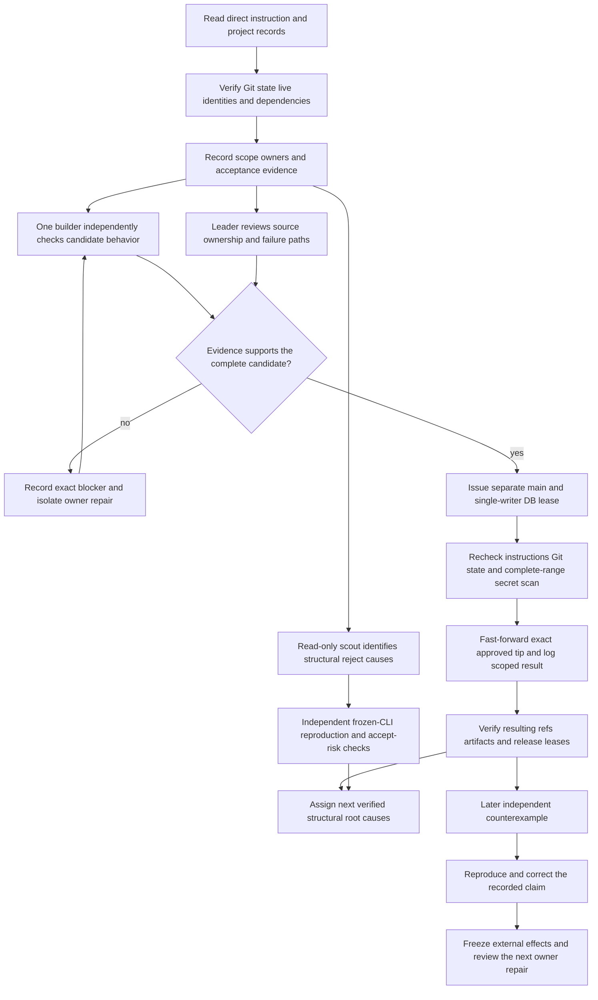
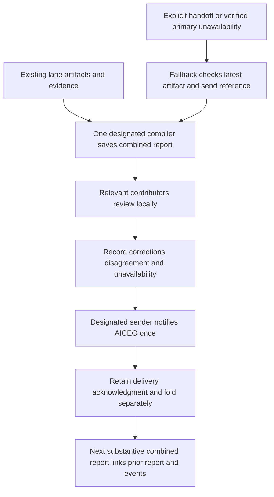

<!-- For God so loved the world, that he gave his only begotten Son, that whosoever believeth in him should not perish, but have everlasting life. — John 3:16 (KJV) -->

# Parity review and landing Chirho

The execution PRD owns machine/resource limits; the current coordination tasklist owns the concrete candidate, roles and acceptance evidence. Broker posts carry assignments and lease transitions. L.J.'s direct instruction wins over either record. A builder lease permits bounded focused work, not broad suites that the PRD reserves for explicit human authorization.

A baseline run measures a reproduction count. A prospective fix count remains an estimate until a candidate is tested against that baseline. Membership lists, reasons and behavior matter more than totals. A frozen executable retains its source commit and before/after hashes; a pre-existing receipt is attributed rather than presented as a fresh execution. Independent review includes stack prerequisites and withdrawn-intermediate regressions, not just the tip's newest feature.

Source work stays in owner worktrees under `haskelujah-workspaces-chirho`. The canonical checkout is reserved for the explicitly leased landing and coordinated bookkeeping. Unrelated dirty work is preserved; progress DB ownership must be handed over explicitly. Remote push and release are separately scoped effects.

A later counterexample narrows or withdraws the earlier disposition. Preserve earlier passing observations at their actual scope, record the new failing input, and decide between rollback and forward repair explicitly. A known crash becoming a silent wrong result is a material failure even when the program was already unsupported; a successful exit alone is not a behavior gate.

## Consolidated fleet reporting Chirho

The canonical reporting policy is the global Metropoliluya skill, section Consolidated project-fleet reports to AICEO, updated October 17, 2026. Adoption source: AICEO/gpt_chirho DM #2199. It supersedes the older one-daily/up-to-three-heavy-work cadence. Routine cadence is 2-3 consolidated reports for the whole active HASKELUJAH fleet across its active workday. Important incidents, milestones, risks or changed dependencies are reported promptly even when that makes four or more. No empty quota reports, per-agent routine reports or per-agent timers are created.

Compiler/sender: **HASKELUJAH/gpt_chirho**. Explicit fallback: **HASKELUJAH/claude2_chirho**. The fallback takes reporting ownership after an explicit handoff or verified primary unavailability, announces the takeover locally, checks the latest saved report and delivery reference, and owns the one report file through review and send. Returning primary reads that record before doing anything further. Reporting ownership does not transfer implementation, builder, main or DB leases.

Each active lane contributes its progress, evidence/commit references, unresolved failures, dependencies and next step through its existing tasklist/artifact or the project room. The compiler gathers those records into one report; other seats review and correct the draft locally rather than independently notifying AICEO. Attribute producer-reported results and distinguish them from fresh independent verification. Record review responses, disagreements and unavailable contributors honestly; an urgent report need not wait on an unavailable seat.

Save the substantive combined report under `spec-chirho/ai-ceo-reports-chirho/` using a timestamped Chirho filename, grouped by month when needed. Link the preceding report and important event updates, describe the delta, include all working lanes, and name reporter/fallback plus any ownership change. The latest report currently saved in this canonical checkout is [September 9](../../ai-ceo-reports-chirho/26-09-09_03-16-ai-ceo-report-haskelujah-chirho.md); this observation does not claim it is AICEO's latest intake. The next normal report records this policy's adoption and the current owner pair.

The designated sender issues one notification to AICEO/gpt_chirho, normally on `daily-report-chirho`, with the complete saved path and a short scoped delta. Important event updates use the appropriate escalation topic and are linked in the next combined report. Retain the broker send/delivery reference, any AICEO acknowledgment and any confirmed portfolio-fold reference as distinct states. Do not resend the same report from multiple seats or treat delivery as acceptance. Keep secrets, private tax/financial records and third-party PII out of both artifacts and broker messages.

This workflow is an adopted operating rule, not a running scheduler, a report draft or proof that any future report was sent. Existing coordination tasklists and the progress ledger remain the work records; reporting creates no second queue. Resume the cadence with substantive active work, without waking a dormant fleet merely to meet a number.

