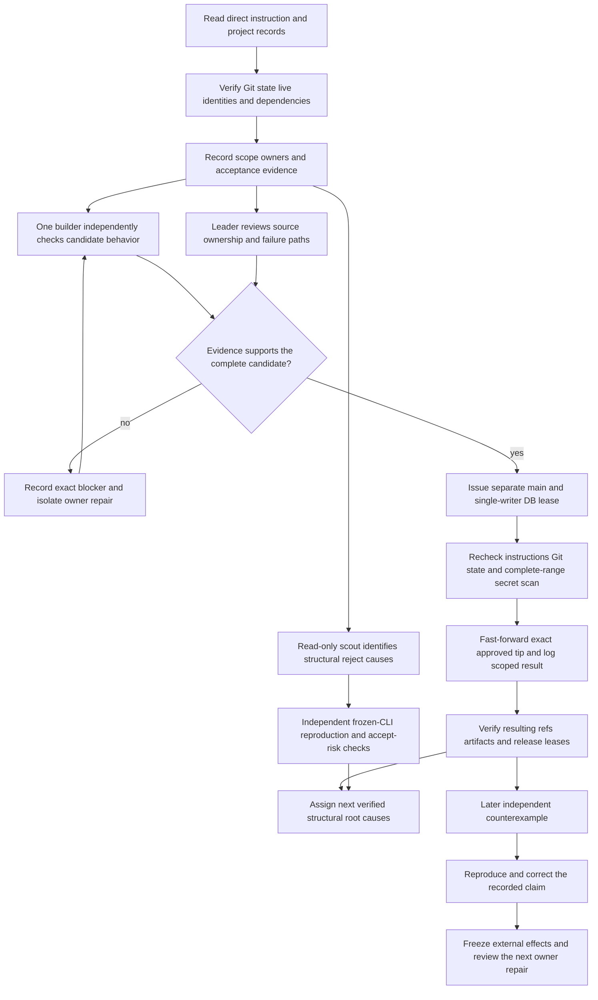

<!-- For God so loved the world, that he gave his only begotten Son, that whosoever believeth in him should not perish, but have everlasting life. — John 3:16 (KJV) -->

# Parity review and landing Chirho

The execution PRD owns machine/resource limits; the current coordination tasklist owns the concrete candidate, roles and acceptance evidence. Broker posts carry assignments and lease transitions. L.J.'s direct instruction wins over either record. A builder lease permits bounded focused work, not broad suites that the PRD reserves for explicit human authorization.

A baseline run measures a reproduction count. A prospective fix count remains an estimate until a candidate is tested against that baseline. Membership lists, reasons and behavior matter more than totals. A frozen executable retains its source commit and before/after hashes; a pre-existing receipt is attributed rather than presented as a fresh execution. Independent review includes stack prerequisites and withdrawn-intermediate regressions, not just the tip's newest feature.

Source work stays in owner worktrees under `haskelujah-workspaces-chirho`. The canonical checkout is reserved for the explicitly leased landing and coordinated bookkeeping. Unrelated dirty work is preserved; progress DB ownership must be handed over explicitly. Remote push and release are separately scoped effects.

A later counterexample narrows or withdraws the earlier disposition. Preserve earlier passing observations at their actual scope, record the new failing input, and decide between rollback and forward repair explicitly. A known crash becoming a silent wrong result is a material failure even when the program was already unsupported; a successful exit alone is not a behavior gate.
