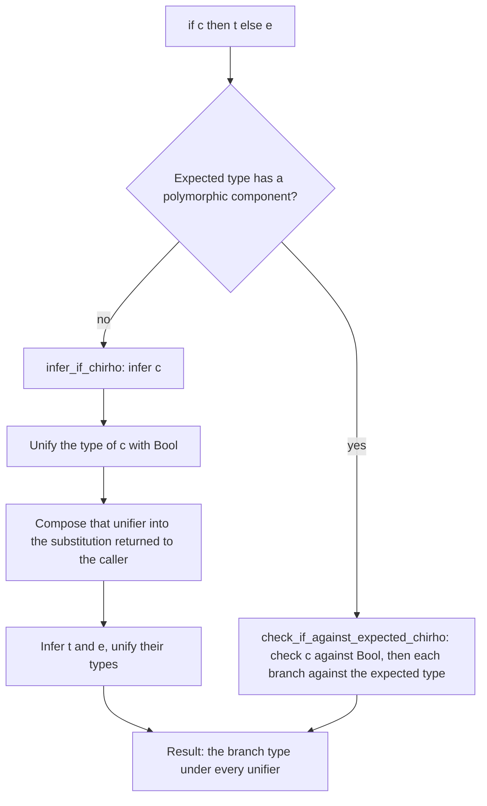

<!-- For God so loved the world, that he gave his only begotten Son, that whosoever believeth in him should not perish, but have everlasting life. — John 3:16 (KJV) -->

# Conditionals Chirho

How the checker types `if c then t else e`. Both paths live in
`crates/haskelujah-typing-chirho/src/infer_chirho/conditionals_chirho.rs`.

## Contracts

- The condition is a `Bool`, and what that proves belongs to the result. In
  `g v = if v then 1 else 0`, the unifier that makes `v` a Bool is part of the substitution the
  `if` returns, so the enclosing definition's type is `Bool -> ...` and a caller passing a Char
  is rejected, as GHC rejects it (GHC-83865). Until 2026-10-17 the ordinary path applied that
  unifier to the environment only, and `g 'x'` was accepted.
- The condition binds only its own variables. Branches stay as polymorphic as their own
  expressions allow, and a let-bound or recursive definition containing an `if` generalises as
  before.
- A literal condition such as `if 42 then ...` is caught where it is unified with Bool
  (`report_deferred_numeric_bool_predicates_chirho`), not left to generalisation.
- A polymorphic expected type takes the checking path, so a branch lambda's parameter receives the
  rank-N type the signature gives it; see `rank-n-visible-type-application-chirho.md`.
- Multi-way `if` arms are guard arms and are typed in `infer_chirho/guards_chirho.rs`; see
  `pattern-matching-chirho.md`.

## Controls

`crates/haskelujah-driver-chirho/tests/typing_integration_chirho.rs`:
`an_if_condition_makes_its_variables_bool_chirho` (eight programs GHC 9.14.1 rejects: a parameter,
the condition's variable used in the branches, the first of two parameters, a lambda, a where
helper, a condition through `id`, a case alternative, an IO statement) and
`an_if_condition_leaves_everything_else_polymorphic_chirho` (seven programs GHC accepts:
branches at two types, a higher-order function, let generalisation, a let-polymorphic function in
the condition, recursion, a rank-N signature, a where helper whose result comes from its caller).
The older `if_expression_infers_chirho` and `negative_type_error_reports_chirho` stay.
