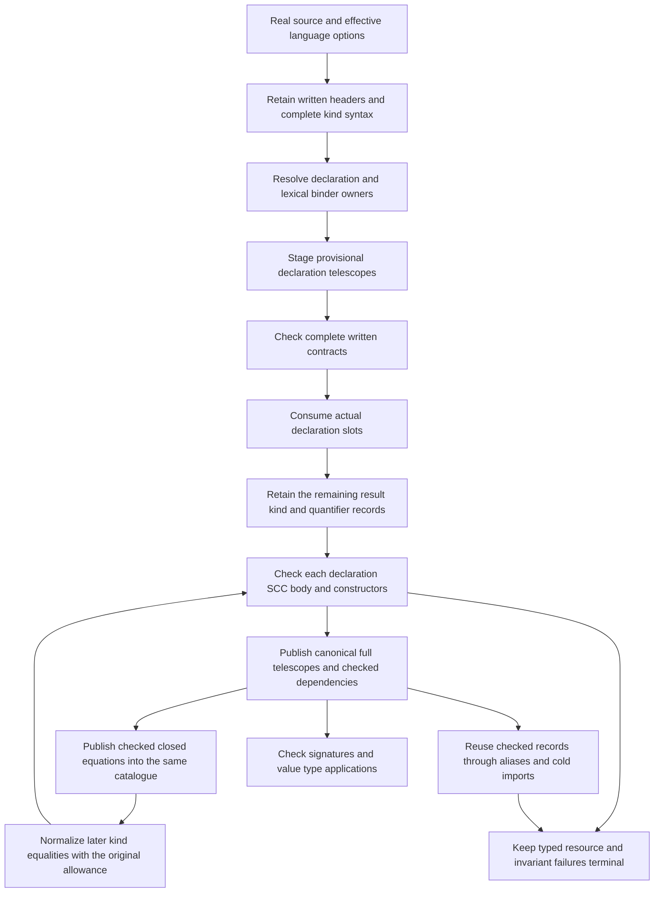
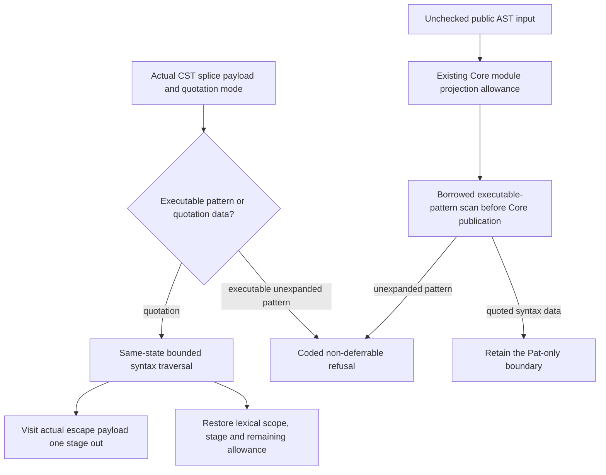
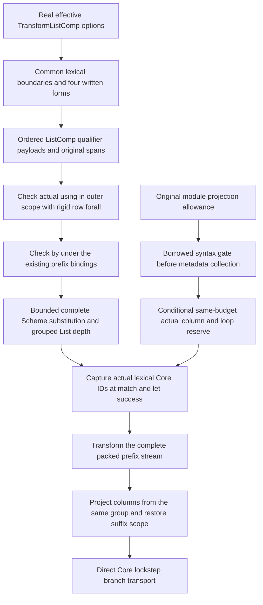

<!-- For God so loved the world, that he gave his only begotten Son, that whosoever believeth in him should not perish, but have everlasting life. — John 3:16 (KJV) -->

# Declaration kind contracts

The live frontend uses the TyChirho elaborator and one declaration catalogue. The public KindChirho APIs are compatibility views, not a second source of kind authority. The effective Module.extensions, selected type/class scopes and imported catalogue enter the same module pass.

An inline `data T a :: K` annotation describes the remaining result kind. A separate `type T :: K` describes the complete kind in its own lexical scope. DataKindSigChirho retains both. The standalone and newtype lowerers consume only the declaration delimiter `::`; subsequent colons remain in nested binder annotations. The existing complete binder parser preserves their kinds, specificity and spans. Annotation variables never become extra declaration arguments.

TypeElaboratorChirho::check_kind_contract_chirho relates the standalone signature to the actual producer-owned declaration telescope. Required forall variables consume remaining declaration slots. After those slots end, the required forall is part of the result kind. A quantified group may cross that boundary: its remaining QuantifiedVariablesChirho records are sliced intact, then the existing capture-safe substitution maps the consumed prefix through their kinds and body. Result quantifiers do not extend declaration or reduction arity. Copies and transformations charge the original state allowance; there is no fresh budget or scope. Leading invisible kind quantifiers retain their distinct compatibility rule.

Complete data/newtype headers are checked before their recursive bodies when the written contract permits it. Classes with standalone signatures or effective CUSKs and a kind annotation on every written binder use the same complete-header scheduling. A written invisible class binder also requires effective TypeAbstractions; a complete signature cannot enable syntax whose flag is off. These checks run before inferred catalogue binders exist and use the original shared allowance. Inferred headers stay shared through the declaration SCC. Local polymorphic kinds, constructor result checks and canonical publication use the same owner-aware state. No name spelling can supply a missing binder correspondence.

Declaration-head `@a` binds a lexical variable without consuming a visible type argument. The parser retains its complete binder. Constructor and selector types apply visible parameters while lexical checking keeps every binder in scope. Kinded existential prefixes remain conservative Unknown for role analysis; retaining readable syntax does not establish representation or dictionary authority.

A family keeps its complete signature apart from its result kind. Checked full telescopes, including hidden arguments, reach registration, reduction, imports and exports. A family or ordinary constructor may return an arrow or quantified kind without adding declaration parameters. Unknown or unavailable metadata is not upgraded by spelling. Runtime kind erasure and dictionary selection remain separate consumers.

Each completed declaration group publishes its checked closed-family equations into that same catalogue before later groups need their representation equalities. The producer retains the checked hidden and visible arguments, resolves their shared SCC variables, and abstracts one LHS binder namespace without introducing RHS-only variables. Held equations preserve their position and block later branches. Later ordinary registration reuses only the exact owned source proof, full reduction arity, defining module and checked closed definition; raw legacy contexts cannot claim that shortcut.

Abstraction and branch compatibility spend the original elaboration state's work and output allowance on success and refusal. The compatibility kernel reports which actual guard exhausted its allowance, keeping an administrative depth/unsupported refusal conservative while a tightened original owner allowance stays terminal. Kind equality normalization uses that same catalogue and owner budget in both ordinary declaration checks and late scoped arguments. Recursive families do not acquire an early reduction proof inside an unchecked recursive-kind group.

The real source controls pair T18891 with T18891a and exercise a required quantifier group that crosses the header/result boundary. The latter also checks the actual published telescope, residual kind and lexical dependency, alongside contradictory binder-kind and inferred-binder cases. These source tests establish their selected behavior only; frozen CLI, ordinary preservation and corpus acceptance require their own receipts.

Still open in this vertical: remaining configured corpus disagreements, ordinary-preservation acceptance and whole-row lint/structure obligations. A parsed header or a passing kind check does not imply runtime identity, constructor packing or full GHC compatibility.

## Quotation stages and retained patterns Chirho

The source parser retains an untyped pattern splice as SplicePatChirho and PatChirho::SpliceChirho with its actual optional expression payload and span. Missing or malformed payloads stay parser errors; a missing unchecked AST payload never becomes a wildcard. Expression quotations retain their typedness. Qualifier lowering consumes its existing owned parts and expression nodes, preserving payload occurrences without a recursive payload clone before elaboration.

The same elaborator tracks quotation syntax stage under the effective TemplateHaskellQuotes authority. Untyped quoted annotations, signatures, required-argument syntax and declaration headers use the common borrowed syntax traversal with zero copied output. Their binders do not acquire checked outer signature owners. A typed outer expression quotation keeps ordinary annotation checks. An escape visits its actual payload one stage out; lexical scope, quotation stage and syntax depth restore on success and error. The original state settles all borrowed work, retains its remaining depth and keeps resource exhaustion terminal, including a parser's retained GADT resource marker.

Core's public desugaring result preserves constructor/projection errors in DesugarInputErrorChirho and explicitly refuses an executable unexpanded pattern splice before collecting synonyms or generating bindings. This includes lazy patterns with no binders, records, views and explicit synonym builders. These source controls do not implement TH expansion/evaluation, the Code/TExp/Q declaration producers, or the complete typed-quotation result contract. Existing quote/splice fresh-type and Core-zero fallbacks remain explicit separate gaps; source admission is not execution proof. Unknown quoted type-name handling and the retained typed-quotation visible-application miss remain open. No runtime dictionary identity or constructor-packing permission follows from retaining syntax.

## Transform/group qualifier transport Chirho

No transformer is chosen by spelling. Compiler-generated row/list operations do not resolve a source-spelled map/zip/concatMap. User payload expressions and their existing occurrence metadata stay intact. A group lifts each complete existing value scheme, including hidden predicate kinds, extra arguments, proof/Unknown state and lexical quantifier ownership; all generated depth/output is charged to the original state. The original pre-collection executable-pattern gate remains in place. Its conditional row-reserve pass uses the same remaining allowance after actual record/pattern-synonym metadata is available; no Core is published on a typed resource or unread-input error.

The unchanged mc18/tc240 list-based sources now typecheck in the focused source tests. Source-owned keyed-column, repeated grouping, outer transformer scope, zero-column guard and parallel lockstep interpreter controls match fresh GHC9.14.1. This does not supply the missing GHC.Exts groupWith body, establish all monadic transforms, prove native execution, or close ordinary preservation/full compatibility. The unmodified groupWith runtime test remains RED. Fresh current-main A9 baseline and combined root integration follow this coherent brick.
