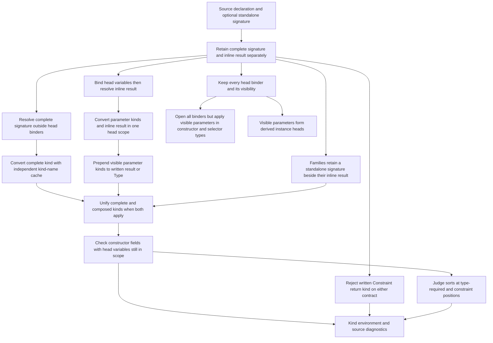

<!-- For God so loved the world, that he gave his only begotten Son, that whosoever believeth in him should not perish, but have everlasting life. — John 3:16 (KJV) -->

# Data/newtype kind contracts

An inline `data T a :: K` annotation describes only the remaining result kind.
A separate `type T :: K` describes the complete kind in a separate lexical
scope. `DataKindSigChirho` retains either or both; absence is not a fabricated
annotation. This distinction is shared by data and newtype declarations.

The standalone conversion swaps the kind-name cache instead of cloning the
growing environment. Fresh identities and accumulated substitutions survive;
the prior name cache is restored. Head annotations and an inline result share
their local kind identities. A complete signature is related to the head by
structural unification, not by matching variable spellings. The cache swap is
O(1); this does not claim the whole module kind pass is linear.

The no-inline default is Type even with a standalone signature. GHC 9.14.1
rejects `type T :: Type -> Type; data T where MkT :: T Int`: a missing head
argument is not supplied implicitly by that complete signature. Conversely,
`data T :: Type -> Type where ...` has a written result arrow and zero head
parameters, so its arrow is retained. Complete kinds are never prefixed twice.

Declaration-head `@a` binds a lexical variable without consuming an ordinary
type argument. `TyVarVisibilityChirho` preserves that distinction; shared parser
group handling prevents annotation tokens from becoming extra parameters. Kind
composition and constructor/selector result types apply only visible parameters,
while naming and field conversion keep every binder in scope. Deriving filters
at its entry boundaries, borrowing ordinary binder slices and copying only a
slice that actually contains invisible binders. This is linear in the head, not
in the growing module environment.

When interpreting source as a kind, `forall a ->` retains a visible argument
classified by the binder's kind; `forall a.` does not. This differs from inferring
the kind of a quantified term type, where both forms have the body's kind.
See GHC 9.14.1's [type-declaration binders](https://downloads.haskell.org/ghc/9.14.1/docs/users_guide/exts/type_abstractions.html#invisible-binders-in-type-declarations)
and [required arguments](https://downloads.haskell.org/ghc/9.14.1/docs/users_guide/exts/required_type_arguments.html).

GHC-55233 is checked on both written contracts with one diagnostic, independently
of the existing Type/Constraint unification compatibility. Binder annotations
are not result annotations; local Constraint shadowing retains its previous
boundary. No broadening of that compatibility rule is part of this repair.

## Type families

A family keeps its standalone signature in `standalone_kind_chirho`, apart from its
inline result kind, and `infer_type_family_decl_kind_chirho` reconciles the two as a
data declaration's are: the signature is converted with the kind-name cache swapped
out, the head composes its parameter kinds with the inline result, and the two unify.
Unlike data, a family with a signature and no inline result leaves its result to the
signature, since a family may return an arrow kind: `type F :: Type -> Type -> Type`
with `type family F a` gives `F a :: Type -> Type`. A name written as an operator is a
standalone signature too, `type (:==) :: j -> k -> Type`, never a synonym (row 686:
T15079, SplitWD). The signature fixes the family's kind only; it adds no kind-indexed
reduction.

## Sort judgments

Type/Constraint unification stays compatible (`Dict :: Constraint -> Type` relies
on it), so `kind_chirho/sorts_chirho.rs` judges sorts where a position fixes one
(K01 reject frontier). A signature, a class method signature, either side of an arrow and a
constructor field require a type: one that resolves to `Constraint` and is headed by
an equality or by a name the module declares is reported, as in `SCon (SClass a)` or
`f :: (a ~ Int) -> Int`. A context requires a constraint: one headed by a data type or
newtype of this module is reported once its arguments leave `*`, as in
`Dict (Int ~ Int) => Int`. `~` is `k -> k -> Constraint` and `~~` is
`k1 -> k2 -> Constraint`, fresh at every use. Type variables and imported names are
never judged: an imported constructor keeps the kind of its first use, so a variable
can resolve to `Constraint` where GHC's polymorphic kind would not. A builtin class
spelling that naming proved (`Show Int` as a field) is a known head too; its instance
heads are judged as described in `compiler-pipeline-chirho/builtin-class-identity-chirho`.
Declarations are judged in source order, so a class used before its declaration is not
yet known.

## Evidence boundary

Lowering controls retain both annotations and their exact source-slice spans, and keep
the following signature. Naming controls distinguish the two scopes and prove
both contracts are visited. Kind controls exercise composition, contradiction,
cache independence and the Constraint rule before constructor use can mask an
error. The driver uses one GHC-9.14.1-executed source for inline, standalone,
combined-data and combined-newtype contracts, with output 42/7/11/13 through
STG, LLVM and Cranelift. Execution and full-gate results are recorded in the
unit tasklist, not inferred from these source-level controls.

Still outside scope: rigid kind skolems, complete polymorphic kind schemes,
arbitrary promoted/named kinds, imported authoritative kind metadata, and the
separate data-family/type-data/refined-GADT-result AST decisions.
Attachment to synonyms and classes, and duplicate/orphan signature diagnostics,
remain separate parser limitations.
The representation repair is not full TypeAbstractions checking: inferred versus
specified binder matching, dependent constructor/selector quantifier metadata,
TH reification visibility, and authoritative cross-module kind schemes remain
unimplemented. The tasklist keeps independently reproduced counterexamples.
