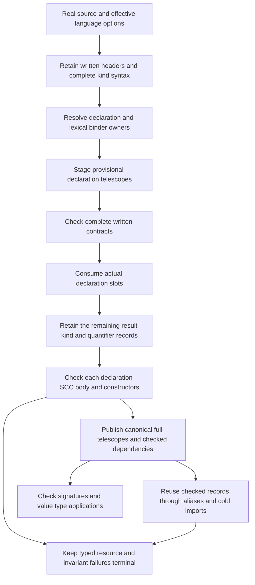

<!-- For God so loved the world, that he gave his only begotten Son, that whosoever believeth in him should not perish, but have everlasting life. — John 3:16 (KJV) -->

# Declaration kind contracts

The live frontend uses the TyChirho elaborator and one declaration catalogue. The public KindChirho APIs are compatibility views, not a second source of kind authority. The effective Module.extensions, selected type/class scopes and imported catalogue enter the same module pass.

An inline `data T a :: K` annotation describes the remaining result kind. A separate `type T :: K` describes the complete kind in its own lexical scope. DataKindSigChirho retains both. The standalone and newtype lowerers consume only the declaration delimiter `::`; subsequent colons remain in nested binder annotations. The existing complete binder parser preserves their kinds, specificity and spans. Annotation variables never become extra declaration arguments.

TypeElaboratorChirho::check_kind_contract_chirho relates the standalone signature to the actual producer-owned declaration telescope. Required forall variables consume remaining declaration slots. After those slots end, the required forall is part of the result kind. A quantified group may cross that boundary: its remaining QuantifiedVariablesChirho records are sliced intact, then the existing capture-safe substitution maps the consumed prefix through their kinds and body. Result quantifiers do not extend declaration or reduction arity. Copies and transformations charge the original state allowance; there is no fresh budget or scope. Leading invisible kind quantifiers retain their distinct compatibility rule.

Complete data/newtype headers are checked before their recursive bodies when the written contract permits it. Classes with standalone kind signatures use the same header contract check. Inferred headers stay shared through the declaration SCC. Local polymorphic kinds, constructor result checks and canonical publication use the same owner-aware state. No name spelling can supply a missing binder correspondence.

Declaration-head `@a` binds a lexical variable without consuming a visible type argument. The parser retains its complete binder. Constructor and selector types apply visible parameters while lexical checking keeps every binder in scope. Kinded existential prefixes remain conservative Unknown for role analysis; retaining readable syntax does not establish representation or dictionary authority.

A family keeps its complete signature apart from its result kind. Checked full telescopes, including hidden arguments, reach registration, reduction, imports and exports. A family or ordinary constructor may return an arrow or quantified kind without adding declaration parameters. Unknown or unavailable metadata is not upgraded by spelling. Runtime kind erasure and dictionary selection remain separate consumers.

The real source controls pair T18891 with T18891a and exercise a required quantifier group that crosses the header/result boundary. The latter also checks the actual published telescope, residual kind and lexical dependency, alongside contradictory binder-kind and inferred-binder cases. These source tests establish their selected behavior only; frozen CLI, ordinary preservation and corpus acceptance require their own receipts.

Still open in this vertical: complete written invisible class-header licensing without a standalone signature, remaining configured corpus disagreements and whole-row lint/structure obligations. A parsed header or a passing kind check does not imply runtime identity, constructor packing or full GHC compatibility.
