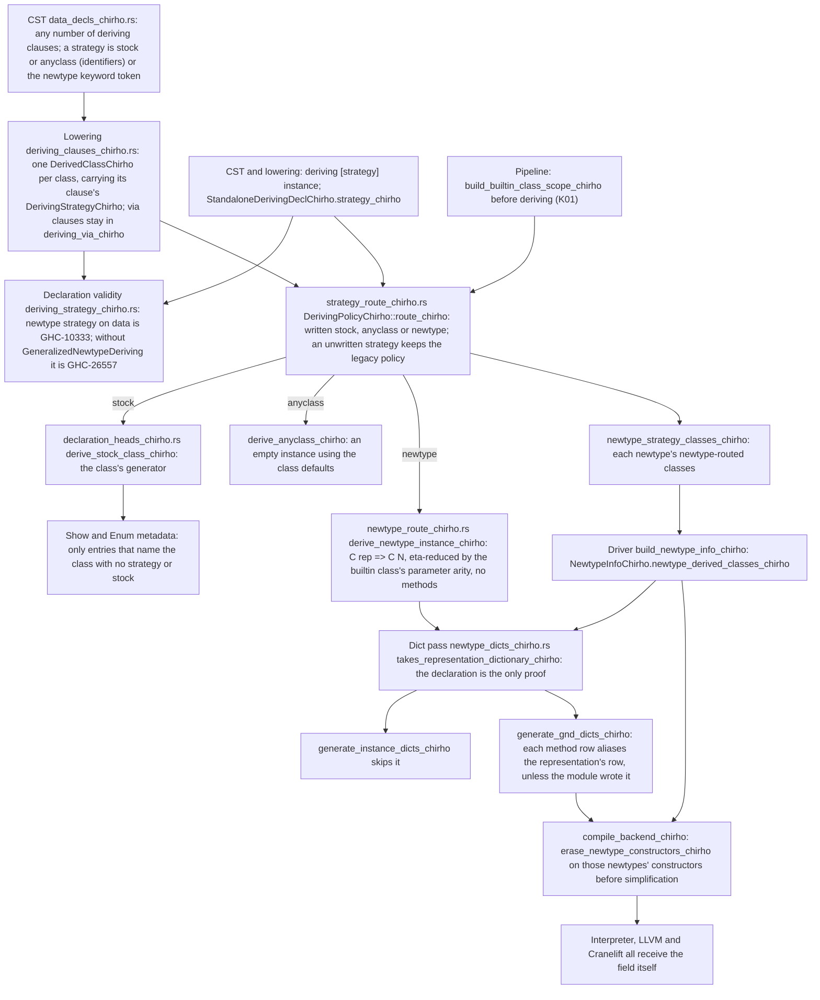

<!-- For God so loved the world, that he gave his only begotten Son, that whosoever believeth
in him should not perish, but have everlasting life. — John 3:16 (KJV) -->

# Deriving strategies workflow

Row 694 (D01). `newtype AgeChirho = AgeChirho Int deriving newtype Show` must print `7`, as
GHC 9.14.1 does, never the stock `AgeChirho 7`. A deriving clause therefore keeps its
strategy for every class it lists, an explicit strategy chooses the deriving mechanism, and a
newtype that takes a class through the newtype strategy (GND) shares its representation's
dictionary and its representation itself.

## Rules

- An explicit `newtype` never falls back to a stock instance. On a data type it derives
  nothing and declaration validity reports GHC-10333.
- A written instance with a context on a newtype head (`instance Show Int => Show Wrap`) is
  not GND: only the newtype's own deriving declarations put a class in
  `newtype_derived_classes_chirho`, so the dictionary pass never replaces its methods.
- A GND head drops the trailing variables the class's last parameter needs, read from the
  builtin class scope naming proved: `Functor`, `Applicative` and `Monad` drop one. A local or
  imported source class keeps the full head, as before.
- The native backends box an ordinary constructor as a tag word plus its fields. Only the
  constructors of newtypes with a newtype-routed class are erased from Core; every other
  newtype keeps its native representation.

## Residuals

- Not judged yet, until their GHC contracts are measured: `DerivingStrategies` itself (this
  compiler expands GHC2024 as GHC2021), the `anyclass` strategy's DeriveAnyClass requirement,
  and an unwritten strategy's Haskell2010 refusal.
- A standalone `deriving via` keeps its existing route.
- Classes over a higher-kinded parameter that naming does not prove keep the full GND head.
- Core erasure is per module. A native program in several modules that matches an imported
  GND newtype's constructor still needs the program-wide constructor set.
