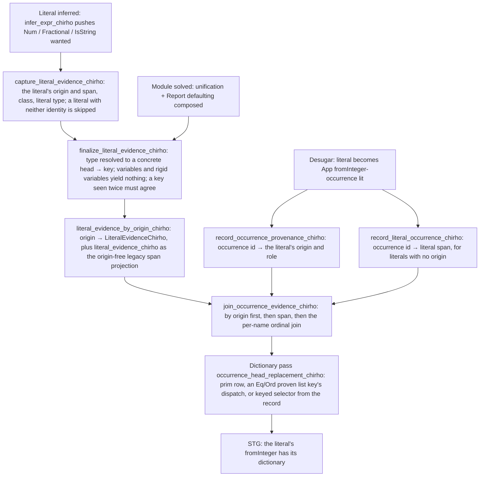
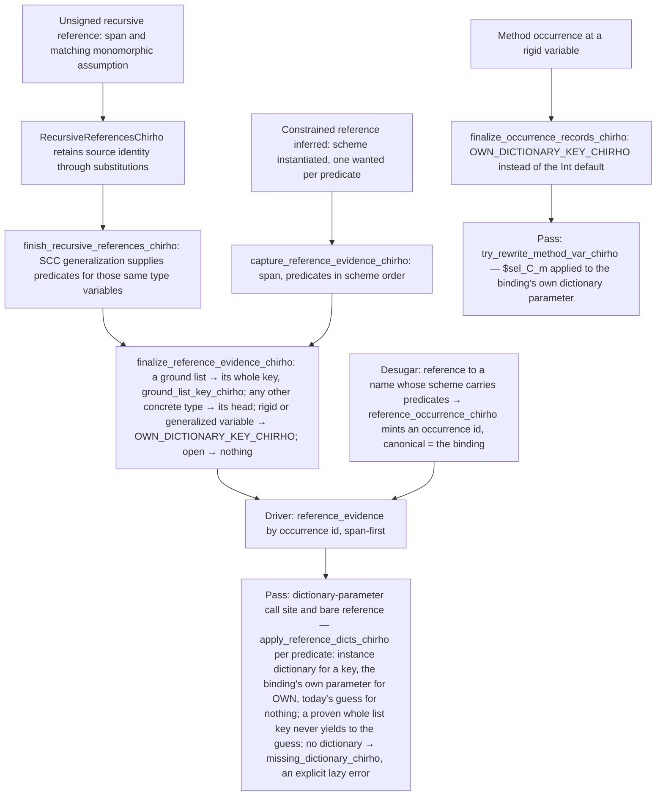
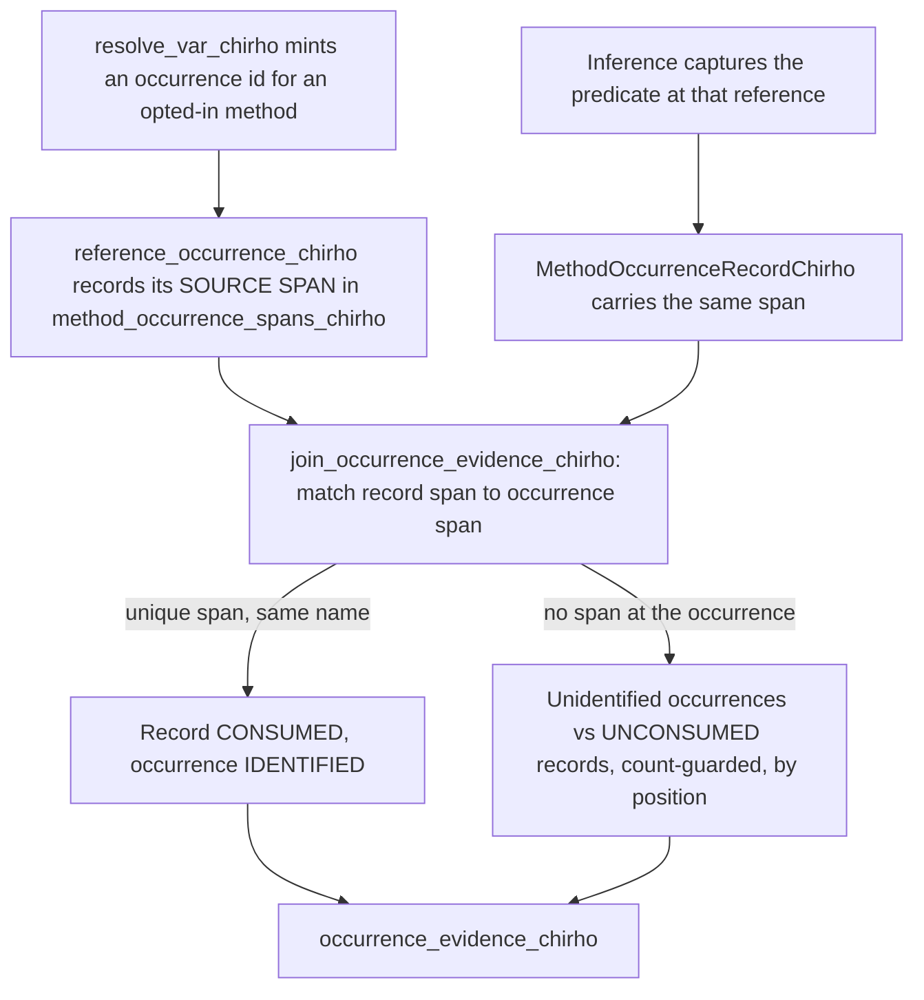
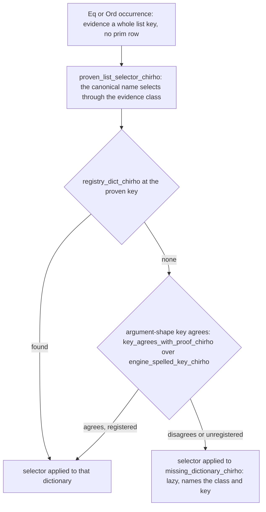
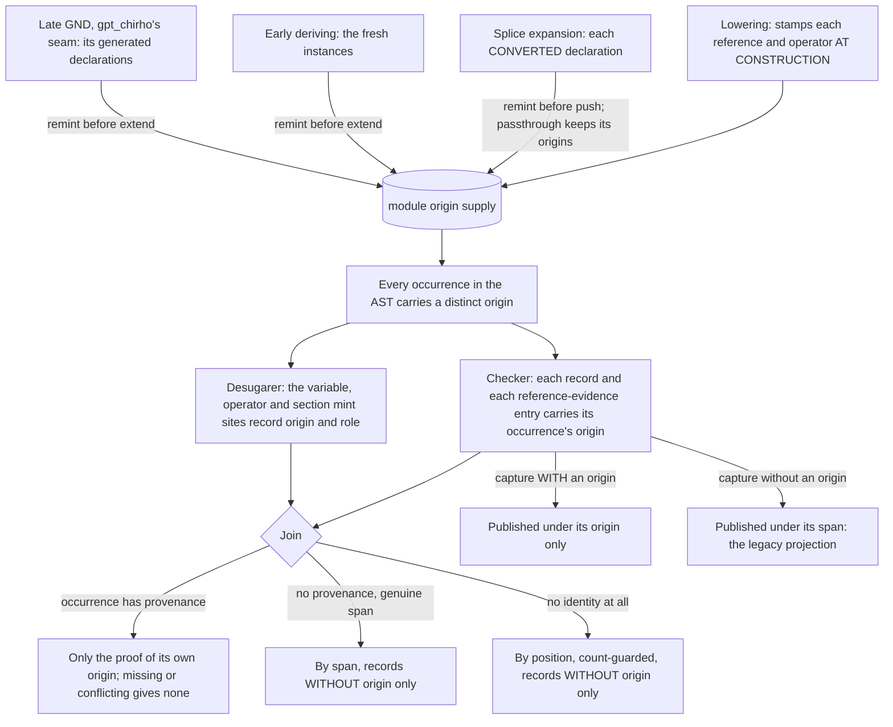
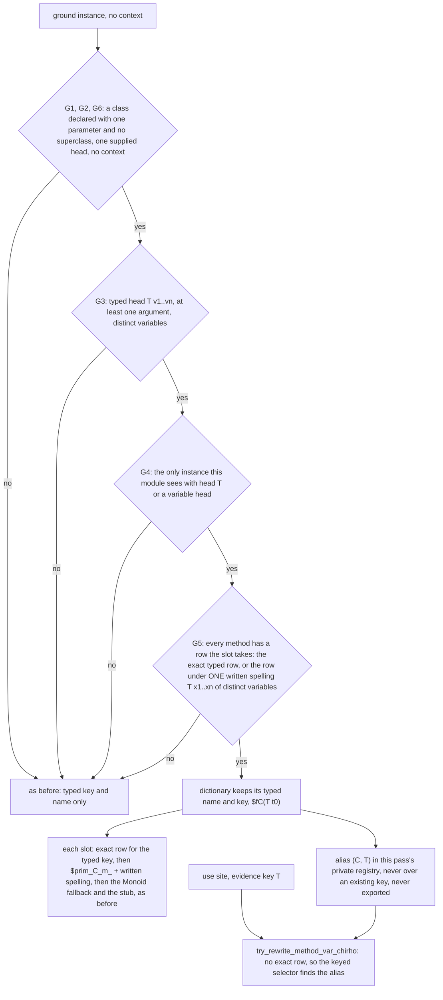

<!-- For God so loved the world, that he gave his only begotten Son, that whosoever believeth
in him should not perish, but have everlasting life. — John 3:16 (KJV) -->

# Dictionary evidence workflow

The dictionary pass used to decide instances by looking at Core syntax (sibling arguments,
literal markers, constructor names, binder types) and by treating a binding's ground scheme
predicates as proof. The checker already solves every constraint; this workflow hands the
pass what the checker proved, one record per source token, and the pass consults a record
before any heuristic. Programs without a record keep today's path and today's verdict.

## Invariants

- A record names one source occurrence, so inference order does not have to match desugar order.
  The key is the occurrence's ORIGIN where the producer minted one, and its span only where it did
  not; a generated node used to mean "dummy span, no record", and now means "its own origin, its
  own record". **This invariant was stated here before it was true of method occurrences**: they
  were joined by a per-name ordinal until 2026-09-19. See "Method occurrences" below; the
  lesson is that an invariant in this document is not evidence about the code, and the join it
  describes has to be read.
- Only a concrete head is evidence. A literal whose type is still a unification variable or a
  rigid variable produces no record; the enclosing binding's dictionary parameter (or today's
  fallback) serves it.
- A key the checker inferred more than once (a re-check, a speculative branch) yields a record
  only when every inference agreed. An occurrence with an identity whose record is missing or
  conflicting receives nothing, and is never rescued by its span or its position.
- The join maps the checker's `Integer` default onto the engine's `Int` rows at the driver
  boundary and nowhere else.
- No heuristic in the pass is widened by this workflow; records are consulted first, and the
  heuristics remain the fallback until a gate retires them.

## Reference evidence (bricks 3 and 4)

- An own-parameter record names the signature predicate it stands for (`$own:k`, recorded when
  the signature is skolemized: `record_own_dictionary_indices_chirho`); the pass keys every
  dictionary binder by predicate index as well as by class, so two predicates of one class are
  two parameters. The class-only form (`$own`) remains for superclass extractions and for
  generalized variables, where the pass's class-keyed parameter is the right one.
- Ground list keys and complete arguments (2026-10-17, gpt_chirho #27285). List dictionaries
  and method rows are named per element (`$fOrd[Int]`, `$prim_Eq_==_[Int]`, `$fOrd[Char]` for
  `String`); the head `[]` names none of them. So a list whose every part is ground keeps its
  whole key, `ground_list_key_chirho` (`infer_chirho/evidence_chirho.rs`), in method
  occurrence records for every class (`Show` already did) and, through
  `ground_or_head_key_chirho`, in reference keys, local `let`/`where` specializations and
  literal evidence alike. An instance head registers as it DISPLAYS (`instance C [[Char]]` and
  one written `[String]` are both `$fC[[Char]]`), while the evidence spells a nested string
  `String`, the spelling `Show`'s own rows use; so every lookup tries the key, then the key
  with each whole-word `String` spelled `[Char]` (`registry_spellings_chirho`, token-aware:
  `ByteString` and `Data.String` are untouched), then for dictionary lookups the head `[]`
  of a whole list key and the head of a higher-kinded class key, as before. A ground
  dictionary's METHOD SLOT crosses the same gap: the desugarer names an instance's method rows
  by the head as written (`$prim_C_m_[String]`, `$prim_C_m_String`), the dictionary by the head
  as typed (`[[Char]]`, `[Char]`), so a head written with `String` got a missing-method stub
  in its slot. `written_method_row_chirho` (`dict_chirho/instance_chirho/string_spellings_chirho.rs`,
  the rule's one home) fills the slot with the ONE source row whose written key, spelled
  out, is the typed key (agy_chirho #27325). The slot tries the exact typed row first, then a
  generic head's confirmed written row (Generic instance heads, below), then this row; two
  such rows are ambiguous and refuse, never a lowest-id pick (gpt_chirho #27399). Still a
  stub: another synonym, an application head (written `Maybe Int`, typed `(Maybe Int)`) and
  a later argument of a multi-parameter head. A head with type variables (written `T b`,
  typed `(T t0)`) is the generic-head rule's.
  A whole key the checker proved is never replaced by the
  argument-shape guess, which reads the element off the syntax and collapses `[[Int]]` to
  `[Int]`. And a call receives a dictionary for EVERY predicate: where none can be built,
  `missing_dictionary_chirho` (`dict_chirho/rewrite_chirho/constrained_references_chirho.rs`)
  passes an explicit error naming the obligation (`no instance dictionary for `Ord [[Int]]`,
  required by `sameChirho``). As any non-atomic argument it is lowered to a thunk
  (`stg_lower_chirho.rs`), so it fails only if forced. Before, the argument was left out and
  the next term argument took its place: programs printed nothing more and exited 0. The
  evidence-LESS typed-argument site (an infix use mints no reference occurrence) obeys the
  same rule through `typed_reference_dicts_chirho`: every slot or none (none → the general
  path decides), never a partial spine; `3.0 `halfChirho` 2.0` with `(Show a, Fractional a)`
  under an `Int` key printed `$PAP halfChirho …` for GHC's `"1.5"` (gpt_chirho #27303). Its
  key comes from the surrounding call, so a dictionary it serves can be at the wrong type;
  reference evidence for infix uses is the separate cure.
- Ground keys, measured boundaries (ground gate on 7ad703e8, gpt_chirho #27462). Unmet and
  left open:
  - The equality SECTION `(== [1])` lowers to the Int primop `==#` with no dictionary at all,
    so `map (== [1]) [[1],[2]]` prints [True,True] where GHC prints [True,False]. It does so on
    4cfb9584 too. The lambda form `\x -> x == [1]` runs through the whole key.
  - `[[1]] == [[2 :: Int]]` with annotated literals prints True (GHC False), on 4cfb9584 too.
    The signed form stays loud, which is fail-closed. Settled by R2 (Proven list keys at
    method occurrences, below): it now fails by name.
  - Both are pre-existing, but a program that used to abort earlier now reaches them, so the
    unit stays held until their leads are settled.
  - A user-class method used DIRECTLY (`tagChirho x`) mints no occurrence evidence and never
    reaches a dictionary. It stays loud; only a constrained call or a standard method's
    occurrence reaches the keys.
  - The literal channel's whole key has no observable effect today. Literal evidence is
    recorded for Num, Fractional and IsString only, so only an OverloadedStrings literal at
    `[Char]` is list-typed, and that literal runs alike under the whole key and under 4cfb9584's
    head key. The rule is kept for one shared key function, and no behavior is claimed for it.
  - The proven-key guard trades an accidental right answer for a loud failure:
    `sameChirho [[[1]], [[1 :: Int]]]` printed True on 4cfb9584 (correct by accident) and now
    fails, naming `Ord [[Int]]`. Its unequal twin printed a wrong True there.
- A reference occurrence is seen through by every dictionary-parameter lookup
  (`canonical_id_chirho`), and the spine pre-pass leaves an evidenced reference in place so the
  call-site path can read its records; one it finds no evidence for is restored to its
  canonical id before STG, exactly as method occurrences are.
- The higher-order-argument rewriter hands an evidenced reference to the variable arm; a key
  guessed from sibling arguments never dispatches a reference the checker proved.
- An unsigned recursive call initially has no scheme predicates to capture. Its name,
  source span and matching monomorphic assumption are retained until the existing SCC
  generalization supplies the predicates. This delays evidence capture, not inference or
  generalization. The every-capture-at-one-span agreement rule is unchanged; a shadowed
  name with a different type assumption is not treated as that recursive binding.
- Nested calls with reference evidence take the normal evidence-first rewrite path. The
  surrounding result type is not substituted for the callee's predicate type (`Eq a`
  must not become `Eq [a]` merely because a recursive deduplicator returns a list).
- Definition-side and call-side dictionary parameters share
  `resolved_pred_dictionary_chirho`: omit a parameter only if the same ground or
  permitted-default dictionary actually exists. A result-only Applicative/Monad
  variable is not a numeric default, and cannot vanish from the caller's argument list.
- Polymorphic `pure`/`return` with a scheme's own dictionary must use its method selector
  before any enclosing-monad heuristic. Their result type may be IO, Maybe or list;
  retaining their bare names would incorrectly force every call onto IO.
- Execution tests call the same unsigned recursive renderer at Int, Bool and Double,
  with a String separator, and check recursive equality on list elements. These read
  the evidence back through behavior, rather than asserting a particular internal key.

## Local bindings (brick 8)

A `let`/`where` binding generalized over a class is not in the module environment and gets no
dictionary parameter from the pass. Its evidence is the type the enclosing code instantiates it
at: `generalize_local_chirho`'s quantified variables are marked local, every instantiation of
the binding records its fresh variables (`instantiate_scheme_parts_chirho`), and
`local_specialization_key_chirho` yields a key when all of them resolve to one concrete head,
transitively when an instantiation resolves to another local binding's variable (`isPrime n =
checkDiv n 2`). Methods, literals and constrained references at that variable carry the key;
two disagreeing instantiations prove nothing and keep today's path.

## Method occurrences (repaired 2026-09-19)

The desugarer mints one occurrence id per free reference of an opted-in class method, in
DECLARATION order. The checker counts references of that name in INFERENCE-VISIT order, and
instance method bodies are inferred last (phase 3e). `join_occurrence_evidence_chirho` matched
those two sequences BY POSITION under a count guard, so a module with two `show` references
exchanged their evidence: the same program printed `W3` or `WChirho 3` depending only on which
declaration came first. The occurrence was rewritten to `$prim_Show_show_Int` before any
dictionary path ran, so the user's instance was found under the wrong key, and the same defect
crashed ("no matching alternative for tag 66") when a nullary and a one-field instance shared a
module.

- A proof serves ONE reference: a record the span join consumed can never be reused by the
  positional path, and vacancy in the consumer map is not ownership of a proof.
- An ambiguous or duplicated span identifies nothing and does not fall through to a positional
  assignment; its occurrence simply carries no evidence.
- The positional path exists only because the desugarer mints occurrences at several sites and
  only the variable-reference site records a span. Deleting it turns 19 driver tests red (all
  desugared shapes); restricting it to names whose occurrences all lack spans regresses a
  derived `Show` of a Bool field in a native round trip, where main is correct. It goes away
  when every mint site carries its own occurrence provenance, which a span alone cannot supply:
  one do or deriving node can create several references sharing a span, so the identity must be
  shared with the node that created them.

## Proven list keys at method occurrences (R2, 2026-10-17)

An `Eq` or `Ord` method occurrence whose evidence is a whole ground list key (`[[Int]]`,
`[Integer]`) that names no method row went through the keyed fallback, and when that found no
dictionary it came back from `occurrence_head_replacement_chirho` as the canonical id. The
rebuilt call recursed with no evidence, the method-application path keyed it off its first
argument, and the cons case of `infer_type_key_chirho` reads an unknown element as `[Int]`:
`[[1]] == [[2 :: Int]]` ran `$fEq[Int]`, whose `==#` compares the inner lists as empty string
prefixes, and printed `True`. Inside `sameChirho :: Eq a => ...`, the keyed fallback's
class-only fallback lent the enclosing `Eq a` dictionary instead, also `True`. Measured alike
on 4cfb9584 and 7ad703e8 (claude_chirho #27479, #27487; gpt_chirho #27481, #27488).

- Agreement compares engine spellings: whole-word `String` as `[Char]`, `Integer` as `Int`.
  The defaulted `[1] == [2]` is proven `[Integer]` and is still served by `$fEq[Int]`; `[Int]`
  never stands in for `[[Integer]]`.
- After a proven miss, never the canonical id and never the class-only fallback. The error is
  a thunk, so a comparison that is never forced (an unused `let`, an empty `map`, the right
  side of a short-circuited `&&`) never fails.
- Measured cost: `[Just 1] == [Just (2 :: Int)]` printed GHC's `False` only because the
  runtime's legacy operand unboxing (`force_to_prim_chirho`) reached the field of the one-field
  `Just` under `$fEq[Int]`'s `==#`; it now fails, naming `Eq [(Maybe Int)]`, the key's spelling.
  `[Just 1] == [Nothing]` was loud already.
- Scope: `Eq` and `Ord` (`PROVEN_LIST_CLASSES_CHIRHO`). `Show` keeps its documented
  dictionary path for shapes without a generated row (`show [Just RedChirho]` prints GHC's
  answer through it); every other class keeps its path, unmeasured.
- Not on this route: `/=` desugars to `not (==)` with no provenance, so it carries no evidence
  and `[[1]] /= [[2 :: Int]]` still prints `False` (GHC `True`), the Eq method set's repair.
  Sections, and infix `<`, `<=`, `>`, `>=`, lower to Int primops before any occurrence exists
  (R1, a separate unit).

## Occurrence provenance (in progress, 2026-09-22)

The identity a span cannot supply is minted by the PRODUCER of each occurrence and carried on the
node. `OriginSupplyChirho` is a field of `ModuleChirho`; lowering creates it, and every later
producer borrows it through the module, so one sequence runs across all of them. A module is not
`Clone`, so the supply cannot fork.

- `occurrences_chirho.rs` in the AST crate is the one statement of where occurrences live. Every
  match in it is exhaustive with no fallback arm, so a new expression, pattern, statement or
  declaration form does not compile until it is classified.
- Fresh generated output is reminted in full. Moving or keeping an occurrence preserves its
  origin. A subtree duplicated as new code is reminted at that duplication. A binder re-read from
  an expression carries no origin.
- Equality and hashing of a name ignore the origin, so no lookup changes meaning.
- Occurrence carriers today: variable and constructor references, the operators of infix
  applications and sections, and literals — in expressions AND in patterns, since lowering stamps
  every literal at construction. DO STATEMENTS now carry an origin too, on the operation each one
  SELECTS - its `>>=`, `>>` or `fail` - rather than on the statement; the checker records evidence
  for that operation under that origin. The join does not consume it yet, because it takes only
  the Reference role. List literals and arithmetic sequences get their own carriers next; until
  then their uses have no provenance and are served by span and position exactly as before.
- A literal in a pattern carries an origin but publishes no evidence yet: the checker captures
  nothing when it binds a pattern. That is a producer gap, not a transport gap, and it belongs with
  do-statement checking.
- Keying by origin gives GENERATED references evidence they never had: the checker used to skip
  a placeholder span at capture. That is a behaviour change, measured, not a neutral re-keying.

## Generic instance heads (2026-10-17)

- Three spellings of one instance used to part (claude2_chirho #27335). The checker types the head
  `SBoolChirho b` as `(SBoolChirho t0)`. The desugarer names the method rows by the head as written
  (`$prim_Eq_==_SBoolChirho b`). A use site keeps only the outer head (`SBoolChirho`). The
  dictionary `$fEq(SBoolChirho t0)` was registered under a key no use site carries and held a
  missing-method stub, so the instance never ran: `==` fell to the raw method. In a class declared
  with one parameter and no superclass, a head that is a constructor applied to distinct
  variables, with no competing head for that constructor among the instances this module sees,
  is the only instance any `T x1 .. xn` can mean here (`generic_head_chirho`,
  `dict_chirho/instance_chirho/generic_heads_chirho.rs`). Both halves are needed: the alias lets
  the use site's existing keyed-selector fallback find the dictionary, and the written row fills
  its slot.
- The alias is private (gpt_chirho #27368). `instance_dicts_chirho` is a field of the pass's
  context, created empty by every `dict_pass_module_*` entry and run once per Core module; nothing
  outside `dict_chirho` reads it. The dictionary keeps its typed binder name, so no new name is
  discoverable downstream. A consumer module recomputes G1-G6 over its own class environment, where
  a downstream OVERLAPPING instance or a same-named type from another module competes (G4). The
  alias is entered with `or_insert`, and a later exact `insert` replaces it, so an exact
  registration always wins.
- Boundaries (gpt_chirho #27342, #27349, #27365, #27366). A row that needs a context never becomes
  an unconditional dictionary (G2, the eligibility filter as before). A specialized, contextual or
  catch-all head for the same constructor leaves the generic one unaliased (G4): a use site that
  kept only the head never guesses among them. A class with a superclass is refused (G6): its
  superclass slot is named by the instance's own key, and the class records superclass names
  without their arguments, so `class S [a] => C a` would reach `S`'s instance for `T` where GHC
  uses `S [T ..]`. The desugarer's key drops parentheses, so only an all-variable written argument
  list is accepted, as a position-wise bijection with the typed variables. A second spelling is
  ambiguous and refuses; a method without a row the slot lookup takes would make a stub
  reachable and refuses (coverage and lookup read the same spellings, agy_chirho #27369). Still
  unsupported: full-key use sites (a ground `T Int` key never falls to `T`), multi-parameter heads,
  lists and tuples, written synonyms, classes with superclasses (claude2_chirho #27367: typed
  superclass keys already dangle across instances, since variables are freshened per instance),
  and instances with a context, which have no dictionary at all yet (the conditional-instance
  unit). Cross-module overlap and same-name controls run only once a multi-module frozen build can
  exercise them. A user-class method used directly mints no occurrence evidence, so its use
  site never consults the alias; a constrained call or a standard method's occurrence does.
  G4 counts only instances that reach the class environment: a context-free instance whose
  head carries an overlap pragma is lost before typing today, and while it is, its generic
  rival must not be aliased (see the tasklist's blocker).

## Current boundary

- An infix or section use of a class METHOD mints its own occurrence id and carries its
  operator's provenance, like a prefix use. An infix or section use of a constrained
  function that is not a method still resolves through the shared canonical id: only a prefix
  reference mints a reference occurrence for per-predicate reference evidence.
- Class methods never mint reference occurrences (the method paths key on canonical ids);
  own-parameter evidence therefore reaches the standard method list only, and a user class
  method at a rigid variable is still dispatched by the pass's inferred parameter keys.
