<!-- For God so loved the world, that he gave his only begotten Son, that whosoever believeth
in him should not perish, but have everlasting life. — John 3:16 (KJV) -->

# Dictionary evidence workflow

The dictionary pass used to decide instances by looking at Core syntax (sibling arguments,
literal markers, constructor names, binder types) and by treating a binding's ground scheme
predicates as proof. The checker already solves every constraint; this workflow hands the
pass what the checker proved, one record per source token, and the pass consults a record
before any heuristic. Programs without a record keep today's path and today's verdict.

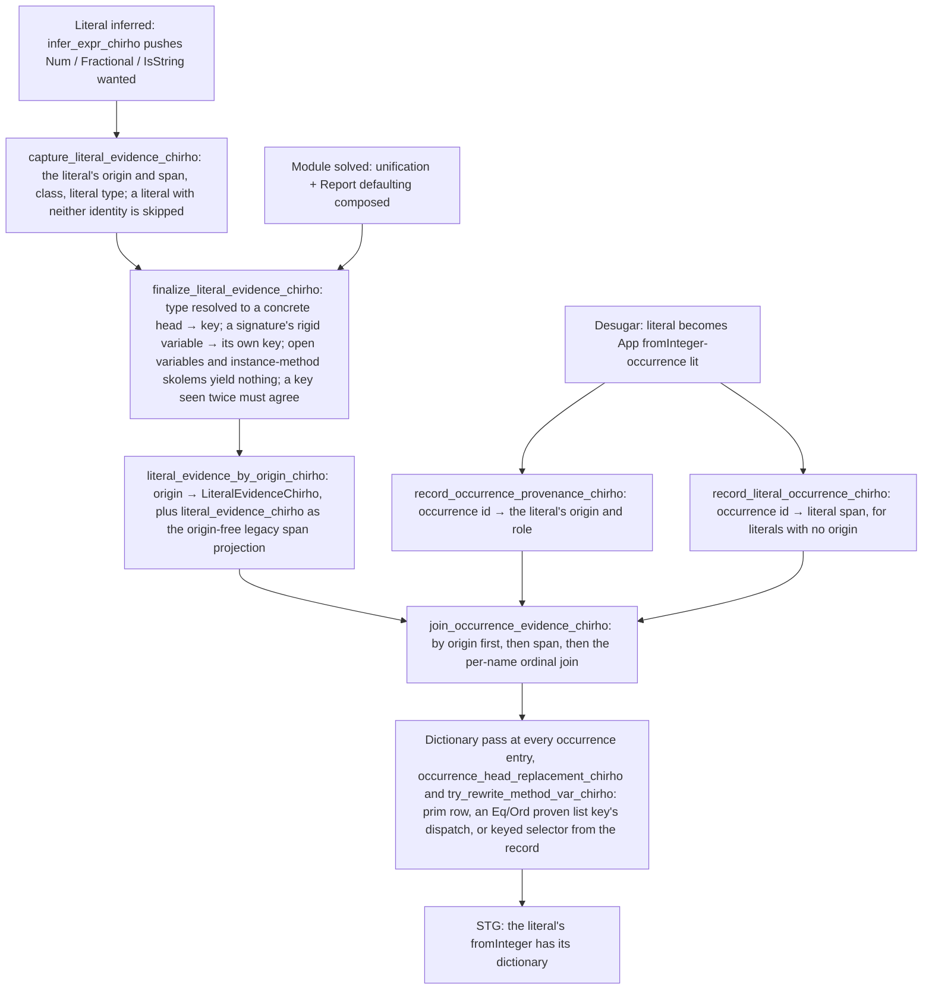

## Invariants

- A record names one source occurrence, so inference order does not have to match desugar order.
  The key is the occurrence's ORIGIN where the producer minted one, and its span only where it did
  not; a generated node used to mean "dummy span, no record", and now means "its own origin, its
  own record". **This invariant was stated here before it was true of method occurrences**: they
  were joined by a per-name ordinal until 2026-09-19. See "Method occurrences" below; the
  lesson is that an invariant in this document is not evidence about the code, and the join it
  describes has to be read.
- A concrete head is evidence, and so is a signature's rigid variable (row 584). A literal there
  takes the binding's own key, as an occurrence at that variable does.
  - It takes `$own:k` for the predicate the signature declares. It takes the class-only `$own` for a class that no predicate names, such as a Num literal under `Fractional a`. The pass serves that through the superclass extraction.
  - A literal still on a unification variable, or on an instance method's skolem, produces no record and takes today's fallback.
  - Before row 584, a rigid literal produced no record either, and the fallback keyed it `Int`, not the binding's parameter. The interpreter masked this, because its float primops accept an Int operand. The natives read the Int's bits as a Double: `incChirho x = x + 1` under `Num a` printed 2.5 at Double, where GHC prints 3.5.
  - Controls: `literals_at_a_signature_variable_take_its_dictionary_everywhere_chirho`, which includes two predicates of one class, and `a_fractional_signatures_literal_takes_its_dictionary_chirho`, in `tests/dictionary_evidence_chirho/fractional_literals_chirho.rs`.
- A literal in a locally generalized binding may reach that same rigid variable through its one
  agreeing instantiation (row 600). `local_literal_specialization_key_chirho` follows the local
  instantiation chain and turns the terminal signature skolem into its exact `$own:k` key. A
  concrete terminal keeps the existing specialization path; open, cyclic, disagreeing and
  instance-method-skolem paths still publish nothing. Reference and method-occurrence evidence do
  not take this literal-only endpoint.
  - Before row 600, `where sum _ = 42` under `total :: Num a => [a] -> a` produced no literal record. The dictionary pass therefore used Num Int: the interpreter rejected `42#` at Double and both natives silently printed `2.08e-322`.
  - Control: `a_local_result_literal_takes_the_enclosing_dictionary_everywhere_chirho` in `tests/dictionary_evidence_chirho/fractional_literals_chirho.rs`.
- `sum` and `product` at a binding's own key fold over that binding's dictionary (row 586).
  - Row 552 turned an evidenced aggregate at a concrete key K into `foldl $prim_Num_+_K ($prim_Num_fromInteger_K 0)`. At `$own:k` there is no such row, so `sum` fell back to the Prelude's Int-shaped `sum`.
  - At Double the interpreter then failed on `AddIntChirho`, and both natives added the Doubles' bits as integers.
  - Now `own_aggregate_chirho` (`rewrite_chirho/evidenced_aggregates_chirho.rs`) builds the same fold from selectors: `foldl ($sel_Num_+ d) ($sel_Num_fromInteger d 0)`.
  - `d` is `own_dict_chirho`'s answer: the `$own:k` parameter, or the Num that a superclass extraction takes from `$dFractional`.
  - The three rewrite sites with the binding's dictionaries in scope ask `evidenced_value_in_scope_chirho` and `evidenced_applied_head_in_scope_chirho`. The surviving-occurrence sweep has none, and keeps today's path.
  - Controls: `sums_and_products_at_a_bindings_own_key_answer_as_ghc_everywhere_chirho`, covering the fold order, empty lists, Int, a point-free `product` and two predicates, and `a_fractional_bindings_aggregates_take_its_dictionary_chirho`, in `tests/native_error_helpers_chirho.rs`.
- A program's own `sum` or `product` keeps its body (row 593).
  - **The defect:** the checker recorded the Prelude function's `Num` evidence on an occurrence whose canonical id is the program's own binder, such as a local `where sum _ = 99`.
  - Both aggregate routes then replaced the call with the Prelude fold: row 552's concrete key, and row 586's own key. It was silently wrong on every engine: `(6.5,9,9)`, where GHC prints `(6.5,99,98)`.
  - **The fix:** `module_bound_ids_chirho` holds every binder in the module's bindings, seeded beside the free ids. `names_programs_own_binder_chirho` checks an occurrence's canonical id against it, and `evidenced_applied_head_chirho` and `own_aggregate_chirho` yield for the program's own.
  - **Already right:** local `print`, `max`, `min`, `maximum`, `minimum` and `^^`, because the checker records no evidence there. They need no guard of their own, and the extrema and `^^` sit behind the same applied-head guard.
  - **Row 600 follow-up:** the local literal residual recorded here now takes the enclosing signature's exact dictionary through the literal-evidence path above.
  - Controls: `a_programs_own_sum_and_product_keep_their_bodies_everywhere_chirho` and `a_local_sum_in_a_polymorphic_binding_keeps_its_body_everywhere_chirho`, in `tests/native_error_helpers_chirho.rs`.
- A generated Prelude binding never takes a local binder's id (row 594).
  - **The defect:** `resolve_or_fresh_id_chirho` gave a generated binding the first id named like it in the name table's hash order, skipping only occurrence ids. Generated bindings include the Prelude's `length` body, and the `foldl` that row 552's fold calls.
  - Beside a local `where length _ = 99`, that was the local binder's id in about half the passes. The Prelude `length` the program uses was then unbound, on every engine.
  - A lone local `foldl` captured row 552's `sum` fold inside `main`. LLVM printed `(4336781493,6)`, where GHC prints `(6,6)`.
  - **The fix:** the resolver prefers the id the program's bindings use free under the name. Otherwise it takes the least other id that is neither a local binder (`module_local_binder_ids_chirho`, split from row 593's set) nor an occurrence id; otherwise a fresh one. Row 580's alias helper goes through it.
  - **Not covered here:** top-level binders, which row 597 below takes up. Those under source names become program-owned. The compiler's `$f…` and `$prim_…` spellings stay resolvable by name.
  - Controls:
    - `local_binders_leave_the_prelude_functions_bound_everywhere_chirho`, in `tests/native_error_helpers_chirho.rs`: six local Prelude names, eight interpreted runs and one per native backend.
    - `a_lone_local_foldl_leaves_the_sum_fold_alone_everywhere_chirho`, beside it: the capture of row 552's fold, on every engine.
    - The 16-pass `a_generated_prelude_binding_never_takes_a_local_binders_id_chirho` and `a_generated_prelude_binding_takes_the_free_id_beside_a_top_level_namesake_chirho`, beside row 580's `a_local_pi_never_takes_the_prelude_alias_chirho`.
- Generated Prelude code keeps to its own dependencies (row 597).
  - **The defect:** generated bodies reach their dependencies by name. A function the program wrote at top level under the same source name took them.
    - The resolver gave the generated binding the program's id, so the program's body won, and every generated caller called it.
    - The two plain-named body-backed lookups, `foldl` in row 552's fold and `putStrLn` in the evidenced `print`, returned the program's binding first.
  - **Silent on every engine,** each from a hidden-and-redefined function:
    - `foldl` under `sum` and `product` gave `(0,1,7)`, where GHC gives `(6,10,7)`;
    - `reverse` under `isSuffixOf` gave `False`;
    - `gcd` under `lcm` gave `(24,1)`;
    - `mapM_` under `forM_` ran the program's version;
    - `putStrLn` under `print` gave `own 7`.
  - **No hiding needed:** a program's own `append` broke `concat` and `concatMap`, and a binary search tree's `insert` broke Data.List `sort`.
  - **The fix:**
    - `module_source_binder_ids_chirho` records the module's top-level binders under source names.
    - The resolver skips them, as it skips local binders (row 594), so a generated binding takes a compiler-owned id.
    - `lookup_compiler_owned_name_id_chirho` serves the two plain-named body-backed sites. The other body-backed lookups name `$` rows and are unchanged.
  - **Still resolvable:** the compiler's own spellings (`$prim_…`, `$f…`, `$w…`), which no program can write. Instance generation still reaches the program's `$prim_` rows by name. `$` and `$!` are source operators.
  - **Spelling:** the natives name top-level functions by spelling.
    - With ids alone, Cranelift refused a second `foldl`, and LLVM merged the two: the program's `foldl (+) 7 [1,2]` gave 10.
    - `spell_compiler_owned_apart_chirho` therefore spells a compiler-owned binding that shares a source name with one of the program's top-level functions `$prelude_<name>`.
    - A program without such a collision keeps every spelling.
  - Controls:
    - In `tests/native_error_helpers_chirho.rs`: `generated_prelude_code_never_calls_a_hidden_redefinition_everywhere_chirho`, `a_programs_own_helper_namesakes_leave_the_prelude_whole_everywhere_chirho`, and the hold `hidden_redefinitions_used_directly_stay_the_programs_everywhere_chirho`.
    - Structural: `generated_code_never_reaches_a_program_written_namesake_chirho` and `only_the_compilers_own_spellings_are_internal_chirho`.
    - Re-pinned: row 594's `a_generated_prelude_binding_takes_the_free_id_beside_a_top_level_namesake_chirho`, and `evidenced_print_rewrites_to_show_instance_then_put_str_ln_chirho`, whose fixture defines its own `putStrLn`.
- A key the checker inferred more than once (a re-check, a speculative branch) yields a record
  only when every inference agreed. An occurrence with an identity whose record is missing or
  conflicting receives nothing, and is never rescued by its span or its position.
- The join maps the checker's `Integer` default onto the engine's `Int` rows at the driver
  boundary and nowhere else.
- `fromIntegral` consumes both predicates of its own reference (row 596).
  - Its generated Core is the Report composition `fromInteger . toInteger`, with explicit
    `Integral` and `Num` dictionary parameters in that order. The constrained-reference walker
    supplies the checker-proved source and result dictionaries independently.
  - Before this, the generated binding was monomorphic `Int -> Double`. Thus
    `fromIntegral (minBound :: Int) :: Integer` rounded through Double and both native backends
    exposed the wrong representation; using that value as `encodeFloat`'s mantissa produced
    `-0.4697265625` instead of `-1.0`.
  - The all-engine control pins direct use, monomorphic first-class use, `map fromIntegral`, the
    exact minimum and maximum machine words, the existing Int-to-Double route, and downstream
    `encodeFloat`. The structural control pins the two dictionary selectors and their order.
- No heuristic in the pass is widened by this workflow; records are consulted first, and the
  heuristics remain the fallback until a gate retires them.
- A literal's `fromInteger` application is keyed by its own record (row 543).
  - `infer_type_key_chirho` gives that application the occurrence's Num record, and `Int` only when there is none.
  - It used to answer `Int` by name. So a method keyed from its first argument, as `/` is, missed the Fractional row whenever that argument was a literal: `1 / 2 :: Double`, a Double signature, and `7 / 2` under defaulting.
  - The interpreter then failed with `missing STG binding /`, and the native backends with `missing native binding /`.
  - Controls: `tests/dictionary_evidence_chirho/fractional_literals_chirho.rs`.
- `(^^)` consumes both predicates in its wired-in scheme (row 577).
  - Its scheme is `(Fractional a, Integral b) => a -> b -> a`. The driver therefore keeps the
    full per-reference evidence list instead of collapsing the occurrence to one class/key pair.
    The binding is present in the environment's constrained-name scan, so no `^^`-specific
    desugaring allowlist is needed.
  - Infix and section fallback operators now mint the same reference occurrence as a prefix use,
    with the operator's span and provenance. Operators lowered to primops still carry no reference
    occurrence. This makes `2 ^^ n`, `(2 ^^)` and `(^^ 2)` join the checker's two proofs without
    widening `+`, `-`, `*`, `^` or `**` sections away from their existing primop paths.
  - The first supported pair is `Fractional Double` and `Integral Int`; the driver already
    normalizes a checked `Integer` exponent to the engine's `Int` row. The occurrence becomes the
    body-backed `$fractional_power_Double_Int_chirho` helper applied to the body-backed
    `$prim_Fractional_/_Double` row. A missing body, an open proof or another key pair keeps the
    existing named-failure route.
  - The helper uses row 570's `^.#`, preserving GHC.Real's repeated-squaring order. A negative
    exponent computes `1.0 / (base ^.# negate exponent)` because the native backends deliberately
    have no standalone `recip#` lowering. When the base is already applied, only that argument is
    rewritten under the proved `Double` key; the exponent keeps its own `Integral` evidence.
  - Controls: `tests/dictionary_evidence_chirho/fractional_literals_chirho.rs` and the body-backed
    refusal unit in `rewrite_chirho/occurrence_rows_tests_chirho.rs`.
- The shared lazy bounded-range bindings preserve the runtime kind of their current Enum value
  when advancing it (rows 569 and 602).
  - `enumFromTo` and `enumFromThenTo` are generated once for the current Int/Char/Ordering
    representation. Their recursive advance uses `enumStepChirho#`: an Int plus a step remains
    Int, while the interpreter restores a Char or Ordering constructor after advancing it. LLVM,
    Cranelift and Wasm lower the same primitive as integer addition because native Char and
    Ordering values already are scalar words.
  - Before this, the first element of a bounded Char range was a Char literal and each recursive
    successor was an Int. `last ['a'..'e']` therefore returned `101`, and consumers saw a mixed
    list. The new step changes no list or String representation and does not claim the separate
    native Show-String boundary.
  - `Ordering` has the body-backed `succ`, `pred`, `toEnum` and `fromEnum` rows GHC supplies.
    Its finite-range adapter recognizes only LT/EQ/GT at the shared range primitives. The
    one-step value outside the constructor interval is a transient Int used by the terminating
    comparison; it cannot become a list element.
  - Unbounded ranges still use their existing `+#` step. A non-scalar Char result fails by name in
    the interpreter; representing GHC surrogate Chars remains a separate boundary.
  - Controls: `tests/dictionary_evidence_chirho/enum_occurrences_chirho.rs`,
    `tests/dictionary_evidence_chirho/ordering_chirho/ordering_literals_chirho.rs`, and the
    primitive unit test `enum_step_preserves_the_runtime_value_kind_chirho`.

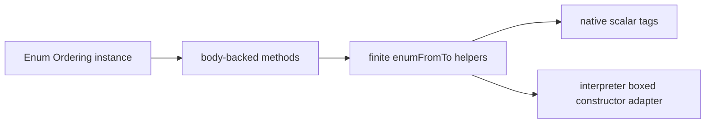
- The desugarer's blind Int primops take the float primop at a Double operand (row 547).
  - Infix and section `<`, `<=`, `>` and `>=` become `<#`, `<=#`, `>#` and `>=#` before any type is known. So does a prefix minus on an operand that is not a float literal, which becomes `negate#`.
  - `rewrite_method_refs_with_locals_chirho` gives such a primop its float counterpart when an operand keys as Double: binder types, type applications and literal records. The rule is `rewrite_chirho/double_primops_chirho.rs`.
  - A concrete monomorphic top-level value also carries its type-environment key into every binding rewrite (row 571). Core can leave that binder at an inference variable even after the checker has fixed `x :: Double`; without the module key, `-x` kept `negate#`, failed in the interpreter and doubled the native IEEE bits as an integer. `collect_module_type_keys_chirho` admits only unconstrained, unquantified, zero-argument schemes with a concrete key. Functions and polymorphic or constrained values keep their existing routes.
  - The counterparts are `<.#`, `<=.#`, `>.#`, `>=.#` (ordered, so a NaN gives False) and `negateFloat#`.
  - `negate#` keys as its operand in `type_keys_chirho.rs`, so `(-1) / 2 :: Double` keys `/` at Double instead of Int.
  - `rewrite_expr_with_type_key_chirho` (`method_args_chirho.rs`) rebuilds primops while rewriting arguments at a key. When that key is exactly Double, it takes the same counterpart (row 553). Elements under `map (+ 0) ([-3 / 2, 1] :: [Double])` used to keep `negate#`, which was silently `-0.75` natively.
  - The same table also maps `+#`, `-#` and `*#` to `+.#`, `-.#` and `*.#` (row 554).
    - `build_section_body_chirho` makes `(+ e)`, `(e -)` and `(* e)` blind Int primops. At Double the interpreter refused them, and the natives added IEEE bits.
    - Each rebuild site now gives them the float primop from its existing proof.
    - `/` sections take the Fractional evidence path, so no `/#` reaches the table.
    - Residual: a section under `iterate` has no keyed operand at either site and stays `*#`.
  - `^#` maps to `^.#`, GHC.Real's repeated squaring at Double (row 570).
    - The desugarer makes `x ^ n` the Int `^#`, except with a float-literal operand, which took `**#`'s `pow` and now takes `^.#`.
    - A base keyed Double retargets at either rebuild site. That includes a top-level Double, through row 571's seeded key.
    - Type keys give `^.#` Double and `^#` its base's key. The rewrite-time inference reads that base with the traversal's own keys, so both `-3 ^ 2 :: Double` and `-xChirho ^ 2` negate a Double.
    - An Int exponent expression keeps its own evidence through the rebuild.
    - Residuals keep `^#`, because nothing keys their base:
      - a lambda under an aggregate (`sum (map (\v -> v ^ 2) xs)`);
      - a left section over the exponents' list (`map (2 ^) [3, 4 :: Int]`).
  - Before, the interpreter refused every such comparison (`LtIntChirho: expected Int#`), and the native backends compared IEEE bits as integers, which orders negative Doubles backwards.
  - Ordering of Strings, tuples and derived types is outside this rule: the seeded `Ord` class has only `compare`.
  - Controls: `tests/dictionary_evidence_chirho/ordering_chirho/double_primops_chirho.rs`, including a top-level literal and a computed Double binding beside typed-parameter, typed-local, named-`negate` and Int holds.
- Other keys reach their ordering through a body-backed `compare` (row 551, the first Ord brick).
  - When an operand of the desugarer's `<#`, `<=#`, `>#` or `>=#` keys as anything but Int, Char, Bool or Double, `rewrite_chirho/compare_route_chirho.rs` looks up `$prim_Ord_compare_<key>` with `lookup_dispatch_body_name_id_chirho`. That lookup accepts a body-backed row and never a missing-method stub.
  - If found, the primop becomes `test (compare a b)`, with one of the Ordering tests generated in `prelude_chirho/ordering_tests_chirho.rs`.
  - That serves Strings, lists, derived types and Ordering.
  - A key without such a row keeps the primop. `Maybe` and pairs/triples receive bounded
    body-backed rows in row 572; prefix `(<)` is a later brick.
  - Controls: `tests/dictionary_evidence_chirho/ordering_chirho/compare_route_chirho.rs`.
- `max`, `min`, `maximum` and `minimum` read the same rows (row 565, the Ord aggregate brick).
  - Their generic bindings are Int-shaped, over `<=#` and `>=#`. `maximum` and `minimum` join `max` and `min` in the driver's per-occurrence evidence names, since their schemes are `Ord a => [a] -> a`.
  - An evidenced occurrence at key K becomes `helper $prim_Ord_compare_K`, in `rewrite_chirho/evidenced_aggregates_chirho.rs`. This holds whether the occurrence is applied, first-class or partially applied.
  - The helpers are generated in `prelude_chirho/ordering_extrema_chirho.rs`.
    - `$ord_max_by_chirho cmp x y` keeps `x` on GT and `y` otherwise, which is GHC's default `max` through `<=`.
    - `$ord_min_by_chirho` mirrors it.
    - `$ord_maximum_by_chirho` and `$ord_minimum_by_chirho` fold the picks, as the Int-shaped bindings do.
  - Int, Char and Bool keep their exact Int-shaped bindings. Double routes too, because `compare x y /= GT` matches IEEE `x <= y`, NaN included.
  - Residuals keep today's path:
    - keys without a body-backed compare row;
    - a polymorphic `Ord a =>` wrapper, whose evidence is a dictionary;
    - the empty list, which fails in `head` rather than with `Prelude.maximum: empty list`.
  - Controls: `tests/dictionary_evidence_chirho/ordering_chirho/extrema_chirho.rs`.
- Concrete `Maybe` and tuple ordering composes only body-backed component rows (row 572).
  - `Show` and `Ord` occurrence evidence retain a complete concrete key, rather than only the
    application or tuple head: `Maybe Int`, `(Int,Char)` and `(Int,Int,Int)`. Open variables
    still name only their enclosing dictionary route.
  - `generate_evidenced_ord_bindings_chirho` runs after conditional list rows exist. It reads
    concrete `Ord` evidence and the same concrete operand keys that the compare route will use
    for already-lowered ordering primops. The prepass is read-only; it does not infer a key from
    heap representation.
  - A `Maybe K` row orders `Nothing` before `Just`, then delegates two `Just` fields to
    `$prim_Ord_compare_K`. A pair or triple compares fields lexicographically and stops at the
    first non-`EQ` answer. Nested components such as `[Int]`, `Maybe Double` or `String` qualify
    only when their compare row already has a real non-stub body.
  - The generator is depth-bounded and limited to pairs and triples. A missing component row,
    a dangling name-table ID, a generated missing-method body, or another tuple arity produces
    no parent row and keeps the previous failure path.
  - Type-key layout is canonical at the registry boundary: `(Int, Char)` and `(Int,Char)` name
    one row, while the application separator in `Maybe Int` remains meaningful.
  - Controls: `tests/dictionary_evidence_chirho/ordering_chirho/structured_orders_chirho.rs` and
    `instance_chirho/structured_orders_tests_chirho.rs`.

## Reference evidence (bricks 3 and 4)

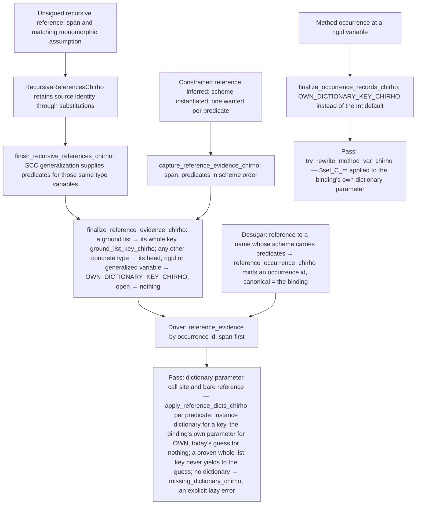

- An own-parameter record names the signature predicate it stands for (`$own:k`, recorded when
  the signature is skolemized: `record_own_dictionary_indices_chirho`); the pass keys every
  dictionary binder by predicate index as well as by class, so two predicates of one class are
  two parameters. The class-only form (`$own`) remains for superclass extractions and for
  generalized variables, where the pass's class-keyed parameter is the right one.
- Ground list keys and complete arguments (2026-10-17, gpt_chirho #27285). List dictionaries
  and method rows are named per element (`$fOrd[Int]`, `$prim_Eq_==_[Int]`, `$fOrd[Char]` for
  `String`); the head `[]` names none of them. So a list whose every part is ground keeps its
  whole key, `ground_list_key_chirho` (`infer_chirho/evidence_chirho.rs`), in method
  occurrence records for every class (`Show` already did) and, through
  `ground_or_head_key_chirho`, in reference keys, local `let`/`where` specializations and
  literal evidence alike. An instance head registers as it DISPLAYS (`instance C [[Char]]` and
  one written `[String]` are both `$fC[[Char]]`), while the evidence spells a nested string
  `String`, the spelling `Show`'s own rows use; so every lookup tries the key, then the key
  with each whole-word `String` spelled `[Char]` (`registry_spellings_chirho`, token-aware:
  `ByteString` and `Data.String` are untouched), then for dictionary lookups the head `[]`
  of a whole list key and the head of a higher-kinded class key, as before. A ground
  dictionary's METHOD SLOT crosses the same gap: the desugarer names an instance's method rows
  by the head as written (`$prim_C_m_[String]`, `$prim_C_m_String`), the dictionary by the head
  as typed (`[[Char]]`, `[Char]`), so a head written with `String` got a missing-method stub
  in its slot. `written_method_row_chirho` (`dict_chirho/instance_chirho/string_spellings_chirho.rs`,
  the rule's one home) fills the slot with the ONE source row whose written key, spelled
  out, is the typed key (agy_chirho #27325). The slot tries the exact typed row first, then a
  generic head's confirmed written row (Generic instance heads, below), then this row; two
  such rows are ambiguous and refuse, never a lowest-id pick (gpt_chirho #27399). Still a
  stub: another synonym, an application head (written `Maybe Int`, typed `(Maybe Int)`) and
  a later argument of a multi-parameter head. A head with type variables (written `T b`,
  typed `(T t0)`) is the generic-head rule's.
  A whole key the checker proved is never replaced by the
  argument-shape guess, which reads the element off the syntax and collapses `[[Int]]` to
  `[Int]`. And a call receives a dictionary for EVERY predicate: where none can be built,
  `missing_dictionary_chirho` (`dict_chirho/rewrite_chirho/constrained_references_chirho.rs`)
  passes an explicit error naming the obligation (`no instance dictionary for `Ord [[Int]]`,
  required by `sameChirho``). As any non-atomic argument it is lowered to a thunk
  (`stg_lower_chirho.rs`), so it fails only if forced. Before, the argument was left out and
  the next term argument took its place: programs printed nothing more and exited 0. The
  evidence-LESS typed-argument site (an infix use mints no reference occurrence) obeys the
  same rule through `typed_reference_dicts_chirho`: every slot or none (none → the general
  path decides), never a partial spine; `3.0 `halfChirho` 2.0` with `(Show a, Fractional a)`
  under an `Int` key printed `$PAP halfChirho …` for GHC's `"1.5"` (gpt_chirho #27303). Its
  key comes from the surrounding call, so a dictionary it serves can be at the wrong type;
  reference evidence for infix uses is the separate cure.
- Ground keys, measured boundaries (ground gate on 7ad703e8, gpt_chirho #27462). Unmet and
  left open:
  - The equality SECTION `(== [1])` lowers to the Int primop `==#` with no dictionary at all,
    so `map (== [1]) [[1],[2]]` prints [True,True] where GHC prints [True,False]. It does so on
    4cfb9584 too. The lambda form `\x -> x == [1]` runs through the whole key.
  - `[[1]] == [[2 :: Int]]` with annotated literals prints True (GHC False), on 4cfb9584 too.
    The signed form stays loud, which is fail-closed. Settled by R2 (Proven list keys at
    method occurrences, below): it now fails by name.
  - Both are pre-existing, but a program that used to abort earlier now reaches them, so the
    unit stays held until their leads are settled.
  - A user-class method used DIRECTLY (`tagChirho x`) mints no occurrence evidence and never
    reaches a dictionary. It stays loud; only a constrained call or a standard method's
    occurrence reaches the keys.
  - The literal channel's whole key has no observable effect today. Literal evidence is
    recorded for Num, Fractional and IsString only, so only an OverloadedStrings literal at
    `[Char]` is list-typed, and that literal runs alike under the whole key and under 4cfb9584's
    head key. The rule is kept for one shared key function, and no behavior is claimed for it.
  - The proven-key guard trades an accidental right answer for a loud failure:
    `sameChirho [[[1]], [[1 :: Int]]]` printed True on 4cfb9584 (correct by accident) and now
    fails, naming `Ord [[Int]]`. Its unequal twin printed a wrong True there.
- A reference occurrence is seen through by every dictionary-parameter lookup
  (`canonical_id_chirho`), and the spine pre-pass leaves an evidenced reference in place so the
  call-site path can read its records; one it finds no evidence for is restored to its
  canonical id before STG, exactly as method occurrences are.
- The higher-order-argument rewriter hands an evidenced reference to the variable arm; a key
  guessed from sibling arguments never dispatches a reference the checker proved.
- An unsigned recursive call initially has no scheme predicates to capture. Its name,
  source span and matching monomorphic assumption are retained until the existing SCC
  generalization supplies the predicates. This delays evidence capture, not inference or
  generalization. The every-capture-at-one-span agreement rule is unchanged; a shadowed
  name with a different type assumption is not treated as that recursive binding.
- Nested calls with reference evidence take the normal evidence-first rewrite path. The
  surrounding result type is not substituted for the callee's predicate type (`Eq a`
  must not become `Eq [a]` merely because a recursive deduplicator returns a list).
- Definition-side and call-side dictionary parameters share
  `resolved_pred_dictionary_chirho`: omit a parameter only if the same ground or
  permitted-default dictionary actually exists. A result-only Applicative/Monad
  variable is not a numeric default, and cannot vanish from the caller's argument list.
- Polymorphic `pure`/`return` with a scheme's own dictionary must use its method selector
  before any enclosing-monad heuristic. Their result type may be IO, Maybe or list;
  retaining their bare names would incorrectly force every call onto IO.
- Execution tests call the same unsigned recursive renderer at Int, Bool and Double,
  with a String separator, and check recursive equality on list elements. These read
  the evidence back through behavior, rather than asserting a particular internal key.

## Local bindings (brick 8)

A `let`/`where` binding generalized over a class is not in the module environment and gets no
dictionary parameter from the pass. Its evidence is the type the enclosing code instantiates it
at: `generalize_local_chirho`'s quantified variables are marked local, every instantiation of
the binding records its fresh variables (`instantiate_scheme_parts_chirho`), and
`local_specialization_key_chirho` yields a key when all of them resolve to one concrete head,
transitively when an instantiation resolves to another local binding's variable (`isPrime n =
checkDiv n 2`). Methods, literals and constrained references at that variable carry the key;
two disagreeing instantiations prove nothing and keep today's path.

## Method occurrences (repaired 2026-09-19)

The desugarer mints one occurrence id per free reference of an opted-in class method, in
DECLARATION order. The checker counts references of that name in INFERENCE-VISIT order, and
instance method bodies are inferred last (phase 3e). `join_occurrence_evidence_chirho` matched
those two sequences BY POSITION under a count guard, so a module with two `show` references
exchanged their evidence: the same program printed `W3` or `WChirho 3` depending only on which
declaration came first. The occurrence was rewritten to `$prim_Show_show_Int` before any
dictionary path ran, so the user's instance was found under the wrong key, and the same defect
crashed ("no matching alternative for tag 66") when a nullary and a one-field instance shared a
module.

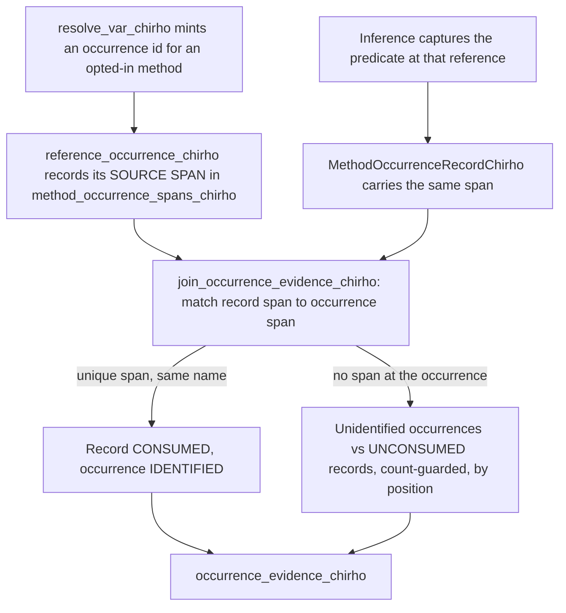

- A proof serves ONE reference: a record the span join consumed can never be reused by the
  positional path, and vacancy in the consumer map is not ownership of a proof.
- An ambiguous or duplicated span identifies nothing and does not fall through to a positional
  assignment; its occurrence simply carries no evidence.
- The positional path exists only because the desugarer mints occurrences at several sites and
  only the variable-reference site records a span. Deleting it turns 19 driver tests red (all
  desugared shapes); restricting it to names whose occurrences all lack spans regresses a
  derived `Show` of a Bool field in a native round trip, where main is correct. It goes away
  when every mint site carries its own occurrence provenance, which a span alone cannot supply:
  one do or deriving node can create several references sharing a span, so the identity must be
  shared with the node that created them.
- `toEnum` and `fromEnum` are in the standard occurrence population. `toEnum :: Enum a => Int -> a`
  cannot be keyed from its Int argument because the class variable is its result. Bare `fromEnum`
  references and arguments whose type is opaque to the dictionary pass have the same need: the
  checker's occurrence proof selects the concrete Enum row. Row 601 retains a result-only
  polymorphic wrapper's Enum dictionary only when that same reference carries the wrapper's exact
  `$own:<predicate-index>` proof; absent or mismatched proof keeps the existing default.
- `succ` and `pred` at `Char` or `Ordering` use the ordinary method-key route: their argument or
  enclosing `Enum a` dictionary already supplies the key. Row 567 adds body-backed `Enum Char` rows that
  apply `ord#`, shift by one, and restore the Char with `chr#`. GHC's `maxBound`/`minBound`
  errors are preserved. A shift into the surrogate interval fails by name because the current
  Rust `char` interpreter representation cannot carry the value GHC produces. Row 602's
  `Ordering` rows case directly on LT/EQ/GT and preserve GHC's endpoint messages.

## Proven list keys at method occurrences (R2, 2026-10-17)

An `Eq` or `Ord` method occurrence whose evidence is a whole ground list key (`[[Int]]`,
`[Integer]`) that names no method row went through the keyed fallback, and when that found no
dictionary it came back from `occurrence_head_replacement_chirho` as the canonical id. The
rebuilt call recursed with no evidence, the method-application path keyed it off its first
argument, and the cons case of `infer_type_key_chirho` reads an unknown element as `[Int]`:
`[[1]] == [[2 :: Int]]` ran `$fEq[Int]`, whose `==#` compares the inner lists as empty string
prefixes, and printed `True`. Inside `sameChirho :: Eq a => ...`, the keyed fallback's
class-only fallback lent the enclosing `Eq a` dictionary instead, also `True`. Measured alike
on 4cfb9584 and 7ad703e8 (claude_chirho #27479, #27487; gpt_chirho #27481, #27488).

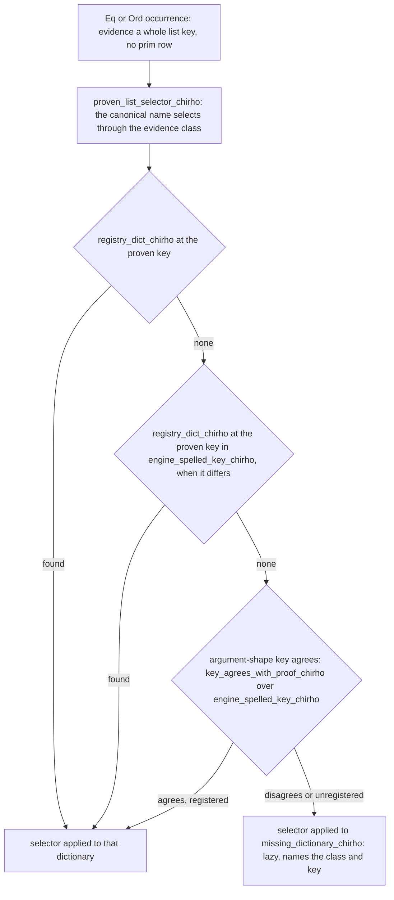

- Agreement compares engine spellings: whole-word `String` as `[Char]`, `Integer` as `Int`.
  The defaulted `[1] == [2]` is proven `[Integer]` and is still served by `$fEq[Int]`; `[Int]`
  never stands in for `[[Integer]]`. Since R2b the proof's own engine spelling is tried right
  after the exact key, so `$fEq[Int]` serves `[Integer]` before any argument key is read; an
  agreeing argument key can only name the same dictionary, so agreement now guards against
  disagreeing keys and serves nothing the proof does not.
- After a proven miss, never the canonical id and never the class-only fallback. The error is
  a thunk, so a comparison that is never forced (an unused `let`, an empty `map`, the right
  side of a short-circuited `&&`) never fails.
- Measured cost: `[Just 1] == [Just (2 :: Int)]` printed GHC's `False` only because the
  runtime's legacy operand unboxing (`force_to_prim_chirho`) reached the field of the one-field
  `Just` under `$fEq[Int]`'s `==#`; it now fails, naming `Eq [(Maybe Int)]`, the key's spelling.
  `[Just 1] == [Nothing]` was loud already.
- Scope: `Eq` and `Ord` (`PROVEN_LIST_CLASSES_CHIRHO`). `Show` keeps its documented
  dictionary path for shapes without a generated row (`show [Just RedChirho]` prints GHC's
  answer through it); every other class keeps its path, unmeasured.
- Not on this route: `/=` desugars to `not (==)` with no provenance, so it carries no evidence
  and `[[1]] /= [[2 :: Int]]` still prints `False` (GHC `True`), the Eq method set's repair.
  Sections other than an `==` section with an origin (R1, below), and infix `<`, `<=`, `>`,
  `>=`, lower to Int primops before any occurrence exists.

## Equality sections (R1, 2026-10-17)

`build_section_body_chirho` lowered an `==` section straight to the Int primop `==#`, so the
dictionary pass never saw it: `map (== [1]) [[1], [2 :: Int]]` compared the lists as empty
string prefixes and printed `[True,True]` (GHC `[True,False]`), and a newtype with its own `Eq`
was compared as its raw `Int` (`[False,False]` for GHC's `[True,False]`). An `==` section whose
operator carries an origin now takes the builder's existing variable path: the opted-in
occurrence of `==`, the operator's origin recorded, and the application built as an infix `==`
builds it. The checker already types a section's operator through its variable path, so the
occurrence is dispatched by the checker's evidence: a method row (`$prim_Eq_==_[Int]`, a user
instance's row), a dictionary, or R2's named failure for a proven nested list (gpt_chirho
#27506, #27508).

- A section without an origin keeps `==#`. Every parsed section has one (the lowerer names
  its operator through `reference_name_chirho`), so the guard serves only producers without
  that metadata, and no parsed program can tell it apart.
- Only `==`. The engine's `Ord` dictionary holds `compare` alone: a variable `<` has no
  binding (`(<) 1 (2 :: Int)` fails with `missing STG binding <`), so the ordering operators
  keep their primops until an Ord method model gives them `compare`-backed defaults. `/=`
  waits for Eq's method set; `+`, `-`, `*` sections keep theirs, unmeasured.

## R2 at every occurrence entry (R2b, 2026-10-18)

R1's gate (r1r2-5827b4bf-chirho) went RED on its own nested section: `map (== [[1]]) [[[1]],
[[2 :: Int]]]` failed with `missing STG binding ==`. R2 lived only in
`occurrence_head_replacement_chirho`, which the argument-spine path calls. A call to a
non-method function with a lambda or method argument (`map`, `filter`, `any`, `zipWith`, a
user's `applyChirho`) goes through `try_rewrite_typed_higher_order_args_chirho` instead. It
guesses a key from the call's other arguments, and `rewrite_expr_with_type_key_chirho` hands
every variable, method occurrences included, to `try_rewrite_method_var_chirho`. That function
tried the occurrence's method rows, then replaced the guess with the proof, found no
dictionary, and returned the bare occurrence: `\x -> x == [[1]]` under `map` crashed the same
way on ground. Inside an `Eq a =>` binding it reached the class-only fallback, and the
enclosing dictionary answered: `pickChirho 'c' [[1]]` printed `True` where GHC prints `False`.

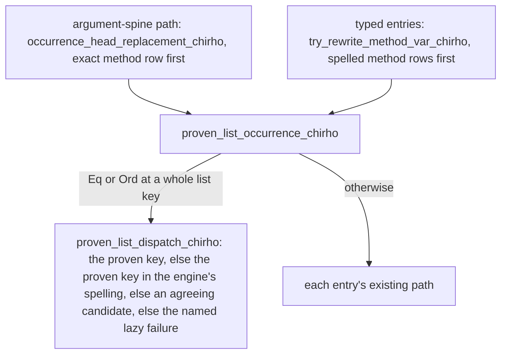

- The spine path offers the call's own key, read lazily. A typed entry offers the key its
  caller read or guessed, before the proof replaces it. Either serves only when it agrees with
  the proof, and neither path reaches the class-only fallback for such an occurrence.
- Typed entries are the arguments of typed higher-order calls, dictionary-parameter calls,
  method applications and `fail`, and a method under a type application.
- A typed entry's guessed key rarely agrees: for `map (\x -> x == [1]) [[1], [2]]` it is the
  element of the cons case's collapsed `[Int]`, that is `Int`, against the proof `[Integer]`.
  The proof's own engine spelling (`[Int]`, then `$fEq[Int]`) serves such defaulted rows
  instead (gpt_chirho R2b disposition, option b), from the proof alone.
- Predicted, unmeasured until built: nested rows name `Eq [[Int]]` or `Ord [[Int]]` instead of
  crashing, the enclosing dictionary no longer answers, and the defaulted `==` rows print
  GHC's answer.
- Ord boundary, measured on the frozen R1/R2 CLI: the `Ord [Int]` list dictionary has no
  `compare` (`compare [1] [2]` fails with `missing method Ord.compare for [Int]`), and
  `compare` at `[Int]` crashes (`no matching alternative for tag 0`). A defaulted `compare` in
  a typed argument reaches that dictionary too; it waits for the Ord method model.

## A generated `Eq [String]` (A4, 2026-10-18)

The combined O1 + R2b gate (combined-d7081c8c-chirho) went RED on one matrix row:
`map (== ["a"]) [["a"], ["b"]]` was GHC-exact on ground and named `Eq [String]` after R1 and
R2b. No dictionary existed. `generate_conditional_ground_dicts_chirho` specialized
`Eq a => Eq [a]` only for `Int`, `Char`, `Bool` and `Double` elements. Ground's answer was
accidental: its section ran `==#` on the whole `[String]` values, which compares only their
first strings, and it was wrong on every measured variant whose first strings agree.

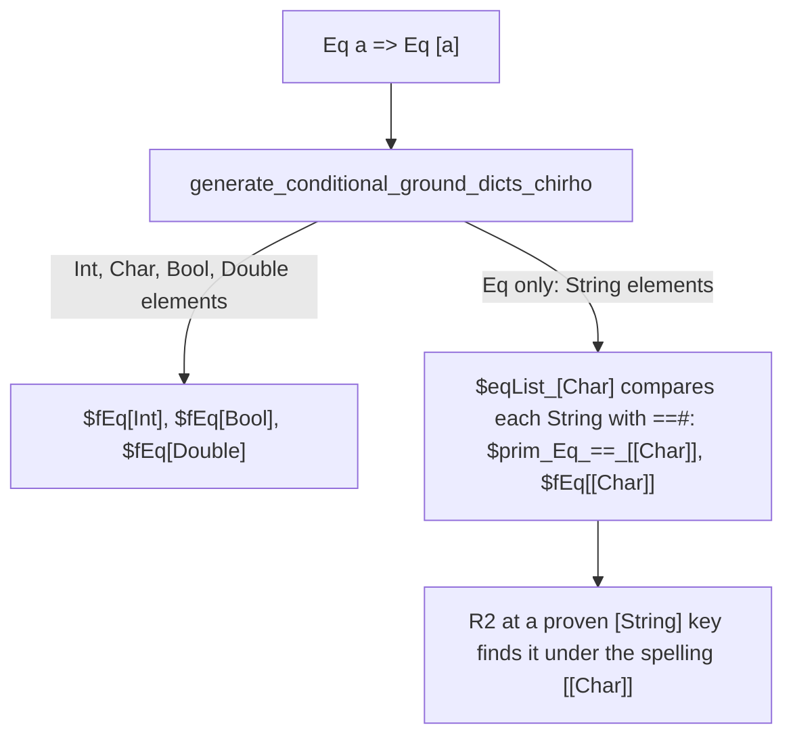

- Each String element compares with the generator's `==#`. The runtime forces both operands
  and compares them whole as strings (`EqIntChirho` sits in the string-compare set beside
  `EqStrChirho`), measured exact on two strings. A mutant switching the comparator to
  `eqStr#` is observationally equivalent, so it was refuted and not added as a control.
- R2 is unchanged. Its exact-key lookup at `[String]` already walks the spelling `[[Char]]`,
  and the typed entries' spelled method rows find `$prim_Eq_==_[[Char]]`.
- Bounded: String elements only. A list of String lists still names `Eq [[String]]`, and the
  general nested specialization (`Eq [[Int]]` and beyond) remains R3's. `Ord [String]` is
  generated too since the Ord list unit below.

## A generated `Ord [T]` (2026-10-22)

gpt_chirho's disposition on #28041. Thirty-three probes on GHC 9.14.1 and two frozen CLIs found
`compare` at list types silently wrong or crashing, from two causes in the conditional
generator. The builtin `Ord a => Ord [a]` carries no method bodies, so every `Ord [T]` slot was a
missing-method stub. That stub, named for the ground key, also took one leading dictionary per
context class.

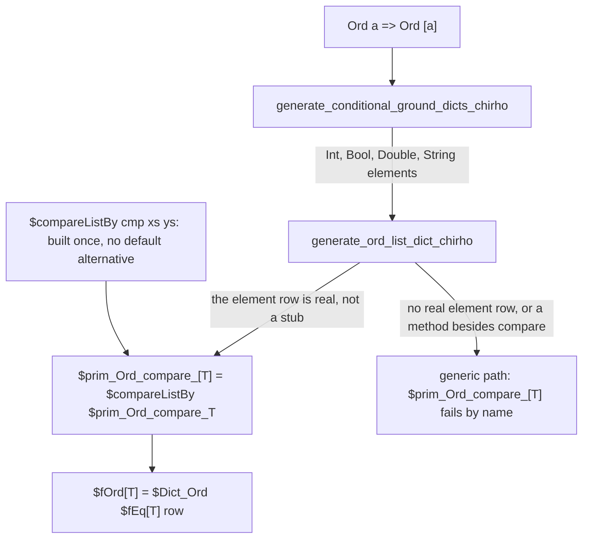

- One recursive `$compareListBy` serves every element type. It compares element by element
  with the given row, recurses on `EQ`, orders `[]` before `(:)`, and forces only what the
  answer needs (`compare (1 : undefined) [2]` is `LT`). With no default alternative, an element
  result that is not an `Ordering` fails instead of picking a branch.
- A row named for a key keeps its method's calling convention. The generic path's
  missing-method stub no longer takes leading dictionaries, so a caller that finds
  `$prim_<C>_<m>_[T]` by name gets the named failure, never a partial application that a
  default branch swallows. `map neededChirho [[1]]` used to print `[[1]]`.
- Measured before: `sortBy compare [[2],[1]]` printed `[[2],[1]]` and
  `maximumBy compare [[1],[3],[2]]` printed `[1]`. `compare [1] [2]` and its siblings crashed
  (`no matching alternative for tag 0`), and a constrained `compare` named the missing method.
- Bool and Ordering compare by constructor order through one generator,
  `generate_constructor_order_compare_chirho` (`instance_chirho/constructor_orders_chirho.rs`).
  Bool's row used to be `compare#`, an Int primop, applied to constructors. It returned the
  integer 0, so `compare False True` crashed and `sortBy compare [True, False]` kept
  `[True,False]`. Ordering's row is the table it always had.
- Bounded: element types only. `compare [[1]] [[2]]` still names `Ord [[Int]]` through R2.
  At non-scalar types, `<`, `<=`, `max`, `sort` and `maximum` stay loud: they are scalar
  primops until an Ord method model. `Ord (Maybe a)` has no dictionary. `compare LT GT`
  dispatched at Int until LT, EQ and GT were seeded (Builtin constructor seeds, below).

## Occurrence provenance (in progress, 2026-09-22)

The identity a span cannot supply is minted by the PRODUCER of each occurrence and carried on the
node. `OriginSupplyChirho` is a field of `ModuleChirho`; lowering creates it, and every later
producer borrows it through the module, so one sequence runs across all of them. A module is not
`Clone`, so the supply cannot fork.

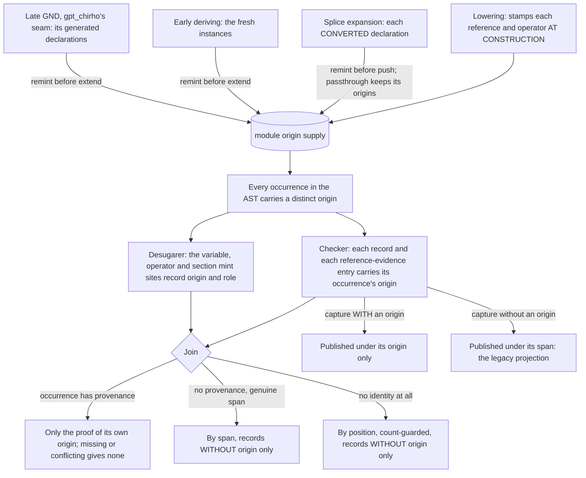

- `occurrences_chirho.rs` in the AST crate is the one statement of where occurrences live. Every
  match in it is exhaustive with no fallback arm, so a new expression, pattern, statement or
  declaration form does not compile until it is classified.
- Fresh generated output is reminted in full. Moving or keeping an occurrence preserves its
  origin. A subtree duplicated as new code is reminted at that duplication. A binder re-read from
  an expression carries no origin.
- Equality and hashing of a name ignore the origin, so no lookup changes meaning.
- Occurrence carriers today: variable and constructor references, the operators of infix
  applications and sections, and literals — in expressions AND in patterns, since lowering stamps
  every literal at construction. DO STATEMENTS now carry an origin too, on the operation each one
  SELECTS - its `>>=`, `>>` or `fail` - rather than on the statement; the checker records evidence
  for that operation under that origin. The join does not consume it yet, because it takes only
  the Reference role. List literals and arithmetic sequences get their own carriers next; until
  then their uses have no provenance and are served by span and position exactly as before.
- A literal in a pattern carries an origin but publishes no evidence yet: the checker captures
  nothing when it binds a pattern. That is a producer gap, not a transport gap, and it belongs with
  do-statement checking.
- Keying by origin gives GENERATED references evidence they never had: the checker used to skip
  a placeholder span at capture. That is a behaviour change, measured, not a neutral re-keying.

## Generic instance heads (2026-10-17)

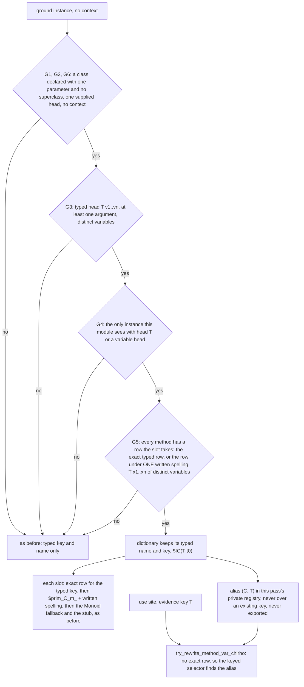

- Three spellings of one instance used to part (claude2_chirho #27335). The checker types the head
  `SBoolChirho b` as `(SBoolChirho t0)`. The desugarer names the method rows by the head as written
  (`$prim_Eq_==_SBoolChirho b`). A use site keeps only the outer head (`SBoolChirho`). The
  dictionary `$fEq(SBoolChirho t0)` was registered under a key no use site carries and held a
  missing-method stub, so the instance never ran: `==` fell to the raw method. In a class declared
  with one parameter and no superclass, a head that is a constructor applied to distinct
  variables, with no competing head for that constructor among the instances this module sees,
  is the only instance any `T x1 .. xn` can mean here (`generic_head_chirho`,
  `dict_chirho/instance_chirho/generic_heads_chirho.rs`). Both halves are needed: the alias lets
  the use site's existing keyed-selector fallback find the dictionary, and the written row fills
  its slot.
- The alias is private (gpt_chirho #27368). `instance_dicts_chirho` is a field of the pass's
  context, created empty by every `dict_pass_module_*` entry and run once per Core module; nothing
  outside `dict_chirho` reads it. The dictionary keeps its typed binder name, so no new name is
  discoverable downstream. A consumer module recomputes G1-G6 over its own class environment, where
  a downstream OVERLAPPING instance or a same-named type from another module competes (G4). The
  alias is entered with `or_insert`, and a later exact `insert` replaces it, so an exact
  registration always wins.
- Boundaries (gpt_chirho #27342, #27349, #27365, #27366). A row that needs a context never becomes
  an unconditional dictionary (G2, the eligibility filter as before). A specialized, contextual or
  catch-all head for the same constructor leaves the generic one unaliased (G4): a use site that
  kept only the head never guesses among them. A class with a superclass is refused (G6): its
  superclass slot is named by the instance's own key, and the class records superclass names
  without their arguments, so `class S [a] => C a` would reach `S`'s instance for `T` where GHC
  uses `S [T ..]`. The desugarer's key drops parentheses, so only an all-variable written argument
  list is accepted, as a position-wise bijection with the typed variables. A second spelling is
  ambiguous and refuses; a method without a row the slot lookup takes would make a stub
  reachable and refuses (coverage and lookup read the same spellings, agy_chirho #27369). Still
  unsupported: full-key use sites (a ground `T Int` key never falls to `T`), multi-parameter heads,
  lists and tuples, written synonyms, classes with superclasses (claude2_chirho #27367: typed
  superclass keys already dangle across instances, since variables are freshened per instance),
  and instances with a context, which have no dictionary at all yet (the conditional-instance
  unit). Cross-module overlap and same-name controls run only once a multi-module frozen build can
  exercise them. A user-class method used directly mints no occurrence evidence, so its use
  site never consults the alias; a constrained call or a standard method's occurrence does.
  G4 counts only instances that reach the class environment: a context-free instance whose
  head carries an overlap pragma is lost before typing today, and while it is, its generic
  rival must not be aliased (see the tasklist's blocker).

## Builtin constructor seeds (2026-10-23)

RC5, from gpt_chirho #28162 and #28187.

**The cause.** Typing seeded `True` and `False` but never `LT`, `EQ` or `GT`.
- A bare Ordering literal was therefore a fresh type variable.
- Its Eq and Ord occurrences defaulted to Int evidence (`default_occurrence_key_chirho`).
- The dictionary pass then served the Int row it was given.

**The fix.** `builtins_chirho/constructors_chirho.rs` now binds the three as mono `Ordering`
beside `True` and `False`.

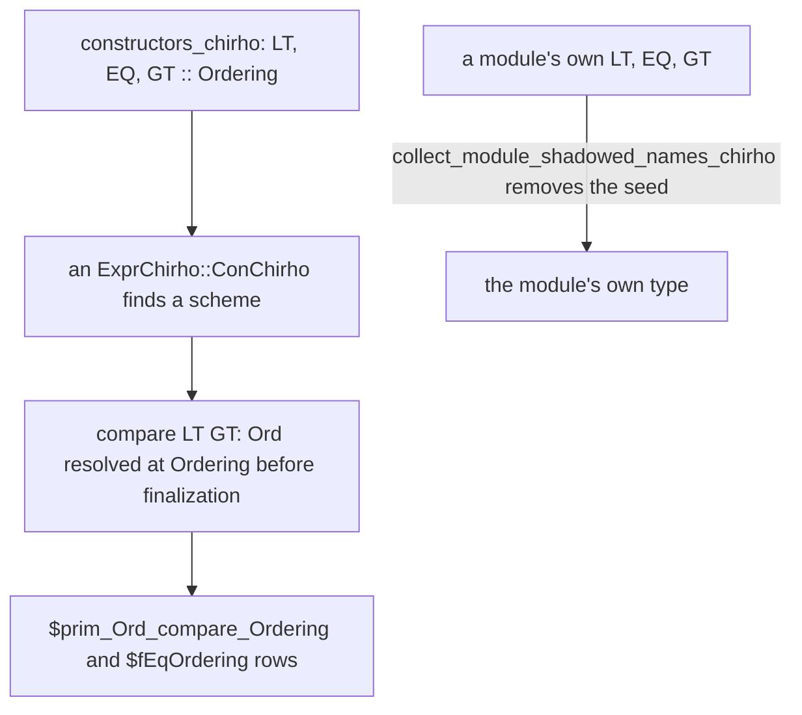

- **Before:**
  - `compare LT GT` and `let x = LT in compare x GT` crashed with no matching alternative for tag 0
    at the Int row.
  - `sortBy compare [GT, LT, EQ]` printed `[GT,LT,EQ]`.
  - `LT == GT` and `GT /= EQ` crashed in Int primops.
  - `x :: Int; x = LT` was accepted and printed `LT`. `GT + (1 :: Int)` was accepted, then
    crashed in the Int addition primop.
- **Now:** the comparisons, the sort and the equalities answer as GHC 9.14.1 does. GHC's two
  rejections are rejections here too: `check` fails with a type mismatch naming `Ordering`. A
  single annotation was the old workaround, and it still gives the same answer.
- **Seven corrections, six run verdicts.** Seven behaviors are corrected (R1, R2, R5, R9, T12,
  T01 and T04 in the tests), but a run-level verdict moves for only six. `GT + (1 :: Int)` (T04)
  already failed its run on the base, because the accepted program crashed. Its correction is
  in the `check` stream, from accepted to the mismatch, which the committed rejection test and
  the gate's placement stage prove.
- **Unchanged:**
  - a module that defines its own `LT`, `EQ` and `GT` (under
    `import Prelude hiding (Ordering(..))`) keeps them;
  - a qualified `P.LT` resolves as before;
  - computed Orderings and user enums are untouched.
- **Tests:** `tests/dictionary_evidence_chirho/ordering_chirho/ordering_literals_chirho.rs`.
  `succ LT` (T10), every other `Enum Ordering` method and both finite range directions are now
  asserted on the interpreter, LLVM and Cranelift. `maximum [LT, GT, EQ]` is covered by the
  compare-backed extrema row.
- **Bounded and adjacent open units:**
  - Row 605 gives `Ordering` its ground `Bounded` instance. The body-backed
    `$prim_Bounded_minBound_Ordering` and `$prim_Bounded_maxBound_Ordering` rows are the LT and GT
    constructor values; the ordinary evidence route serves direct and polymorphic uses on every
    engine.
    - `minBound` and `maxBound` join the occurrence population because their class variable is
      result-only. A `Bounded a =>` binding retains its own dictionary only when its body proves
      that exact `$own:k` predicate; otherwise the Report's existing result-only Int default stays.
    - A program's hidden-and-redefined bounds remain its own bindings and receive no Prelude
      evidence rewrite.
  - `Ordering` still has no `Read` instance in the class environment;
  - unbounded `enumFrom` remains outside row 602's finite-range contract;
  - any other constructor the seed lacks still becomes a fresh variable, so an imported `:|` is
    accepted at Int;
  - Eq and Ord still default to Int without Num;
  - a user `data Ordering` under `Prelude hiding` still fails Show (T15).

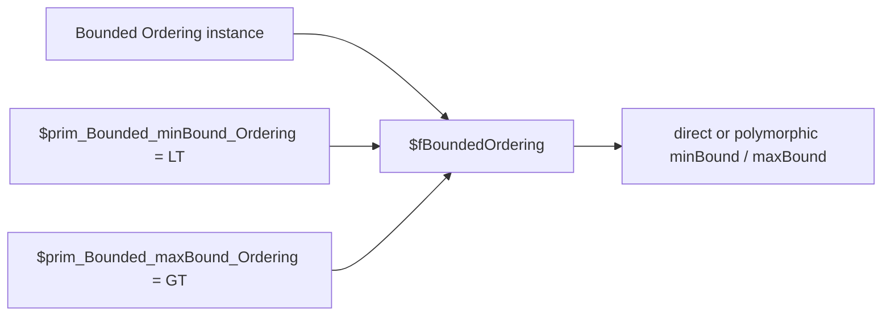

## RealFloat Double predicates (2026-10-26)

Row 581 gives `isNaN`, `isInfinite`, `isDenormalized`, `isNegativeZero`, and `isIEEE`
body-backed Double rows and guarded Prelude aliases. The definitions are generated Core, not five
backend-specific primitives: all three engines therefore evaluate the same comparisons, cases, and
division.

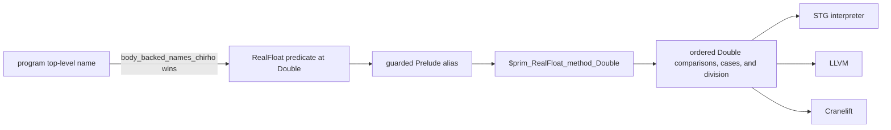

- `isNaN x` is `not (x == x)`; `isInfinite` compares past the largest finite magnitude.
- `isDenormalized` excludes both signed zeros and accepts only magnitudes below the smallest
  positive normal Double. `isNegativeZero` first proves equality to zero, then tests the sign of
  `1 / x`. `isIEEE` is true for the Double representation.
- GHC 9.14.1 controls cover finite values, both infinities, NaN, both signed zeros, the smallest
  subnormal, the smallest normal value, a top-level value, and first-class use through `map`.
- The guarded alias yields to any body-backed top-level definition of the same name. A polymorphic
  `RealFloat a =>` wrapper is exact in the interpreter at Double; the native backends still stop on
  their separate `pi#` and `recip#` dictionary obligations, so this row does not claim that broader
  dictionary-passing route.

Row 582 extends the same module with the three properties that are constant for a concrete Double
representation: `floatRadix _ = 2`, `floatDigits _ = 53`, and
`floatRange _ = (-1021, 1024)`. Their body-backed rows return Core literals (and one `$tuple2`), so
no engine-specific primitive or representation reader is involved. GHC 9.14.1 controls cover
ordinary values, signed zero, NaN, Infinity, the normal/subnormal boundary, first-class `map` uses,
and program-owned definitions of all three names.

Row 585 supplies the remaining representation queries `exponent` and `significand` at Double.
Their surface schemes were absent, so the typing environment first records
`exponent :: RealFloat a => a -> Int` and `significand :: RealFloat a => a -> a`. Generated,
body-backed Double rows then call `exponentFloatChirho#` and `significandFloatChirho#`; the STG
interpreter, LLVM, and Cranelift route both primitives to one pair of bit-level routines in the RTS.

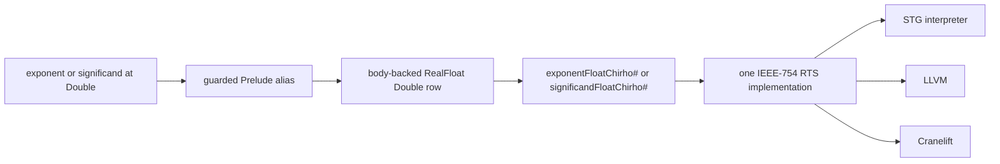

- `exponent` normalizes subnormals before deriving GHC's `decodeFloat`-style exponent and gives
  1025 for Infinity and NaN.
- `significand` installs the Double exponent for 0.5 through 1.0 while preserving the sign and
  fraction bits. GHC maps both signed zeros to positive `0.0`, which the shared routine preserves.
- GHC 9.14.1 controls cover ordinary values, both signed zeros, the minimum subnormal, the smallest
  normal, the largest finite Double, Infinity, NaN, first-class uses, and program-owned names.
- `scaleFloat` remains Row 587. Its Int exponent needs a per-argument key: applying this row's
  Double result key to that argument retargeted an Int negation to `negateFloat#`, so Row 585 does
  not widen evidence routing to make it pass accidentally.

Row 587 supplies `scaleFloat :: Int -> Double -> Double`. Its body-backed RealFloat row makes the
two argument types explicit, and the typed rewrite preserves the exponent's Int key both at the
generated-row application boundary and inside `scaleFloatChirho#`. This is deliberately keyed by
the generated row rather than by the source spelling `scaleFloat`, so a program-owned function of
that name keeps its own argument types.

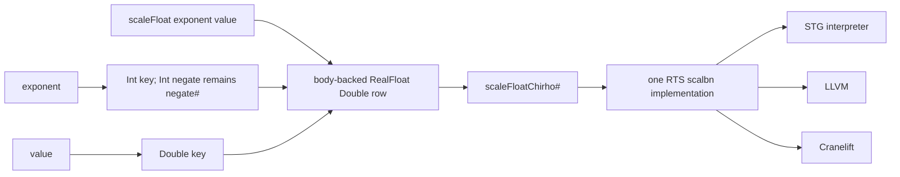

- The RTS clamps a machine-Int exponent to C `scalbn`'s `int` range. GHC-measured controls pin
  overflow, underflow, the normal/subnormal boundaries, signed zero, Infinity, NaN, and the full
  machine-Int extremes.
- First-class `map (uncurry scaleFloat)` and a top-level negative exponent cross the same route.
  A separate ownership control defines `scaleFloat :: Double -> Double -> Double`, proving this
  row does not infer from the unqualified spelling alone.
- Row 590 supplies `decodeFloat` and `encodeFloat` at Double as generated Core over these same
  representation operations. `decodeFloat` scales the significand by 53 binary digits, truncates
  its exact integral mantissa, and subtracts 53 from the exponent; either signed zero becomes
  `(0,0)`. `encodeFloat` converts the currently representable machine-word `Integer` mantissa and
  applies the existing `scaleFloat` routine. Infinity and NaN therefore retain GHC's IEEE payload
  mantissas and exponent, while finite round trips need no new backend primitive.

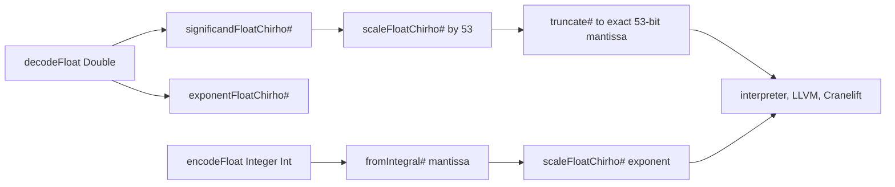

- Both public aliases yield to program-owned top-level definitions. The standard surface schemes
  were already present; Row 590 adds the executable body-backed Double rows.
- The generated case helper now records the branch's actual Core result type. This corrects the
  tuple-valued `properFraction` and `decodeFloat` case metadata while retaining a Boolean wrapper
  for the predicate rows.
- Rigid-signature literal evidence (row 584) and dictionary-passing `sum` and `product` (row 586)
  remain separate units.

## Current boundary

- A separately declared result-only `Num` or `Enum` predicate remains a dictionary parameter when
  a free constrained reference in that binding body carries the exact
  `$own:<predicate-index>` proof (rows 599 and 601). Definition and callers use the same body-aware
  inventory. Thus
  `convert :: (Integral a, Num b) => a -> b; convert = fromIntegral` receives both dictionaries,
  and its Integer and Double instantiations are exact on every engine; likewise
  `enumAt :: Enum a => Int -> a; enumAt = toEnum` receives the caller's concrete Enum dictionary.
  With no exact own proof, result-only defaulting stays unchanged; this includes an inferred local
  binding whose body is only an unkeyed literal. Other result-only classes retain their existing
  policy.
- Row 596 remains the occurrence-level foundation: concrete annotations directly on
  `fromIntegral`, and monomorphic aliases such as `Int -> Integer` or `Int -> Double`, carry both
  proofs independently of row 599.
- An infix or section use of a class METHOD mints its own occurrence id and carries its
  operator's provenance, like a prefix use, unless the desugarer lowers that operator to a
  primop first. Those carry no occurrence and no evidence: infix `<`, `<=`, `>`, `>=`, `div`,
  `mod`; every section of `+`, `-`, `*`, `/=`, `<`, `<=`, `>`, `>=`, `^`, `**`, and an `==`
  section without an origin; a saturated prefix `div`, `mod`, `quot` or `rem` call. Infix
  `/=` becomes `not (==)` with no provenance. An infix or section use of a constrained function
  that is not a method mints a reference occurrence when it takes the fallback variable path,
  just as a prefix use does (row 577). A constrained operator lowered to a primop still has no
  reference occurrence or per-predicate reference evidence.
- Class methods never mint reference occurrences (the method paths key on canonical ids);
  own-parameter evidence therefore reaches the standard method list only, and a user class
  method at a rigid variable is still dispatched by the pass's inferred parameter keys.
- Row 520 covers `toEnum` and `fromEnum` occurrence dispatch for valid scalar `Char` values and
  the corresponding native `chr#`/`ord#` word representation. The current `char`-backed runtime
  cannot represent GHC's surrogate `Char` values, and its `chr#` invalid-range behavior is not
  GHC-exact. Row 567 supplies the missing body-backed `succ` and `pred` rows and keeps crossings
  into the surrogate interval loud. Range syntax remains separate: LLVM and Cranelift already
  produce the correct ordinal lists, while the interpreter mixes the first Char with later Int
  values through its Int-specialized sequence functions.
