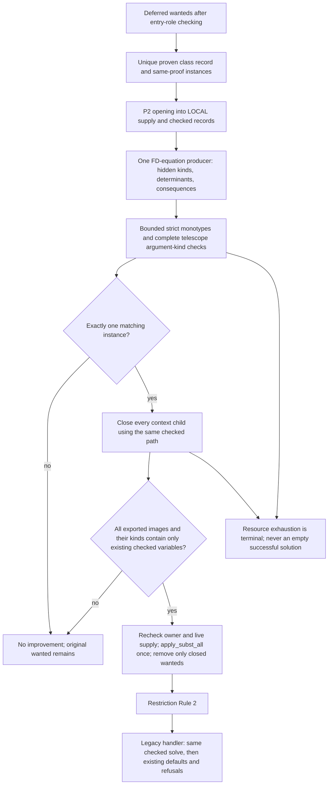
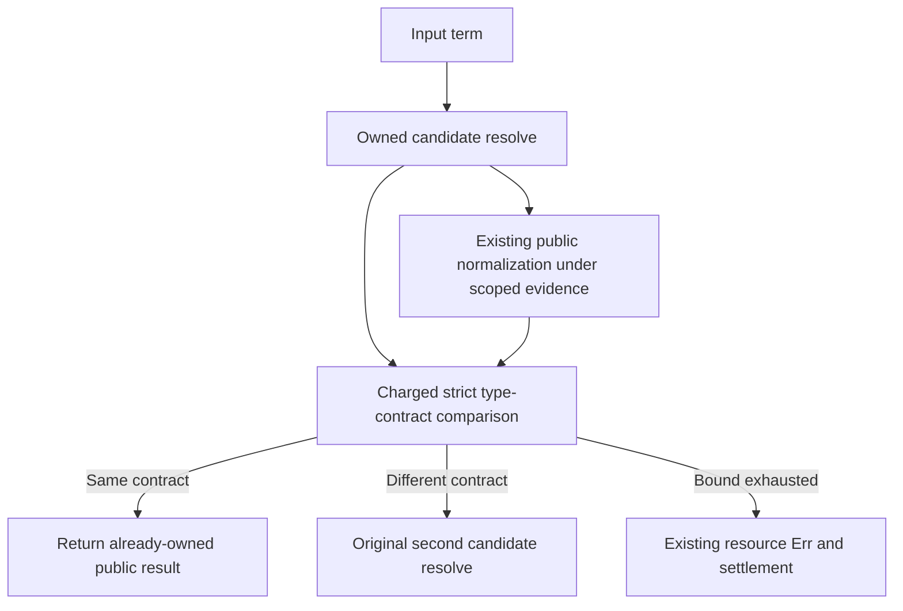
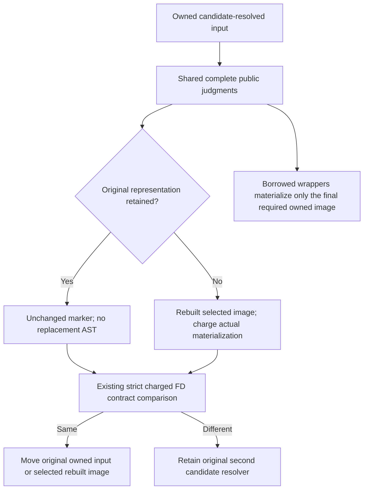

<!-- For God so loved the world, that he gave his only begotten Son, that whosoever believeth in him should not perish, but have everlasting life. — John 3:16 (KJV) -->

# Functional dependencies at generalization and at the module end

A fundep `a -> b` makes `b` a function of `a`. In a wanted `C Ex t` of
`class C a b | a -> b`, the closed `Ex` fixes `t`. GHC does not quantify `t`,
and it does not quantify a constraint that mentions such a variable (Note [Do
not quantify over constraints that determine a variable] in GHC.Tc.Solver). The
constraint is left over and becomes "No instance for C Ex t0" (should_fail
T18398). Code: `crates/haskelujah-typing-chirho/src/infer_chirho/solving_chirho/fundep_generalization_chirho/`.

## Checked instance improvement (Work 722, P3)

The standalone driver's P1 authority proves only actual current class declarations. P2 retains each source instance's real owner and checked binder kinds. P3 consumes both at the deferred-wanted boundary, before restriction Rule 2. The legacy deferred handler calls the same solve; its returned FD delta is retained separately from caller-published legacy defaults in final module composition.



- A class-name lookup does not authorize equations. Wanted, unique class record and instance must carry the same proven identity. Hidden kinds and ordinary class arities must agree.
- Ordinary determining type positions match only the opened instance's fresh variables. Hidden-kind and checked application-kind equations may solve an actual current Meta when uniquely justified. Universal and Unknown variables never become binding domains.
- All matching FD groups share one consistent substitution. Consequences are checked jointly, including repeated variables, occurs checks, nominal constructor identities, multiplicities and monotypes. A second eligible instance declines the whole candidate; this introduces no overlap policy.
- Kind checking uses the existing immutable declaration catalogue and actual variable records. It checks every supplied argument against its telescope kind, rather than merely projecting the result kind. Missing, held, foreign and unknown metadata supplies no improvement. Unresolved families and polymorphic operands are not decomposed, opened or deferred by this path.
- The complete candidate tree owns its substitution and P2 records. Every new ID must zonk out of public images and their kinds before publication. Consequently no speculative supply or binder record reaches the live state. A failed or cyclic child discards its parent's tentative equations. The owner's spent budget remains monotone; P2 and P3 loans are settled sequentially, never overlapped.
- The extracted `mod.rs` retains the earlier generalization/refutation behavior. The old `ClassEnv::fundep_improve_chirho` substitution writer and its per-predicate local-copy caller are removed. Its class unit controls now test equation production; separate checked-solver controls test actual publication and failure preservation.

This is a source checkpoint, not measured compiler or semantic acceptance. The seven original GHC-accepted fundep witnesses and companion runtime dictionary handoff remain required end-state gates. Provenance is not backfilled for bare `fresh_var_chirho` results: an empty-list element or application result lacking an actual checked Meta/kind record stays unsupported by P3 until its real producer supplies that record. Imported owners, overlapping candidates, unclosed contexts and rank-n operands likewise receive no new acceptance from this brick. The historical observations below retain their named source scopes.

```mermaid
flowchart TD
    G[generalize_with_io_defaulting_chirho<br/>scope TopLevel or Nested] --> M0[mono0: environment and given variables]
    M0 --> C[fundep_newly_mono_vars_chirho<br/>close mono0 over the deferred wanteds' fundeps<br/>normalized arguments, to a fixed point]
    C --> Q[quantified = type variables - mono0 - newly]
    Q --> P{place_fundep_wanted_chirho:<br/>does the wanted mention a newly variable?}
    P -- no, or it mentions a rigid variable --> E[existing partition, unchanged]
    P -- yes, top level --> D[stays deferred]
    P -- yes, nested, mentions a quantified variable --> S[quantified into the scheme]
    P -- yes, nested, no quantified variable --> D
    D --> checked_fd_chirho[solve_deferred_fundeps_chirho, checked closed trees]
    checked_fd_chirho --> restriction_chirho[restriction Rule 2]
    restriction_chirho --> F[check_deferred_solutions_chirho: same solve, legacy defaults]
    F --> B{report_unsatisfiable_fundep_wanted_chirho:<br/>fully known and faithful, not magic, not entailed by givens,<br/>no other class extends it, no variable a nested binding quantified,<br/>a fundep with ALL determining arguments closed and a determined<br/>argument holding a variable, and no instance matches the<br/>determining positions under ONE substitution<br/>(an uncertain position counts as a match)}
    B -- yes --> R[no instance for ...]
    B -- no --> X[existing module-end checks]
```

## Rules and their controls

- A wanted that mentions no newly monomorphic variable keeps today's
  partition: R00 `meth p Ex (0 :: Int)` (concrete range), R01, R07, F08 and F15
  (no fundep).
- At top level, a wanted over a newly monomorphic variable is never
  quantified: N01-N03 (T18398 reductions), F05 (`C4 p Ex p0`, with `p`
  quantified), F12, R04.
- A nested binding quantifies such a wanted when it mentions a quantified
  variable, and its call sites decide: R08 (never called) is accepted, and R09
  (called at `Int` and `'c'`) is rejected.
- The module-end refutation needs every determining argument closed:
  - no variable, rigid skolem, synonym, stuck family or `#` head after
    normalization (R06 resolves through a synonym);
  - a determined argument that holds a variable, flexible or rigid (F10);
  - no instance whose determining positions match under one substitution
    (F16 is rejected and F17 accepted, against `instance C3 x x Int`).
- A position matching cannot read with certainty counts as a match. That
  includes an applied variable in an instance head against list, tuple or
  arrow syntax (`needs_syntax_split_chirho`): `instance Shape (c a) (c a)`
  binds `c` to `[]`, `(,) Int` or `(->) Bool`, but `match_ty_chirho` never
  splits that syntax. Accepted: GHC's tc126 (read whole from the corpus), and
  H01-H03 (list, tuple and arrow) with H05 (`Maybe (c a)` against
  `Maybe [Int]`). Before this revision gpt_chirho's corpus gate rejected each of
  them (#27489). H04 (`Shape ExChirho r`, a nullary determinant) is still a
  certain mismatch and stays rejected.
- A class that another class extends is never refuted at the module end. A
  given of the subclass could supply it by superclass projection with its
  arguments permuted, which `pred_entailed_by_givens_chirho` does not model:
  S00 `D p Ex b =>` is accepted. As a consequence, S01 and S02 (the same body
  without the given) stay accepted, while GHC rejects them: that boundary is
  kept on purpose.

- A leftover wanted that mentions a variable some nested binding quantified
  is never refuted at the module end. It escaped that binding's scheme,
  because a wanted over a rigid variable is never quantified there, so no
  call site judged it. GHC quantifies it and checks each call: R02
  (`let g p = meth p Ex b in g q` under `C q Ex b =>`) is valid, and it stays
  accepted (gpt_chirho's built gate, #27472).

- The subclass guard asks `is_transitive_superclass_chirho` about every known
  class. Context reduction and given entailment share that walk. It visits
  each class once, so a superclass cycle that UndecidableSuperClasses allows
  ends it, as in T16414's unrelated `All -> All2 -> All`.
  - Before this change the walk was recursive and never ended on such a cycle:
    3ff084c1 and f9974cc4 overflowed their stack on T16414, and held
    overflowed on C1 (context reduction) and C2 (given entailment).
  - Controls, in `rigid_tyvars_chirho/superclass_cycles_chirho.rs`:
    - C1, C2 and C4 (a superclass reached through the cycle) are accepted;
    - C5 (F12's shape beside the cycle) is still refuted;
    - T16414 is accepted, as on held. GHC rejects T16414 for overlapping
      instances, which is outside this unit.

## Boundaries kept

- R02n (the same body with no given) and R02u (the same given, with `g`
  called at `True`) are rejected by GHC and stay accepted here, as on held.
  Quantifying such a wanted into the nested scheme is the repair that would
  judge them.

- No instance improvement at generalization: GHC improves R03 to `b := Int` at
  the definition, while haskelujah keeps its module-end improvement.
- MPTC runtime (gpt_chirho's frozen gate on 3ff084c1, #27485):
  - R05 and R10 keep held's empty line where GHC prints;
  - M02 keeps its PAP, M03 its runtime error, and M01 prints 3 exactly;
  - R03b CHANGED. Held printed an empty line (rc 0). The rule now fails it
    loudly (rc 1), `missing STG binding methChirho`, where GHC prints 6. The
    wanted `C p Ex b` is no longer quantified into `fChirho`'s scheme, so
    `fChirho` takes no dictionary. The module end improves `b := Int` and
    checks the instance, but gives no evidence to the method occurrence
    inside `fChirho`. GHC improves before generalizing and solves it from the
    instance. R11b (`KeyChirho [e]` with `instance C Ex Int`) fails the same
    way.
- A later top-level binding absorbs a leftover wanted (N01m and N03m: GHC
  rejects, and they are accepted here as on held). The existing partition reads
  only the FIRST argument's variables (`pred_chirho.ty_chirho`), so `C Ex t`,
  whose first argument is closed, counts as "all quantified" at the NEXT
  top-level generalization. It joins that binding's inferred scheme, and when
  the binding has a signature (`main :: IO ()`), the signature's scheme
  replaces the inferred one and the wanted is dropped. Measured on the frozen
  CLIs: N03g (`g :: ()` after `f`) and N03h (`g = ()` after `f`) are accepted,
  and N03p (`main` BEFORE `f`) is rejected. Neither the module name nor `main`
  matters. Reading every argument there is a broader repair of the existing
  partition, so it is not part of this unit.
- Normalization: MU6 (`normalized_pred_args_chirho` clones instead of
  normalizing) survived on 3ff084c1 and on f9974cc4.
  - Normalization happens upstream:
    - `ast_type_to_ty_chirho` expands synonyms and reduces families when it
      converts an annotation, so R06's synonym is already expanded;
    - `unify_normalized_chirho` normalizes both sides of every unification;
    - at the module end, phase 1 of `check_deferred_preds_chirho` normalizes
      every argument after the final substitution.
  - Deferred wanteds are substituted without normalizing
    (`apply_subst_all_chirho`).
  - R11 (`KeyChirho [e] = ExChirho`, the list fixed by `xs ++ []`) was predicted
    from source to need the helper, but under MU6 it stayed rejected
    (gpt_chirho #27512). A second trace located no other route.
  - The helper stays the rule's single defensive normalization point, with no
    measured discriminator. R11 stays only as a natural control that GHC
    rejects.
- C3 (`AllChirho a =>` using `FooChirho a`): GHC rejects it with `Could not
  deduce`. Held overflows on C3 and accepts its acyclic analog A3, because held
  does not report that could-not-deduce. The cycle-safe walk is predicted (not
  run) to accept C3 the same way.

Controls live in `crates/haskelujah-driver-chirho/tests/rigid_tyvars_chirho/fundep_generalization_chirho.rs`
and, for superclass cycles, `superclass_cycles_chirho.rs` beside it.
Every embedded program was measured against GHC 9.14.1 exactly as the test
builds it. tc126 is the corpus file itself. tc231 (GHC-39999, `No instance for
Zork s (Z [Char]) b0`) is a correct new rejection that sits in the corpus's
accept bucket. It stays there as an actual membership delta.


## Owned normalization reuse Chirho

The checked FD solver keeps the first candidate-resolved owned input while public
normalization runs. It compares that input with the owned public result through the
existing bounded strict `same_type_contract_chirho`, charging its actual work to the same
loan. Equality reuses the public result; inequality retains the original second candidate
resolve, because a scoped family Given may reveal a candidate-bound Meta. Comparison
exhaustion returns the existing resource error. That initial R2 reuse changes no allowance,
depth, debit, role or context closure. The equation loop still performs its full composite normalization; no
initial-pair reuse assumes that composite is idempotent.



The public-solver control elaborates a real empty `RevealChirho :: Type -> Type`, keeps its
actual key/telescope/owner/scopes, and opens a real implication with `RevealChirho Int ~ alpha`.
`ConvertChirho Int Bool` closes alpha in the scratch candidate; the subsequent
`GivenChirho (RevealChirho Int) Int` can consume the scoped `GivenChirho Bool Int` only after
public normalization exposes alpha and the second candidate resolve follows its Bool link.
The fixture explicitly verifies that the family input has no free variables, its public
image is the distinct unbound alpha, and Given has no instances. Candidate substitution
therefore cannot alter the first input; the public solver retains Convert's Bool binding
only in its scratch candidate until all wanted-closing rounds finish. A failed Given match
has no instance/equation branch to rescue it. This is the source reason the fallback is
reachable, rather than an inference from a future passing count. The missing-Given twin
keeps that wanted at solver return. Prior exhaustion, recursion,
kind/identity and unclosed-child assertions remain unchanged. This is source-only design
coverage until executed; any effect on the original tc125 resource outcome is unmeasured.


## Public normalization storage handoff Chirho (Work 730)

The shared equality, synonym and family walkers distinguish `UnchangedChirho` from
`RebuiltChirho(TyChirho)` only after their existing judgments. The marker carries storage
information, not type/class authority or a cross-call cache. An unchanged result is relative
to the exact original input, including metadata: an early rebuilt image remains rebuilt
when a later pass is stable. Every pass still compares its selected next image against the
current image with the existing bounded equality and preserves that selected return image.
The 100-pass and depth-128 limits, lexical binders, evidence preparation, checked catalogue
selection, family matching, cycle/refusal behavior and partial settlement remain in force.



A stable walk allocates no parallel result vector or replacement AST. Reconstruction starts
at the first changed child; copied sibling terms, names, binder records and changed kinds
are charged before materialization. Evidence premises remain freshly prepared under the
same allowance. Borrowed APIs retain their owned-result contract and cannot return a free
copy of an unchanged input. They do not clone the input before a rule can shrink it.

The intrinsic family producer keeps its original 100,000-work reservation. Its builder uses
only that already-debited reservation, never a second outer loan or a default/clamped budget;
unused work is not refunded. Selected body/identity clones, actual escaped symbol payloads,
scalar names and oversaturated arguments/App nodes debit the caller's live output before
materialization. Scalar payloads come from the actual bounded rendered/digit/key data;
AppendSymbol constructs the same escaped bytes whose size it checked. Ordinary stuck
intrinsics remain distinct from exhaustion. Source-family matcher results retain their own
existing matching/output ledger and need no duplicate result copy.

The old family depth control charged a speculative List root before its child at depth129
refused. The lazy path now performs the same refusal and consumes work without allocating
that root, so its output allowance stays exactly unchanged. A separate real family reduction
before a later depth failure proves that already materialized output remains debited. This
is an explicit ownership-cost correction, not a refund or a resource limit change.

Focused controls cover stable owned storage with zero output allowance, the corresponding
borrowed failure, early rewrite followed by a stable pass, selected metadata ignored by
semantic equality, and actual sibling/name/kind copy exhaustion. Existing cyclic/growing
evidence, capture/oversaturation, held/ambiguous/stuck family, depth/partial-cost and FD
fallback/missing-Given controls remain required. The source handoff has no compiler or
original tc125 success claim until the root executes those end-state gates.
