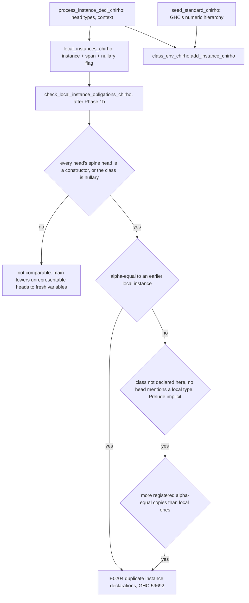
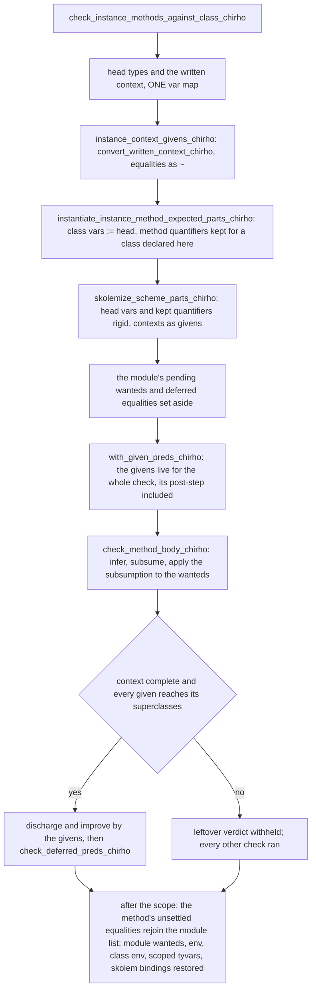

<!-- For God so loved the world, that he gave his only begotten Son, that whosoever believeth in him should not perish, but have everlasting life. — John 3:16 (KJV) -->
# Instance declaration obligations

An instance is not merely registered; it has to be allowed to exist. GHC checks this at the
declaration, before any use site. We registered every instance and asked nothing.

## Instance methods: checked as signature-bound bindings

A method body used to have its leftover wanteds DISCARDED, the instance context was never a
given, and the instance's variables were flexible: `show x` with no `Show T`, `==` under a
`Show a` context, or a method fixing the instance's `a` to `Int` were all accepted. Now a method
gets exactly the judgement a top-level binding with a signature gets. Boundaries, each recorded
in the code:

- **Unmodelled premises.** A quantified or variable-headed (`?`) context makes the givens
  incomplete: only the leftover-wanted verdict is withheld.
- **Superclasses through a multi-parameter given.** Superclasses are recorded by name, not with
  their arguments, so `Convert a b` under `class Show a => Convert a b` cannot give `Show a` (the
  top-level form is rejected on main too, though GHC accepts it). The verdict is withheld; the
  repair is superclass argument substitution, its own solver unit.
- **Built-in and imported classes.** Their seeded method schemes have fixed, nameless variables
  and some lack their contexts (`foldMap`, `traverse`), so their method quantifiers stay
  flexible. Making them rigid needs that seed metadata repaired first.
- **The class's own predicate** at the instance stays a given, so recursion resolves as before.
  A superclass reached through it is the declaration's superclass obligation (below), not the
  method's.
- **Defaulting.** Local literals still default when the wanteds are judged; the defaulting
  substitution itself is discarded, a check-only choice that leaves evidence unchanged.
- **Isolation.** A method's context is evidence for that method only. The module's pending
  wanteds and deferred equalities are set aside before the method's given scope opens and come
  back only after it closes, because `with_given_preds_chirho` discharges and retries whatever is
  pending under the givens still installed. A method's unsettled equalities rejoin the module's
  list and are retried and reported at its end, as they always were (gpt_chirho #27163).

## Invariants

- **Alpha-equality of heads** (`ClassEnvChirho::instance_heads_alpha_equal_chirho`) matches all head
  types in both directions with `match_consistently_chirho`, which keeps a repeated variable
  consistent (`C a a` does not match `C Int Bool`); the second direction makes the renaming
  injective. Contexts never distinguish instances. The older `match_ty_chirho` composes
  sub-matches without comparing them and is unchanged for its existing callers.
- **A bare name is not an identity; a written spelling inside one module is.** The checker
  identifies types by bare name, and the multi-module frontend collapses every qualified spelling
  of a "safe" imported name to it, so `Strict.StateT` and `Lazy.StateT` become one `StateT` (the
  constraints package declares `Lifting Functor` for both, and the first cut of this rule rejected
  it). Each local instance therefore records the class and head constructors AS WRITTEN,
  qualifier included, and two local instances are compared only under identical spellings. A
  duplicate written with two spellings of one entity is missed; a valid program is never rejected.
- **The non-local half needs the seeded entity to be the only possible referent**: every written
  name unqualified, the class not declared here, no head type declared here (T11552 declares its
  own `MaybeT`, T10592 its own `Eq`), no `NoImplicitPrelude`, and no Prelude import that is
  qualified or carries an import/hiding list (the driver's injected `import Prelude` is plain).
- **A variable spine head is not evidence.** Main lowers type operators, promoted constructors,
  type-level literals and kind-indexed variables in instance heads to fresh type variables;
  comparing them would make unrelated heads equal (T11754, T13943, T22647).
- **The seeded numeric hierarchy is GHC's**, not the Haskell 98 report's: `Num` has no
  superclasses (a `Num a` given does not entail `Eq a`/`Show a`; a Num dictionary has no
  superclass slots) and `Integral` has `Real` and `Enum`, so `==` under `Integral a` comes
  through `Real => Ord => Eq`. `dict_chirho/layout_chirho.rs` derives slots from these lists.

## Superclass obligations — written, measured, NOT enabled

GHC-39999 "arising from the superclasses of an instance declaration". Strict entailment (a given
with superclass closure, or an instance whose sub-goals hold strictly; variables never assumed
satisfiable; depth exhaustion = unproved), argument-carrying superclass predicates, and GHC's rule
that a given's superclasses are usable only when the given is Paterson-smaller than the instance
head (tcfail223, T22891) are implemented and tested in the kit
`/private/tmp/haskelujah-instance-superclasses-kit-chirho/` and on the stacked branch. They wait on
two facts measured 2026-09-18:

1. **Completeness.** A locally declared head type is not a closed instance universe: an imported
   module that sees the type through a SOURCE import cycle may declare the orphan superclass
   instance, and GHC accepts it. The check may fire only when the module imports nothing but
   Prelude (or, later, when the driver proves the module has no hs-boot).
2. **Faithful contexts.** Main's `parse_simple_constraint_segment_chirho` takes the first ConId as
   the class and every VarId as an argument: `(Eq a, Show a)` becomes `Eq a a`, `C1 x T1` becomes
   `C1 x`, `Duper (Fam a)` becomes `Duper a`, and a `forall`/`=>` context is dropped whole. Nothing
   in the AST records the loss, so no checker-side guard can tell a mangled context from a real
   one; ten valid files were falsely rejected in the diagnostic pass. gpt's branch lowers contexts
   as types (`lower_chirho/contexts_chirho.rs`). Constraint synonyms in contexts (T10335) must be
   expanded as well.
   RESOLVED since: the scanner is deleted (no `parse_simple_constraint_segment_chirho` remains in
   the parser), contexts lower through `lower_chirho/contexts_chirho.rs`, and
   `convert_written_context_chirho` keeps every argument and expands constraint synonyms. The
   instance-method check above relies on that. Completeness (1) still stands.

## Boundaries

- Kind-shaped instance errors, family instances and abstract-class instances belong to the kind
  and boot-class work (row 484).
- Paterson conditions on instance contexts (GHC-22979) need the same faithful contexts.
