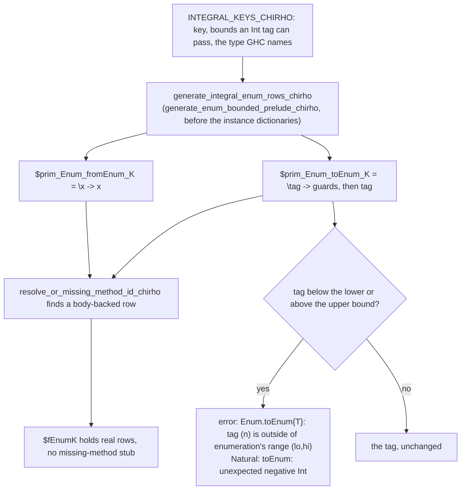

<!-- For God so loved the world, that he gave his only begotten Son, that whosoever believeth in him should not perish, but have everlasting life. — John 3:16 (KJV) -->

# Integral Enum rows: checked `toEnum`, identity `fromEnum`

Sixteen builtin Enum keys are integers at run time:
- the sized `Int` and `Word` types;
- `Word`;
- `Natural`;
- the C integer wrappers.

Their instance dictionaries used to hold missing-method stubs. Now each key has
two real rows:
- `$prim_Enum_fromEnum_K` returns its argument;
- `$prim_Enum_toEnum_K` checks the tag against the key's range. Outside it, it
  fails with GHC 9.14.1's message; inside it, it returns the tag.

Code: `crates/haskelujah-core-chirho/src/dict_chirho/prelude_chirho/integral_enum_chirho.rs`.

## Keys and GHC 9.14.1's behaviour (measured on aarch64-darwin)

| Family | Keys | `toEnum` check |
|---|---|---|
| signed | Int8, Int16, Int32 | below and above, `{IntN}` in the message |
| signed | Int64 | none: every Int tag is in range |
| unsigned | Word8, Word16, Word32 | negative and above, `{WordN}` |
| unsigned | Word, Word64 | negative only, range `(0,18446744073709551615)` |
| Natural | Natural | negative only, `toEnum: unexpected negative Int` |
| C | CChar, CInt | below and above; messages name `Int8` and `Int32` |
| C | CLong | none (it is `Int64`) |
| C | CUInt | negative and above, `{Word32}` |
| C | CULong, CSize | negative only, `{Word64}` |

- **Default target.** The C wrappers' representations (CChar `Int8`, CInt
  `Int32`, CLong `Int64`, CUInt `Word32`, CULong and CSize `Word64`) are the
  measured aarch64-darwin model, the default target. The compiler has no
  target ABI map, so no cross-target C parity is claimed. Another target's
  sizes would be an explicit parameter of the table.
- **The failure route** is `error`. The held STG lowering maps it to
  `ErrorChirho`, and the interpreter raises the forced string, so a computed
  message comes out exactly. `error#` is not needed.
- **Dispatch is by exact key.** The rows serve whichever route names K: the
  checker's proof for `toEnum` and `fromEnum`, or a key the pass reads from an
  annotation. On held alone, `toEnum 300 :: Word8` is still keyed from its Int
  argument and takes Int's identity. So the end-to-end range controls belong to
  the combined replay with the Char unit, where `toEnum` carries the proof.

## Boundaries

- Float and () keep their stubs.
  - () fails loudly today, a never-wrong outcome.
  - A Float list printed through `toEnum` prints nothing with rc 0. The list
    renderer swallows the stub's error. That is a separate fail-closed
    prerequisite, not this unit.
- succ, pred, Bounded, Num, Show and Read at these keys are unchanged.
- A value outside Int's range cannot be built through `toEnum`. So GHC's own
  `fromEnum` failure for such a value is not reachable here, and it is not
  measured.
- The LLVM and Cranelift backends are not measured here.

## Controls

- `crates/haskelujah-core-chirho/src/dict_chirho/prelude_chirho/integral_enum_tests_chirho.rs`
  runs the dictionary pass alone:
  - all 32 dictionary slots take body-backed rows;
  - `fromEnum` is the identity;
  - each `toEnum` guards exactly the table's bounds, lower first;
  - 23 measured failures render GHC's exact text, and 23 measured in-range tags
    pass.
- `crates/haskelujah-driver-chirho/src/stg_lower_chirho/primitives_chirho/tests_chirho.rs`:
  a computed `error` message, the rows' `showInt#`/`++#` chain, fails with its
  exact text.
- **On the combined Char replay:** the six never-wrong `toEnum` rows
  (`STUB_BACKED_PRINTS_CHIRHO`), the 16 scalar round trips, the signed
  negatives, the measured failures, and () as a green never-wrong control.
